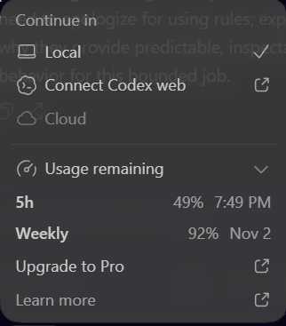

# AI-assisted development disclosure

VoxDesk was implemented with OpenAI Codex in the candidate's local workspace. Codex assisted with architecture, Python/TypeScript implementation, tests, debugging, dependency review, interface review, and documentation. No other AI coding tool was used by this agent. The runtime application makes no LLM calls and needs no LLM credentials. Browser speech recognition and synthesis handle audio only; Python rules determine every action.

## Recorded usage and screenshot

**Recorded: 2026-10-26 17:36:04 PKT (Asia/Karachi, UTC+05:00).** The functional Python backend and Next.js frontend were already complete at initial implementation commit `bde1b5f`. Subsequent work refined the working product through real conversation feedback, parser corrections and regression tests.

The original screenshot is preserved without editing. It shows **49% of the five-hour quota remaining** and **92% of the weekly quota remaining**, alongside the labels `7:49 PM` and `Nov 2`. These account-level quota percentages do not measure this project's token count. The recorded time above comes from the current UTC clock converted to Pakistan time.

Authentic counters were subsequently found in the primary local Codex session log, replacing the earlier unavailable-count placeholder. The latest counter at the cutoff is dated **2026-10-26 17:34:34 PKT**:

| Tool / model recorded in session | Input tokens | Output tokens | Total tokens |
| --- | ---: | ---: | ---: |
| OpenAI Codex / gpt-6.1-sol | 14,840,089 | 175,628 | **15,015,717** |

The input counter includes **14,599,936 cached input tokens**. The log separately reports **64,523 reasoning output tokens** within output usage. These are cumulative session counters across repeated context processing; cached/reasoning figures are not added again to the total. This snapshot covers the primary coding session; automatic approval-review sessions and work after the cutoff are excluded. It is not a billing statement or a conversion of the quota screenshot.

The [filtered JSON usage log and commit list](docs/evidence/codex-usage-2026-10-26.json) preserve the original token-count fields, event timestamp, source filename/line, screenshot checksum and Git scope. Raw conversation logs and unrelated account files are not included.

## Completed work and later refinement

**20 project commits** were completed from assessment baseline `1e8a7dc` through `ca1d325`, excluding three upstream commits and the later commit adding this evidence:

| Phase | Commits | Delivered result |
| --- | ---: | --- |
| Functional backend and frontend, `aa682c2` through `bde1b5f` | 14 | Python decision engine, real availability and persistent booking/rescheduling/cancellation, transaction/retry protection, Next.js interface, browser STT/TTS, Decision Inspector, tests and documentation. Initial recorded validation: 82 backend tests, 6 browser tests, frontend build and typecheck passed. |
| Later polishing and robustness fixes, `6d79132` through `ca1d325` | 6 | Broader spoken phrasing, retained booking references and details, availability handoff, calendar dates, name extraction and occupied-slot recovery. Latest backend validation: 274 tests passed. |

The initial 14 commits were organized after implementation at the candidate's request and use their actual creation timestamps. They are component-based commits, not a reconstructed timeline of live development. The six later fixes address functional conversation defects as well as polish; frontend build/browser results above predate those backend refinements.

The main problems were overly narrow phrase matching, lost conversation context, dates leaking into time parsing, and instruction words being stored as names. Smaller issues included a TypeScript build failure, an unsafe rescheduling mutation order, browser-test setup/locator errors and a dependency audit finding. The corrections and checks are recorded below. Real microphone recognition quality remains a device-level check; parser tests do not establish audio accuracy.

## Review and corrections

Observed issues from this implementation session:

| AI-assisted mistake / review finding | How it was corrected and verified |
| --- | --- |
| The first time parser used a substring check for noon, accidentally assigning 12:00 to “Friday afternoon”. | The entity test failed. Word boundaries replaced the substring check; the fixed-clock parser tests passed. |
| Initial intent rules treated the noun in “read a book” as a booking command. | Tightened creation patterns to command/request contexts and retained a regression case. |
| After adding “yesterday” extraction, the engine asked for a time before rejecting the past date. | A workflow test failed; known dates are now validated before asking for additional details. |
| A UI refactor lost TypeScript's null narrowing for the conversation object. | The production build failed, optional chaining was corrected, and the subsequent build/typecheck passed. |
| The first browser-test server command used forward slashes in a Windows command-shell executable path. | Corrected the platform-specific path; the servers and browser suite launched successfully. |
| An unscoped browser test found both the app alert and Next.js's route-announcer alert. | Scoped the assertion to the conversation region. This was a test-locator issue; the permission error was already rendered. |
| Screenshot review showed that scrollIntoView could scroll the entire workspace when new messages arrived. | Changed scrolling to the message container and reran connected browser flows/screenshots. |
| Review found that rescheduling assigned ORM fields before validating the customer name; a caught domain error could leave a dirty object. | All validation now precedes mutation. A regression test catches the error inside a committing transaction and verifies the original appointment is unchanged. |
| The initial Next.js dependency tree included a PostCSS version flagged by npm audit. | Added a patched PostCSS 8.5.31 override. The final audit reported zero vulnerabilities; the build and browser flows were revalidated. |
| Real user testing exposed narrow phrase matching (“make a booking”), filler captured in a name (“And John”), generic recovery after unclear speech, and reference memory lost between workflows. The first automated suite did not cover this spoken conversation. | Added the reported conversation and ordinary-language/safety regressions: the initial new suite reproduced 24 failures. Expanded deterministic grammar, retained verified session references and related workflow details, added targeted status/reference recovery, cleaned name fillers, and guarded explicit confirmation and rejected fields. Current executed results are recorded in the progress log. |
| A second real transcript exposed silently ignored malformed approximate times, details discarded after availability, unhandled repair prefixes, space-separated hour/minute tokens, and “new booking” phrasing. | Added another complete API/database conversation regression and related safety cases. The initial targeted run reproduced 25 failures (5 cases already passed). Shared repair normalization and booking grammar, validated explicit time claims, retained/refreshed availability follow-up details, and bounded affirmative-action confirmation corrected the faults. The final full backend suite passed 156 tests. Browser recognition/audio quality was not claimed to be fixed or physically reverified. |

The third transcript exposed missing calendar-date formats and date numbers reaching the clock-time parser. The initial targeted run reproduced 35 failures out of 37 cases. A separate deterministic calendar grammar now consumes valid and invalid date spans before time extraction, with named-month/ordinal and year-first numeric support. Additional tests caught a partial word-ordinal match (“thirty third” becoming the third day); the grammar now consumes out-of-range day words and rejects them through calendar validation. The final full backend suite passed 202 tests. No physical speech recognition quality was inferred from these text/API regressions.

The fourth transcript exposed “Use name Taha” being stored as “Use Name Taha”. The initial 32-case regression suite reproduced 19 failures, with 13 already passing. Anchored name-request wrappers now extract only the name, with bounded courtesy/repair cleanup and rejection of incomplete requests or alternatives. API/database tests verify the exact reported conversation and a pending name correction followed by fresh confirmation. The full backend suite passed 234 tests. Existing stored appointments were not migrated, and browser/audio checks were not rerun.

The fifth transcript exposed names embedded in booking requests being dropped whenever calendar/time/service fields or parsing issues were present, plus an unhandled "You should use Muhammad" instruction. The initial 24-case regression run reproduced 16 failures, with 8 already passing. Explicit name clauses are now consumed independently before other fields are parsed, preserving the name through date/time repairs. The follow-up added 30 cases in total, including persisted booking values, current-draft name reminders, independent time errors, ambiguous/negated name corrections and fresh-booking isolation. The full backend suite passed 264 tests. The malformed "428th" date still requires clarification; no transcription guess or runtime LLM was introduced. Browser/audio checks were not rerun.

The sixth transcript exposed a missing "for the name" variant; the name was never captured before a slot conflict. The initial 10-case targeted run reproduced 8 failures with 2 already passing. A shared preposition rule now supports "for [the] name" and "with [the] name" in inline requests and separate answers. API/database regressions cover the exact conversation, repeated slot conflicts, retained transcribed spelling, explicit name correction and the unchanged conflicting booking. The full backend suite passed 274 tests. No spelling guess, database rewrite or browser/audio verification was performed.

## Strict-audit fixes and second usage snapshot

The later strict review found defects beyond the transcripts: cancellation could select the wrong operation, repairing one invalid field could restore another rejected value, service exclusions and partial clock expressions could be misread, and the browser lacked robust storage failure handling. Saved appointment details could also appear replaced by an abandoned proposal. Mobile labels/controls, keyboard focus, selectable slots and speech replay needed improvement.

Five focused implementation commits (`259149e` through `f893f5b`) address these findings. They add 17 operation/repair regressions, 49 language contrast cases and 14 browser recovery/interaction cases. Initial targeted runs reproduced 14 operation failures and 39 language failures. Final executed checks passed **340 backend tests, 20 browser tests, production build, typecheck and frontend formatting**. CI is configured, with remote execution still pending publication. The tests were authored by the same coding agent; neither independent human validation nor physical voice quality is claimed. See [the progress log](docs/PROGRESS.md) and [conversation test matrix](docs/CONVERSATION_TEST_MATRIX.md).

Verification also encountered Windows temporary-directory permissions that blocked Node, and a browser output directory that overlapped the separate build. Both test setup issues were corrected before the final passing browser run. The candidate's running application and demo database were preserved; tests used a separate build, ports 3011/8011 and a disposable database.

**Second snapshot recorded: 2026-10-26 19:03:04 PKT.** The latest token event before this cutoff is 19:02:37 PKT. The original 17:36 snapshot and screenshot above remain unchanged. [The second filtered usage log](docs/evidence/codex-usage-audit-2026-10-26.json) records the counters and commit scope:

| Primary Codex / gpt-6.1-sol session | Input tokens | Output tokens | Total tokens |
| --- | ---: | ---: | ---: |
| Cumulative at second cutoff | 30,899,359 | 270,358 | **31,169,717** |
| Increase since first snapshot | 16,059,270 | 94,730 | **16,154,000** |

Cumulative input includes **30,461,952 cached tokens**; output includes **106,502 reasoning tokens**. As above, do not add these subsets to the total. The increase includes evaluation, discussion, implementation, testing and documentation since the first cutoff, rather than measuring the fixes alone. Automatic approval-review sessions and work after this cutoff are excluded. These are repeated-context session counters, not unique source-code tokens, an efficiency benchmark or a billing statement.

There are **26 project commits at this cutoff**: the original 20, one usage-evidence documentation commit and five audit implementation commits. The later documentation commit containing this snapshot is excluded. All audit commits are local. The candidate explicitly requested **“dont submit yet”**; no push, PR or deployment was performed.

Sandbox socket and Node write restrictions required approved command retries. Those environment errors were not reported as successful installs/checks. No test results, token counts, screenshots or physical voice verification were invented.

Executed checks and remaining verification limits are documented in [docs/PROGRESS.md](docs/PROGRESS.md). Browser UI screenshots under ignored test artifacts demonstrate UI rendering only, not AI token usage or physical speech verification.

## Later UI refinement and rescheduling conversation

The candidate requested a chat-focused UI with light/dark themes, voice controls in the composer, a separate Appointment view and an animated Inspector toggle. Visual iterations initially stayed uncommitted at the candidate's request. A navy palette was rejected; it was replaced with warm neutral surfaces inspired by the supplied reference. The candidate then explicitly authorized regular local commits: UI foundation `20f901d`, workspace `26b9e9d`, browser navigation checks `edc3330`, followed by rescheduling `03efb44` and conversation controls `6dd832b`. No push, PR or deployment occurred.

The next real transcript exposed missed “change the timing for this appointment”, command-shaped “rescheduled” speech, a date-only question for a generic reschedule, compound denial and a polite closing. Added two 29-case suites, each initially reproducing 24 failures with five already passing. One new test first failed collection because it used Pytest's reserved `request` parameter; renaming fixed setup. The full suite caught an intermediate reset affecting legacy reference recovery; the reset now runs only for an explicit new action request. Final backend validation: **398 passed** with the existing upstream warning.

Controls now use whole-utterance grammar with bounded repeated denial clauses and courtesy. Context can disambiguate a directional destination after a reschedule is already established; no fuzzy mapping makes “diamond” a booking object or treats a reported action as a new command. Plain thanks preserves the workflow, explicit “nothing else” closes it, and rejecting an absent proposal preserves the saved receipt. The full reported conversation verifies the original appointment is unchanged after discarding the move. Text/API tests do not establish physical speech recognition quality.

The earlier authentic usage snapshots are historical cutoffs. This later UI work and conversation repair are excluded from their token totals; no later token count is inferred from time, commits or quota percentages.
