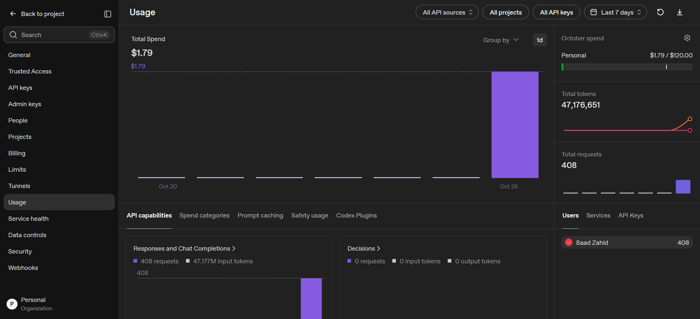

# AI tool usage disclosure

## Run the project

The project does not require an external AI API key for the normal demo. Start the backend and frontend with PowerShell(s) as described in `README.md`. The backend runs a local deterministic parser and a small explainable intent classifier; no external LLM is called at runtime.

This project was created with assistance from GitHub Copilot and OpenAI GPT5-mini in VS Code. The models helped scaffold the Python API, deterministic expense-logging flow, React interface, tests, and project documentation.

Important: The training/evaluation pipeline may use model-assisted tools during development, but saved/served behavior is implemented in Python rules and the explainable intent classifier. If you enable external model-backed features (for example, a combined-currency converter or a model-based intent assistant), you must configure API keys and review privacy implications before enabling them in production.

## Review and corrections

The generated implementation should be reviewed like any other code. In particular, amount/category/date parsing is intentionally limited, browser speech APIs vary by browser, and the in-memory expense store is not production-ready. Tests cover logging, missing fields, corrections, cancellation, and the running total; they are not exhaustive. Verify behavior locally and update this disclosure if you make further AI-assisted changes.

## Token / usage evidence

