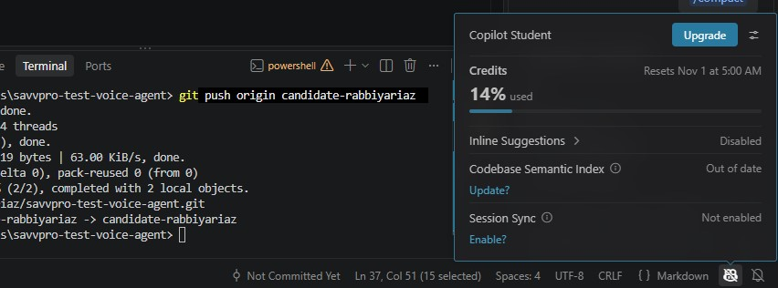

# AI Usage

## 1. Tools used

- **GitHub Copilot**: generated boilerplate and implementation from my specifications: NLU regex patterns, the FSM scaffold, the FastAPI wrapper, the React page, and pytest assertions. I wrote the specs, defined the logic, and reviewed and corrected all output.
- **Claude Opus 4.8:** Planning, use-case selection, edge-case design, prompt drafting, and debugging guidance.

## 2. How I used them

I directed the design and decision logic myself; AI tools accelerated the mechanical work under my specification.

- **Design and architecture: mine.** I chose the use case, defined the slots and state machine, and specified every edge case the brain must handle before any code was written.
- **Scaffolding: AI-assisted, I specified.** I used Copilot to generate boilerplate for the brain modules and FastAPI/React setup from detailed specs I wrote, then reviewed and corrected the output.
- **Tests: I defined, AI drafted.** I designed the test scenarios (including the adversarial cases); Copilot drafted the assertions, which I verified against intended behavior.
- **Debugging: mine.** I found the bugs through manual adversarial testing (see Section 3); AI helped implement the fixes I'd identified.

## 3. Where they got things wrong

| Issue | What the AI did | Fix |
|---|---|---|
| Phone number parsed as a date | `dateparser` misread a phone number as a date. | Added digit-length guards and slot-directed phone parsing. |
| Filler stored as `patient_name` | Stored “whatever works” as the patient name. | Added slot-directed parsing: accept a bare name only when `patient_name` is the pending slot. |
| Change phrase stored as a name | Stored “actually make it Friday” as a patient name. | Added change detection before name capture. |
| Strict time parsing | Failed on “p.m”, “3.30”, and “around 2 ish”. | Loosened parsing, stripped dots and filler, and accepted a dot as a minute separator. |
| Confirmation regression | Broadening confirmation words caused a mid-call change to be caught as `confirm_no`. | Fixed ordering so slot changes take precedence over `confirm_no`. |
| Availability message conflation | Treated outside-working-hours requests as if the slot were taken. | Separated the two cases into distinct messages. |

## 4. Key takeaway

AI accelerated scaffolding and test generation, but every bug above was found through my own adversarial manual testing, not by the AI.
I directed the decision logic and edge-case design; the AI implemented to that specification.

## 5. Token / credit usage

This project was built on a GitHub Copilot Student plan, which is credit-based rather than token-metered, so exact per-request token counts are not exposed. Total consumption for the entire project was approximately **14% of the monthly credit allowance** (resets Nov 1), shown below.

Planning and design guidance used Claude (conversational), which shaped the architecture and edge-case design but produced no committed code.