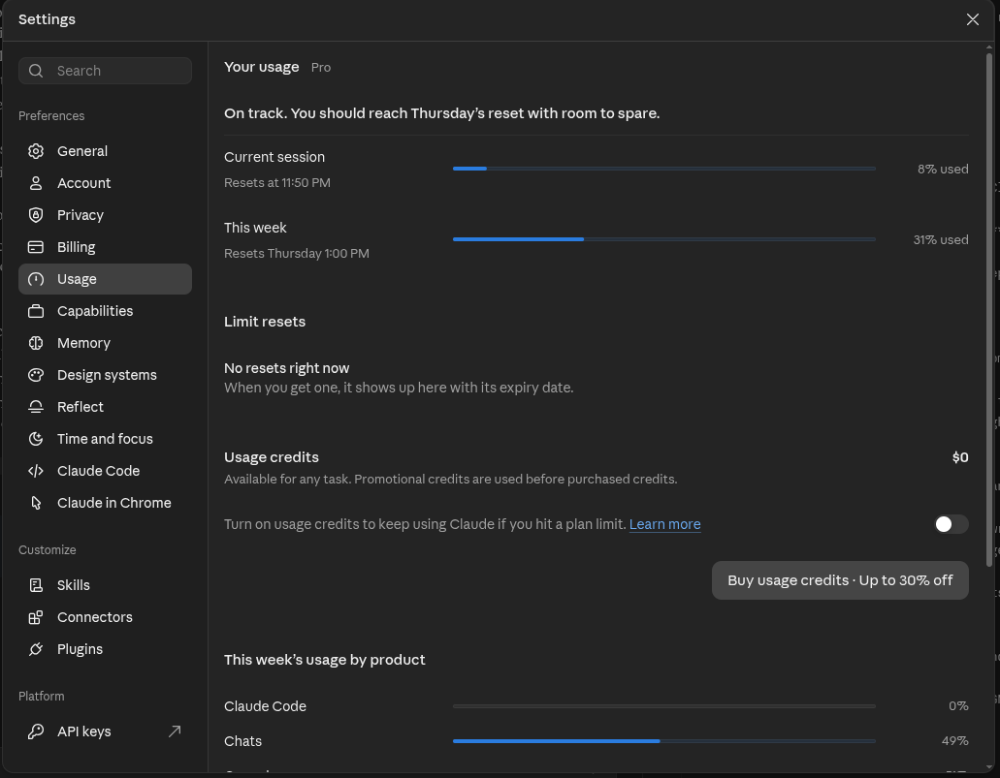

# AI usage

## 1. Tools used

* **Claude Sonnet 5.5**, used through the Claude **chat** interface (not Claude Code, not an IDE plugin, not an API).
* No AI model is used **inside the product**. The assistant's brain is plain Python rules (see DESIGN.md).
  There are no API keys anywhere in this repository.

## 2. How I use AI (my approach)

I use AI mainly **for learning**, not as something to trust blindly. For a project I do this:

1. I open a **dedicated chat/project** for that one task.
2. I start with an instruction prompt, roughly: *"You are a senior software engineer. Help me understand the stack
   before we start, and plan this in small, easy steps."*
3. I go through the plan **step by step** and solve each step myself, asking the AI to explain and to **review**
   what I wrote ("review my code, don't rewrite it").
4. I write the **logic** myself. I let AI generate the parts I already know well, such as the Next.js frontend
   (I have several years of Next.js projects) and the standard API layer, because I can read and judge that code quickly.

For this assignment, step 2 was: *understand what a voice assistant is and how a "brain" can work without an LLM*,
then write my own call scenarios (see DESIGN.md section 1) before writing any code.

## 3. What AI did, and who wrote what

| Part | Written by | How AI was used |
|---|---|---|
| Call scenarios and the "arrow table" (the state/rules spec) | **Me** | AI explained what states and slots are; I wrote the calls and the table |
| `services/booking.py` (calendar, hours, 30-min grid, double-booking) | **Me** | AI reviewed and explained my bugs; it did not rewrite my code |
| `tests/test_booking.py` | **Me** (AI extended some cases) | AI suggested more edge cases |
| `brain/nlu.py` (`NLUResult`, `normalize`, intents, services) | **Me** | AI reviewed; the long phrase lists were generated by AI |
| `tests/test_nlu.py` | **Me** with AI suggestions | |
| `brain/extractors.py`, `brain/parser.py`, `tests/test_extractors.py` | **AI** | Generated by Claude because of the time limit; I ran the tests |
| `brain/state.py`, `brain/responses.py` | **AI** | Generated from my scenarios and arrow table |
| `brain/policy.py` (the decisions) | **AI** | Generated from my arrow table; I had planned to write it myself |
| `brain/assistant.py`, `tests/test_scenarios.py`, `tests/test_responses.py` | **AI** | The scenario tests are my sample calls turned into tests |
| FastAPI layer (`app/api`, `main.py`, `config.py`, `cli.py`, `seed.py`, `tests/test_api.py`) | **AI** | |
| Next.js frontend (`frontend/`) | **AI** | I reviewed it; Next.js is a stack I know well |
| README, DESIGN, this file | AI draft, edited by me | The scenarios and process in DESIGN.md are mine |

## 4. Where the AI was wrong, and how I caught it

* **Overlapping phrase lists.** The first intent lists put words like `extract`, `extraction`, `wisdom tooth` and
  `treatment` under the **book** intent, which collided with the service names. Bare `open` / `close` under
  **ask_hours** and `do it` under **affirm** were too greedy as well. My tests caught these and I narrowed the phrases.
* **Overcomplicated explanations.** Some early explanations (what a state is, what `NLUResult` is, how replies work
  without an LLM) were too abstract. I asked for simpler ones with examples until I understood them.
* **Too big for the time.** The first design had more features than I could finish and understand in the time
  available, so I asked for the scope to be reduced and for the work to be split differently.
* **A sloppy helper test.** One generated calendar test was needlessly convoluted; it was rewritten with a simple
  `timedelta`.
* **My own bugs, found with AI review:** wrong annotation syntax (`=` instead of `:`), a typo in an import,
  booking being stored *before* the opening-hours check, an unbounded `while True` slot search, a rounding bug on the
  30-minute grid, and `normalize` removing commas instead of turning them into spaces.

## 5. How I checked the AI's work

* I ran everything: `python -m pytest -q` (all backend tests pass), and `npm test`, `npm run typecheck`,
  `npm run build` in the frontend.
* I ran the full app and made test calls in the browser, including the taken-slot and discount cases from my scenarios.
* No secrets are committed: `.env` files are git-ignored; only `.env.example` files are in the repo.

## 6. Token usage

Claude chat does not show exact token counts per message, so I am **not** inventing numbers. Evidence I can give:

