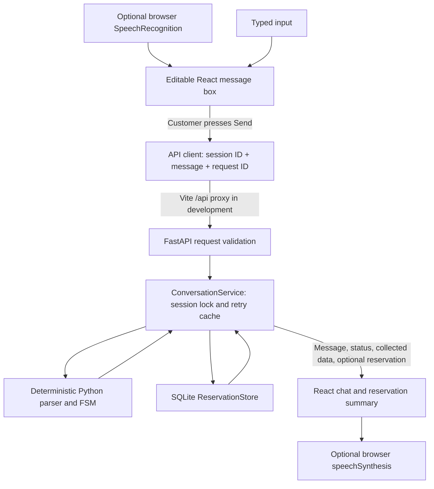
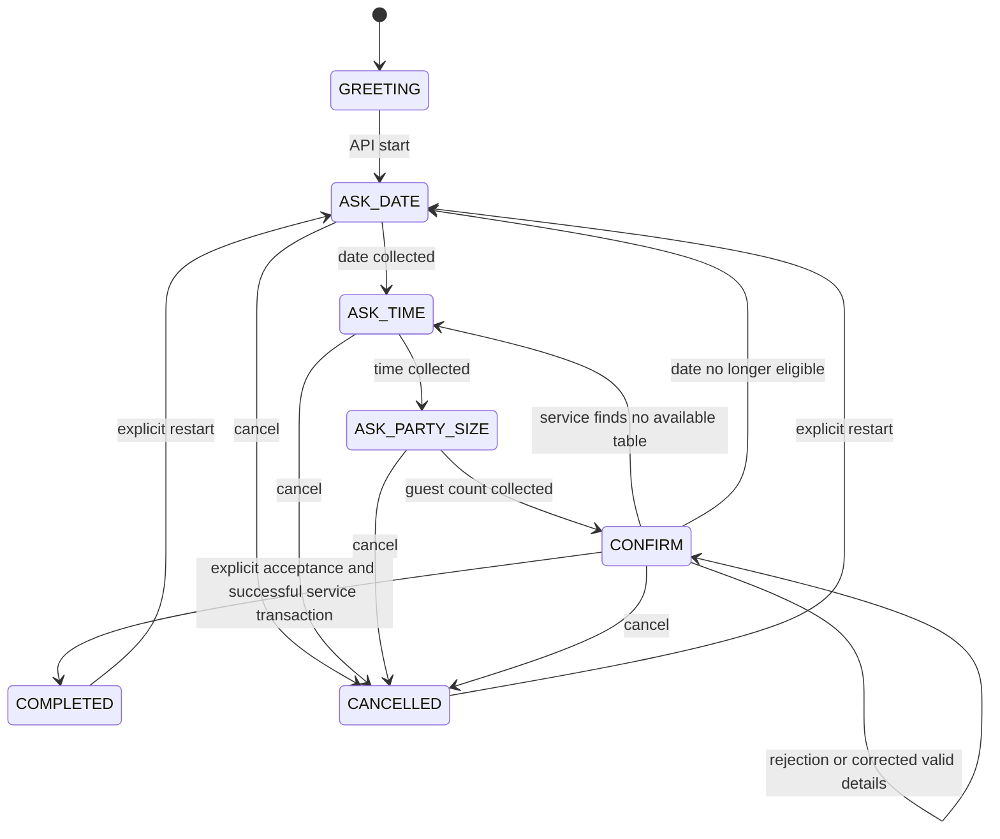

# Design: The Golden Fork reservation assistant

The use case is a fictional restaurant reservation: collect a date, time, and
number of guests; check tables; present the details; save only after explicit
confirmation; then return a confirmation. Text is always available. Optional
browser dictation and spoken replies provide the speech → brain → speech path.
No real customer names, contact details, or restaurant inventory are required.

## Architecture and request flow

The browser calls `POST /api/conversations/start` to obtain an opaque session ID.
Each message calls `POST /api/conversations/message` with `session_id`, `message`,
and a client-generated `request_id`. The existing `GET /api/health` is a process
health response; it does not prove database readiness.

Routes validate schemas and translate errors. The service coordinates independent
brain and storage modules. The brain imports neither FastAPI nor SQLite, and
storage imports neither the brain nor FastAPI. No frontend reservation algorithm
or LLM decides what to book.

## The deterministic brain

`backend/app/brain/parser.py` uses keyword patterns, regular expressions, lookup
tables, and explicit precedence. `states.py` defines states and intents;
`responses.py` supplies response templates. `engine.py` stores each conversation's
state, collected date/time/party size, and turn history.

The diagram is a summary, not a complete transition table. Any active turn can
provide multiple fields, skip collection prompts, correct an earlier field,
request help, or restart. A bare number is interpreted only in a relevant
collection state. Unknown/unrelated input prompts for the missing detail.

Intent precedence handles global cancel/restart/help and explicit change
commands first. Extracted details are processed before affirmative confirmation:
`yes, for 6 people` changes the details and asks again. Without new details,
explicit rejection is checked before affirmative phrases, so `not correct`
never means `correct`.

Recognized impossible dates and invalid complete time tokens produce explicit
errors and cannot fall back to a valid number embedded in the invalid input.
Signed guest counts remain signed for validation. Multiple distinct time
candidates, such as `7pm or 8pm`, require a choice. Invalid corrections clear the
affected slot, retain the other valid fields, and block confirmation until that
slot is supplied correctly. Terminal sessions ignore ordinary corrections;
explicit restart starts a new draft.

Date/time conventions are intentionally limited and documented:

* Explicit-year ISO/named/numeric dates and `yesterday` preserve their actual
  date, so past values are rejected. Yearless month/day values roll forward.
* Numeric month/day input uses MM/DD. A bare weekday selects the next occurrence;
  the established `next Friday` rule skips that occurrence by another week.
* Bare hours from 1–11 use the restaurant's PM default. Explicit AM/PM and
  24-hour forms are supported; invalid components are rejected.
* The parser is English and rule-based. It does not understand arbitrary natural
  language or clarify every possible ambiguity, including competing dates.

## Availability, persistence, and confirmation

The fake restaurant has six tables: capacities 2, 2, 4, 4, 8, and 20 (40 seats).
A reservation occupies one smallest-fitting table for exactly 90 minutes.
Tables cannot be combined or shared. Half-open occupancy intervals permit a
20:30 start after a 19:00 booking, but reject 20:29 for that same table.

Dates must be today through 90 days ahead, inclusive. Seating starts must be
11:00–21:30, inclusive; occupancy may finish after last seating. Parties must be
integers from 1–20. Local dates/times use the restaurant/development host's local
date; creation timestamps are UTC. Same-day seating is not compared with the
current minute. See [the full database policy](backend/DATABASE.md).

SQLite stores table inventory plus reservation ID, date, time, party size,
assigned table, status, creation timestamp, submission key, and a constrained
minute-of-day value. Python validation precedes saving. Database CHECK/foreign-key
constraints, unique keys/indexes, and insert/update triggers protect static
validity, table capacity, and overlapping confirmed intervals.

The service checks availability before presenting complete details for acceptance.
This is advisory, not a hold. When the brain accepts an explicit confirmation,
the service calls creation, which rechecks inside `BEGIN IMMEDIATE` before
inserting. A success response is returned only after the transaction succeeds.
If another caller took the table, the service asks for another time instead.

The standalone FSM models completion without storage; the integration service
is responsible for withholding that result until storage confirms it. On database
or unexpected processing errors it restores the prior FSM state/history. A lost
response after a possible commit is reconciled by retrying the original booking
key, not by claiming that no booking occurred.

## Duplicate submissions and failures

React creates a UUID for each logical message. It retains the exact payload in
memory and tab-scoped session storage before sending. Failed uncertain requests
must be retried with that same payload; additional submissions/new sessions are
blocked in the UI until recovery. Reload can restore an unresolved request.

The service serializes each session with a lock and caches replies by message
ID. Same ID/text replays the original response; changed text under that ID is a
409. A separate server-owned booking key uniquely identifies a draft's write.
SQLite returns the original row for an identical booking retry, even if the
previous commit succeeded but its response failed. A restart gets a new draft
key and does not cancel an already saved booking.

HTTP 404/409/422/503/500 handling is documented in [API.md](backend/API.md).
Clients receive generic errors; diagnostic exceptions stay in server logs.

## Optional voice and UI behavior

`useSpeechInput.js` feature-detects standard/prefixed browser recognition,
requests English one-shot dictation, shows interim preview, and adds only final
text to the editable draft. It does not send automatically or interpret intent.
Permissions, missing audio devices, empty results, service/network errors,
interruption, cancellation, and late callbacks have explicit handling.

`useSpokenReplies.js` uses browser synthesis only after opt-in. It tracks handled
assistant reply IDs, skips restored history, replaces old queued speech, and
supports stop/disable. Starting dictation stops playback to reduce feedback.
Text chat and the backend remain usable when browser voice APIs are unavailable.
No audio endpoint, application speech credential, or paid integration is added.
Browser vendors may use network speech services; offline/on-device behavior is
not guaranteed. See [voice usage and manual checks](frontend/README.md).

## Verification and project boundaries

Backend pytest tests cover parsing/FSM, persistence, constraints, independent
connections, transactions, concurrency, API integration, and uncertain-commit
recovery. Frontend Vitest/jsdom tests cover API transport, UI, retries, storage,
keyboard input, and mocked voice lifecycles. The browser script runs real React,
Vite, FastAPI, and SQLite with mocked speech APIs, including mobile layout and
editable dictation through an actual booking flow. Tests use fake data and
temporary databases. Physical microphone/audible-output quality still requires
manual checking.

See [README.md](README.md) for setup, [TESTING.md](TESTING.md) for commands and
edge cases, and [SUBMISSION.md](SUBMISSION.md) for the current verification record
and incomplete submission requirements.

This is a local assessment application, not a production service: one backend
worker, in-memory sessions/cache/locks, no authentication, no session eviction,
no public reservation lookup or cancellation/rescheduling endpoint, no holidays
or table joining, and no deployment/migration/backup workflow. Server reloads
lose sessions while retaining bookings. Browser voice behavior varies by device.
