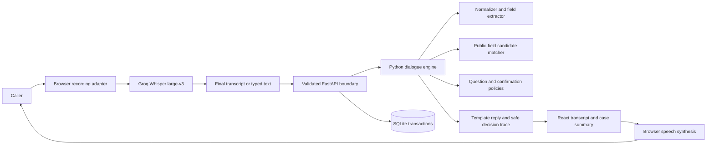

# Riverside Lost Property: Design

Status: approved by the user on 2026-10-26; implementation in progress. All commits and submission are managed by the user.
Date: 2026-10-26.

## Purpose

Build a voice assistant for the lost-property desk of one fictional shopping mall. A caller describes a lost item, answers useful follow-up questions, and receives either a pending claim reference or a lost-item report reference. Staff must review ownership before releasing property.

The assessment's central requirement is preserved: our Python code interprets the caller's words, maintains the conversation, ranks records, chooses questions, and decides which action is allowed. No LLM, embedding service, generative dialogue, or AI agent participates in those decisions. Speech recognition and synthesis only convert audio and text.

## Agreed direction and alternatives

The user selected a shopping-mall lost-and-found assistant and approved synonym-aware, code-owned matching with staff-reviewed claims.

1. **Embedding-based semantic retrieval:** could recognize a broader range of paraphrases, but makes model influence over decisions harder to distinguish from the assessment's prohibited AI brain. Not selected.
2. **Synonym-aware weighted matching and explicit dialogue states:** predictable, inspectable, testable, and clearly implemented by us. Selected.
3. **Exact field filtering alone:** simple, but misses ordinary descriptions such as “rucksack near the restaurants.” Not selected because callers need vocabulary flexibility.

The remaining implementation choices below are proposed engineering defaults, rather than additional preferences attributed to the user.

## Scope

- One mall, English conversations, and four categories: bags, phones, wallets, and keys.
- Voice input and spoken replies, plus an equivalent typed interaction.
- Multiple facts in one utterance; follow-up questions; corrections; uncertainty; repeat, help, restart, cancel, and explicit confirmation.
- Three outcomes: possible match submitted for staff review, unresolved possibilities submitted as a lost-item report, or no match submitted as a lost-item report.
- A responsive caller interface showing the conversation, collected details, safe candidate summaries, and an optional decision inspector.
- Fictional fixtures only. Display a persistent demo notice asking users not to enter real personal information. Do not collect names, phone numbers, emails, account credentials, serial numbers, or device unlock codes.

The first release does not include telephone-network integration, notifications, multiple malls, multilingual understanding, public inventory browsing, staff authentication, item release, or automatic ownership verification. These do not improve the core assessment enough to justify their added surface area.

## Proposed stack and operating boundary

| Area | Choice | Reason |
| --- | --- | --- |
| Backend | Python, FastAPI, Pydantic | Validated contracts and generated OpenAPI documentation |
| Brain | Pure Python modules | Independently testable, deterministic interpretation and decisions |
| Persistence | SQLAlchemy, Alembic, SQLite | Real transactions, explicit schema migrations, simple local setup |
| Frontend | React, TypeScript in strict mode, Vite | Focused client application with typed boundaries |
| Speech | Groq whisper-large-v3 via the Python backend; MediaRecorder input and browser speechSynthesis output | Server-only GROQ_API_KEY in root .env; speech remains separate from reasoning |
| Tests | pytest, Vitest, React Testing Library, Playwright, axe-core | Domain, integration, component, browser, and accessibility verification |
| Quality | Ruff, mypy, ESLint, TypeScript, coverage, dependency/secret scans | Repeatable checks recorded in CONSTRAINTS.md |
| Delivery | Committed dependency locks, GitHub Actions, a container image | Reproducible setup and a reviewable submission |

The workspace currently has Python 3.14.0, Node 24.11.1, and npm 11.6.2. Target Python 3.14 and Node 24; record exact supported runtimes and dependency versions when resolving the initial locks. Do not assume a package supports the installed Python until installation and tests demonstrate it. Prefer a supported dependency release over silently downgrading the runtime.

The supported assessment deployment is a local or single-instance demonstration with one API worker and a durable SQLite volume. PostgreSQL, a distributed limiter, authenticated staff workflows, and an operational retention policy would be prerequisites for a larger real deployment. This design adopts production engineering practices without claiming those unbuilt capabilities.

## Architecture and ownership



The engine accepts a typed snapshot, an utterance, an inventory snapshot, and an injected clock. It returns a new snapshot, a reply, a safe trace, and an optional proposed effect. It does not perform HTTP calls, access a microphone, read environment variables, use random ranking, or commit database changes. The application service validates and executes effects transactionally.

Suggested layout, finalized in the implementation plan:

```text
backend/
  pyproject.toml
  requirements.lock
  alembic.ini
  migrations/
  src/lost_property/
    main.py                 # Application factory and lifespan
    api/                    # Routes, public schemas, error mapping
    domain/                 # Types, normalization, extraction, matching, dialogue
    application/            # Turn orchestration and confirmed actions
    persistence/            # Database models, repositories, transactions
    config.py
    telemetry.py
    cli.py                  # Migrate/seed/expiry maintenance entry points
  tests/
frontend/
  src/
    app/
    features/conversation/
    features/decision-inspector/
    speech/
    api/                    # Generated OpenAPI types and typed fetch wrapper
    styles/
  tests/e2e/
tasks/
.github/workflows/
```

Avoid generic repository frameworks, plugin registries, event buses, and microservices. Add a module only when it has a distinct responsibility.

## Data model

### Found item: internal inventory

- Internal ID; category and subtype; public description; normalized colour and optional brand.
- General mall zone; date found in the venue's local timezone.
- Structured private identifying facts and accepted vocabulary groups. Store no actual credentials or device serial numbers, even in fixtures.
- Availability: `available` or `returned`.
- Created/updated timestamps. Inventory is seeded through a local CLI, not an unauthenticated API.

Private identifying facts never appear in public response schemas, HTML, generated frontend fixtures, decision explanations, logs, or synthesized replies. The checked-in fixture source is intentionally fictional and is not a production secret store.

### Conversation

- Opaque ID; hashed random session capability; expiry; monotonically increasing version.
- Current state; caller-provided fields; uncertainty markers; field provenance; previous question and bounded retry counts.
- Internal candidate IDs and volunteered identifying details, kept server-side.
- Request-ID ledger containing request hashes and public responses for retry safety.
- Bounded transcript and trace, available only within that session.

### Lost report and claim request

- A lost report contains the confirmed caller description and a reference, with status `open`.
- A claim request contains the confirmed caller description, an internally selected candidate, and a reference, with status `pending_review`.
- Neither action records ownership or marks an item returned.
- A pending claim does not reserve an item globally. Anonymous claims must not let a caller block someone else's legitimate review. Staff reconcile competing claims outside this release.
- The confirmed conversation outcome has a unique database constraint on session ID plus search number. Repeated confirmation cannot create duplicate records; explicitly restarting after completion starts a new numbered search in the same session.

Demo retention defaults: expire and remove conversations and their request ledgers after 24 hours; remove reports and claims after 30 days. Provide an explicit maintenance command, invoke it at application startup, and enforce session expiry on every request. Persistent multi-day deployments must schedule the command daily; document this responsibility. No raw audio is stored by our application. Report/claim foreign keys must survive removal of their originating conversation through a nullable association.

## Interpretation and matching rules

### Normalization and extraction

- Case-fold and normalize whitespace and punctuation; preserve the original utterance for the caller's transcript.
- Recognize phrase synonyms before single words: “rucksack” to backpack, “restaurants” to food court, “navy” to dark blue. Use explicit, version-controlled vocabulary.
- Extract category, subtype, colour, brand, venue zone, lost date, descriptive tokens, and voluntarily supplied identifying details.
- Support explicit dates and relative expressions such as today, yesterday, and named weekdays using an injected clock and configured venue timezone, initially `Asia/Karachi`.
- Ask for clarification for ambiguous numeric dates, future lost dates, conflicting descriptions, and unsupported categories. Never silently guess a date format or invent a value.
- “Maybe blue” remains uncertain. “Not blue, black” removes blue and confirms black. An unrecognized description does not become a fabricated structured fact.
- A field correction invalidates the shortlist, selected candidate, identifying-evidence assessment, and any previous confirmation. Retain only evidence whose meaning remains valid after the correction.

### Public candidate ranking

First exclude returned items, explicitly incompatible confirmed categories, and items whose found date precedes a confirmed lost date. Uncertain categories and dates must not trigger these exclusions.

Use a transparent initial scoring policy, calibrated against fixtures before final acceptance:

| Signal | Contribution |
| --- | --- |
| Confirmed category agreement | +30 |
| Description similarity | 0 to +25 using Jaccard overlap of normalized descriptive token sets |
| Confirmed colour agreement / contradiction | +15 / -15 |
| Confirmed brand agreement / contradiction | +10 / -10 |
| General zone agreement | +10 |
| Found on the lost date / within the next two days | +10 / +5 |

Unknown or uncertain fields contribute zero and do not penalize a candidate. Remove category, colour, brand, date, and location tokens from the description-token score so those signals are not counted twice. An empty description token set scores zero. Clamp final scores to 0..100; these are heuristic points, never probabilities.

Provisional thresholds: below 40 points is insufficient evidence for a shortlist; 40 or more is a candidate worth discussing. A leading candidate needs at least 55 points, a margin of at least 15 over the next eligible candidate, a confirmed supported category, and one additional confirmed public attribute before entering the identifying-detail stage. With no runner-up the margin requirement is satisfied, but every other requirement still applies. Tie-break by internal ID for reproducibility, never to imply a tie is resolved. Show no more than three safe candidate summaries.

These initial values are proposals, not measured accuracy. A labeled fixture suite must justify or revise them through a documented policy change before release; do not tune thresholds simply to make an individual failing test pass.

### Selecting the next question

1. Handle stop, restart, help, repeat, and corrections before ordinary matching.
2. Ask for a supported category if missing or ambiguous.
3. Among unanswered public fields that differ across the leading candidates, ask the field with the most distinct known values. Use a fixed tie order: colour, location, lost date, brand, description.
4. If ranking cannot yet produce candidates, collect a description and approximate lost date before concluding that none is convincing.
5. Ask at most twice for the same missing field; accepting “I don't know” must allow a report rather than trap the caller in a loop.
6. After at most six matching questions without a useful resolution, offer a lost report. After two unanswered or conflicting identifying-detail prompts, offer a lost report and staff assistance without claiming ownership.

### Identifying details and caller selection

The caller may reject or select a safe candidate summary using its conversation-local label. A selection is a preference, not evidence: it cannot bypass ranking requirements, identifying questions, or staff review. Internal item IDs are never accepted from caller request bodies as a claim target.

Ask generic questions such as “Can you describe any distinctive marks or attachments?” or “Can you describe something inside?” Never ask “Does it have a yellow duck keychain?” Compare volunteered details using normalized, explicit vocabulary groups, not model judgments. Require at least one distinguishing private fact consistent with a single eligible candidate before offering a claim request. If facts fit multiple candidates, contradict the selected candidate, or remain unclear, do not force a selection: offer a lost report for staff investigation.

Do not return private facts, per-fact correctness, or private-match scores to the client. Give only a general message that staff need to check the possible match. Candidate ranking explanations are derived exclusively from public attributes already discussed.

## Dialogue states and effects

| State | Expected behaviour |
| --- | --- |
| `collecting` | Extract facts, search, and ask a useful public question |
| `disambiguating` | Narrow candidates or accept a safe candidate preference |
| `identifying` | Ask open identifying questions without revealing stored facts |
| `confirming` | Read back a safe summary and ask permission to submit the proposed report or claim |
| `completed` | Return the persisted reference; subsequent confirmations repeat the receipt |
| `cancelled` | Stop with no new report or claim; allow an explicit new conversation |

“Yes” only confirms an action while in `confirming`. Negation, uncertainty, and a correction in the same turn take precedence over an affirmative word. “Yes, but actually it was blue” must update the description and restart matching. A failed database commit must never produce a success receipt.

Restart discards the unsubmitted search after a confirmation if any entered details would be lost. Cancellation does not delete an already submitted claim; explain that staff must handle that request, without inventing an administrative action. Changing facts after completion starts a new search only with the caller's agreement.

## HTTP contract and concurrency

Use `/api/v1`. Public endpoints:

- `GET /health/live`: process health, no internal configuration.
- `GET /health/ready`: database connectivity and migrated schema readiness; return 503 when not ready.
- `POST /api/v1/session`: create an anonymous session or resume the valid session cookie; return the public snapshot and greeting.
- `GET /api/v1/session`: retrieve only the current session's public snapshot; never return inventory or private evidence.
- `POST /api/v1/turns`: accept `{request_id, expected_version, text}` and return the reply, new version, safe snapshot, safe trace, and optional receipt.
- `DELETE /api/v1/session`: erase the current conversation and expire its cookie; confirmed reports/claims retain only their required fictional case fields until their own expiry.

Use an opaque random capability in an HttpOnly, SameSite=Strict cookie; Secure in HTTPS deployment, with an explicit localhost-only development exception. Store only its hash server-side. Keep frontend and API on one origin through Vite's development proxy and the deployment server. Do not introduce permissive CORS or browser token storage. Validate Origin for mutating requests and require JSON bodies where applicable.

Enforce 1..1000 trimmed characters per turn, a 16 KiB request-body cap, at most 60 turns per session, a 30-minute idle expiry bounded by the 24-hour absolute TTL, and no more than five session creations per client address per ten minutes. Limit turns to 30 per session per minute. Use bounded in-process rate-limit storage in the supported single-worker setup; do not trust forwarded client addresses unless a configured trusted proxy sets them.

Persist the new state, turn response, request ledger, and any confirmed outcome in one transaction. A unique `(session_id, request_id)` and compare-and-swap version check provide retry and concurrency safety. A unique `(session_id, search_number)` prevents duplicate outcomes while allowing an explicitly restarted search. Identical retries return the saved response before checking its now-stale expected version; reuse of a request ID with different payload returns 409. Separate stale requests return 409 without modifying state. Generate receipt references from sufficiently random identifiers under a database uniqueness constraint.

All errors use `{error: {code, message, request_id}}`; use 422 for invalid input, 401 for absent/expired session capability, 409 for conflicting requests, 413 for oversized input, 429 for limits, and 503 for temporary database failure. Unexpected errors return a generic 500 response. Do not expose SQL, stack traces, echoed secrets, or validation internals containing the full request text.

Generate frontend API types from OpenAPI and check for generated-contract drift in CI. Freeze exact fields and type names in the implementation plan after this design is reviewed.

## Voice and interface behaviour

Implementation update: at the user's explicit request, speech recognition uses Groq `whisper-large-v3`, not browser SpeechRecognition. MediaRecorder captures one clip (maximum 60 seconds); a session-authenticated raw-audio endpoint validates at most 8 MiB in memory and forwards it to Groq. The server key loads from root `.env` or process environment and is never sent to the browser. Transcription does not mutate the conversation. Finish recording submits the clip; discard/cancel invalidates late callbacks. Only the resulting text reaches the existing Python turn endpoint. Browser speech synthesis reads replies. Groq is used for STT only.

The production runtime dependencies are hash-locked. Development tooling is version-pinned in a separate lock; its initial hash-resolution run exceeded the user's delivery deadline, so a complete installed-version snapshot was retained instead of leaving setup dependent on a missing file.

- Before starting the microphone, explain that the browser's recognition provider may process audio online and request explicit user initiation. No microphone recording begins on page load.
- Detect microphone recording and synthesis independently. Name unsupported features clearly and retain typed input and visible assistant replies.
- Record one utterance per turn, then transcribe the finished clip. Empty, failed, cancelled, or late transcriptions must not create a turn.
- Model idle, listening, submitting, speaking, and error states explicitly. Stop recognition before speaking and cancel synthesis before listening, restarting, or leaving. Do not let the assistant transcribe its own voice.
- Do not automatically retry uncertain mutations with new request IDs. Reuse the original ID after transport failures and resynchronize the snapshot after a 409.
- Provide mute, replay last reply, stop listening, typed input, and end-conversation controls. Avoid automatic microphone reactivation.
- Handle permission denial, missing microphone, silence, network recognition failure, synthesis failure, and API timeout with visible recovery actions.
- Keep the transcript as the primary view; place item details and safe candidates beside it on desktop and beneath it on mobile. Put the decision inspector behind a disclosure control so it does not interrupt the caller's task.
- Use semantic controls, visible focus, labels, polite live announcements, adequate contrast, reduced-motion support, and keyboard operation. Do not announce every interim recognition fragment.
- Use clear typography and a restrained mall-service visual identity; avoid decorative dashboards, fake statistics, and unsupported accuracy claims. Detailed visual design remains an implementation choice subject to real-browser review.

## Security, operability, and quality

Trust boundaries are the browser/API, public/internal serialization, speech provider, and application/database. Primary abuse cases are item-detail enumeration, cross-session access, repeated confirmation, fabricated confirmation IDs, and oversized or excessive requests.

Enforce response allowlists; parameterized database access; cookie and Origin controls; bounded attempts and input; safe generic errors; CSP, frame restrictions, no-sniff headers, and HTTPS/HSTS in deployed mode. Do not log utterances, identifying details, session capabilities, or complete request bodies. Structured logs contain request ID, route, latency, rule IDs, error code, and outcome type. Use operational counts and health checks instead of building a separate monitoring stack.

Use Alembic migrations rather than silently creating production tables on startup. Make fixture loading idempotent, require an explicit demo flag, and never wipe a database during normal startup. Configure SQLAlchemy's SQLite transaction and foreign-key behaviour explicitly and verify it on Python 3.14. Keep each request's database session isolated.

Keep golden tests at a fixed injected reference date. The demo seed command accepts an explicit `--as-of` date, defaulting to the venue's current date, and anchors fictional records to that date on their first insertion. Rerunning the command must not move existing found dates or overwrite case data; this keeps tests reproducible and demonstrations useful without changing inventory during startup.

`CONSTRAINTS.md` defines proposed checks and their activation milestones. A threshold is not enforced until its tool and CI step exist. Keep dependency locks, review install scripts before executing them, scan for exposed secrets and high/critical dependency findings, and never weaken tests or thresholds to obtain a green result.

## Acceptance scenarios

1. A caller describes a black rucksack near the restaurants; normalization finds plausible bags without claiming ownership.
2. Two similar bags lead to a useful distinguishing question, followed by an identifying question if one becomes sufficiently plausible.
3. Selecting “the first one” alone cannot submit a claim.
4. A volunteered distinctive fact supports a pending claim only after an explicit final confirmation.
5. “Actually, it was blue” invalidates the old selection and confirmation and reruns matching.
6. “Not blue, black,” uncertain colours, unknown dates, and “I already told you” do not corrupt state or repeat completed questions unnecessarily.
7. No convincing record leads to a confirmed lost report with a persisted reference.
8. Ambiguous dates, unsupported requests, silence, and unknown vocabulary get bounded clarification and a useful exit.
9. Returned items and temporally impossible confirmed matches are excluded.
10. Another session cannot read a transcript, replay a request, or use someone else's candidate label.
11. Private fixture facts never appear in any response, error, trace, DOM, or log; user-volunteered details are not incorrectly treated as fixture disclosure.
12. Retried and concurrent confirmations create exactly one outcome; stale corrections cannot overwrite newer state.
13. Denied microphone permission and missing speech support preserve a complete typed flow.
14. A supported browser completes an actual microphone-to-spoken-reply conversation; mocked speech tests alone do not satisfy this scenario.
15. Migrations and idempotent seeding work on an empty database, saved outcomes survive process restart, and expiry maintenance removes the promised records.

## Delivery roadmap

See [tasks/plan.md](tasks/plan.md) and [tasks/todo.md](tasks/todo.md) for the proposed sequence and review checkpoints. Build a working typed conversation first, add safe submission and persistence next, and attach voice to the same tested brain. Each slice includes its own tests and documentation; quality is not postponed until the end.

## Assessment evidence and submission

Keep setup, run commands, browser limitations, troubleshooting, test commands, and demo walkthroughs in README.md while preserving the original submission instructions in a separate document before rewriting it. This DESIGN.md is the assessment design deliverable.

Maintain AI_USAGE.md throughout implementation: tool/model information actually available, assistance received, mistakes and corrections, and genuine usage evidence. Never invent token counts. Store a redacted tool usage export or screenshot under docs/ai-usage/; if the session cannot expose token accounting, record that limitation and request the actual export before claiming the submission is complete.

Use the existing fork at `Harris-05/savvpro-test-voice-agent` and branch `candidate-Harris-05`. The final pull request targets `savvpro/savvpro-test-voice-agent:main` with title `feat: complete voice-agent assessment`, as required by the supplied README. Verify the external deadline with the user before submission because the repository provides no date.

## Sources checked while planning

- [FastAPI lifespan events](https://fastapi.tiangolo.com/advanced/events/): application resource startup and cleanup.
- [SQLAlchemy SQLite documentation](https://docs.sqlalchemy.org/en/20/dialects/sqlite.html): transaction control and foreign-key configuration; recheck the locked release's documentation during implementation.
- [Vite getting started](https://vite.dev/guide/): runtime requirements and React/TypeScript setup.
- [MDN SpeechRecognition](https://developer.mozilla.org/en-US/docs/Web/API/SpeechRecognition): limited browser availability and possible server-side audio processing.

## Design review

Independent builder review completed on 2026-10-26: no consequential unanswered questions or material implementation contradictions were reported. The user approved the design and roadmap on 2026-10-26, including English-only, one fictional mall, Groq Whisper STT and browser TTS with typed fallback, local/single-worker SQLite deployment, no contact collection, and pending staff review rather than item release. The user instructed that all commits remain their responsibility.
