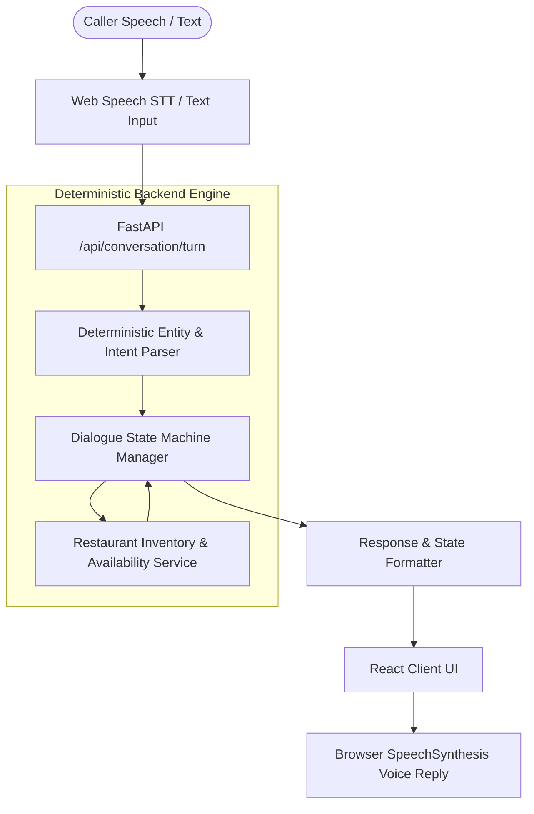
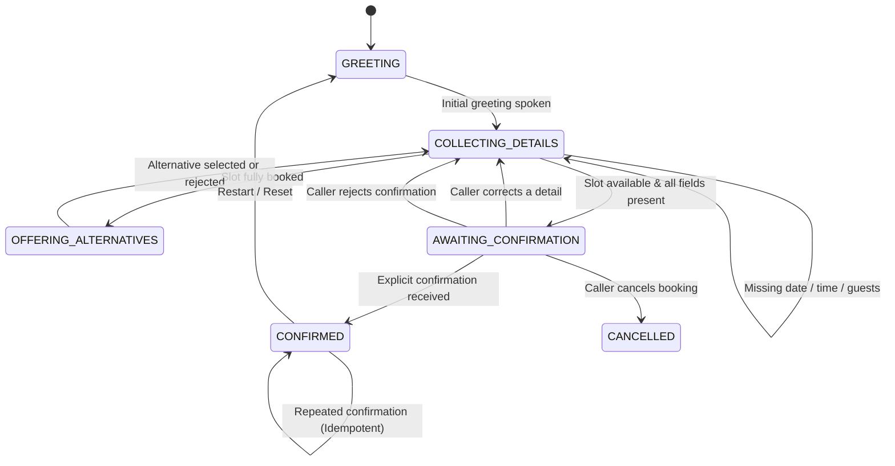

# Tableline — Architecture and Decision Design

## 1. Problem Statement & Scope

Restaurant phone reservation desks manage high-stress callers who frequently:
- Provide multiple pieces of information out-of-order in one sentence.
- Revise details midway through conversation (*"Wait, make that 6 people"*).
- Inquire about peak hours that are already sold out.
- Hesitate or reject offered alternatives before committing.

The core challenge is building a resilient, conversational reservation agent **without using Large Language Models (LLMs) at runtime**. The entire "brain" must be deterministic, auditable, testable, and low-latency.

---

## 2. System Architecture

Tableline decouples the conversation lifecycle into distinct modular layers:



### Component Responsibilities:
- **`backend.parser.DeterministicParser`**: Analyzes raw transcribed speech using compiled regex patterns, word-number mappings, and dateutil resolvers. Extracts date, time, party size, customer name, intent (`BOOK_OR_UPDATE`, `CONFIRM`, `REJECT`, `CANCEL`, `RESTART`), and correction flags without external network calls.
- **`backend.dialogue_manager.DialogueManager`**: Maintains explicit conversation states across turns. Handles missing entity prompts, dynamically catches in-flight corrections, invalidates stale availability checks, and triggers alternative slot searches.
- **`backend.restaurant_service.RestaurantService`**: Manages table capacity (5 tables per 30-min slot), validates dinner service hours (17:00–21:30), calculates proximity-ranked alternative openings for fully booked slots, and ensures idempotency when generating unique reservation codes (`TL-XXXXXX`).
- **`frontend.App.jsx`**: Manages Web Speech recognition audio streams, synthesizes spoken assistant responses, displays live interim transcripts, and presents an auto-updating booking summary card.

---

## 3. Finite State Machine (FSM)

The dialogue engine transitions between explicit states:



---

## 4. Entity Extraction & Correction Handling

### Deterministic Entity Parser
1. **Party Sizes:** Matches numeric digits or natural english word equivalents (`one`, `two`, `four`, `a couple`, `six of us`, `party of 8`). Validates against standard floor limits (1 to 12 guests). Zero guests triggers a targeted clarification prompt.
2. **Dates:** Recognizes keywords (`today`, `tonight`, `tomorrow`), weekdays (`this Friday`, `next Saturday`), and explicit dates (`October 30th`). Compares against reference date to prevent historical date bookings.
3. **Times:** Parses 12-hour AM/PM formats (`7:30 pm`, `7pm`), 24-hour formats (`19:30`), and contextual restaurant colloquialisms (`at 7`, `at eight`).
4. **Correction Detection:** Flags phrases like `actually`, `wait`, `instead`, `change that to`, or `make it`.

### Stale-State Invalidation Principle
A critical defect in naive chatbots is confirming a stale reservation after the user changes a parameter at the last second. 
In Tableline:
- If a caller reaches `AWAITING_CONFIRMATION` or `CONFIRMED` and utters a change (e.g., *"Make that 8 PM instead"*), the dialogue manager immediately sets `is_confirmed = False`, clears `reservation_reference`, and moves back to re-evaluating inventory for the newly requested time.

---

## 5. API Contracts

### `POST /api/conversation/start`
- **Output:**
  ```json
  {
    "conversation_id": "conv_a8b1c2d3",
    "state": "GREETING",
    "assistant_message": "Good evening, thank you for calling Tableline...",
    "booking_details": { "date": null, "time": null, "guests": null, "customer_name": null }
  }
  ```

### `POST /api/conversation/turn`
- **Input:**
  ```json
  {
    "conversation_id": "conv_a8b1c2d3",
    "message": "Table for 4 this Friday at 7 PM"
  }
  ```
- **Output:**
  ```json
  {
    "conversation_id": "conv_a8b1c2d3",
    "state": "OFFERING_ALTERNATIVES",
    "assistant_message": "I checked our availability for 4 guests on 2026-10-30 at 19:00, but that slot is currently fully booked. However, we have tables open at 18:30, 19:30, 20:00. Would any of those suit your party?",
    "booking_details": { "date": "2026-10-30", "time": "19:00", "guests": 4, "customer_name": null },
    "suggested_alternatives": ["18:30", "19:30", "20:00"],
    "is_confirmed": false,
    "reservation_reference": null
  }
  ```

---

## 6. Engineering Trade-offs & Limitations

1. **Rule-Based Parsing vs. Open-Domain Natural Language:**
   - *Advantage:* Instantaneous response time (<5ms), zero token cost, 100% deterministic reproducibility, no hallucinations, easily tested with unit tests.
   - *Limitation:* Complex indirect idioms or uncommon phonetic misspellings in low-quality speech recognition may require the user to repeat or select from explicit prompt chips.
2. **Browser Native Web Speech API:**
   - *Advantage:* Free, client-side, zero latency audio streaming, no external cloud credentials required.
   - *Limitation:* Speech recognition availability depends on browser implementation (Chrome/Edge provide native support; Firefox and Safari vary). A full text input fallback is provided to guarantee complete accessibility across all platforms.
