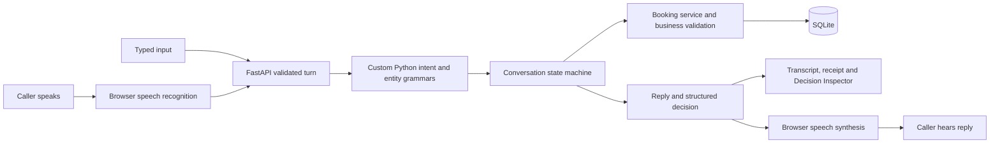

# VoxDesk implementation and design

## Use case and scope

Northline Studio is a fictional single-chair barbershop. Its receptionist handles a complete telephone-style job: identify a service, collect a date/time and fictional customer name, check a real schedule, explain the proposal, obtain confirmation and persist a booking. The same assistant checks availability, reschedules or cancels an existing appointment, answers business questions and closes the conversation.

This job makes uncertainty concrete: a caller can change a time, reject a proposal, omit a detail, refer to an earlier booking or retry after losing a response. The implementation favors an inspectable decision and a safe clarification over silently guessing. The app uses no real customer contact details, external calendar account or payment integration.

## Architecture and ownership

The frontend owns presentation, microphone/speaker lifecycle and transport recovery. FastAPI validates the request contract. The Python brain owns intent, collected details, questions, proposals, confirmation and responses. The booking service owns calendar validation and writes. The database layer makes a turn's effects atomic. No browser button directly changes an appointment.

| Source | Responsibility |
| --- | --- |
| `backend/app/main.py`, `config.py` | Application factory/lifespan, database-error responses, CORS, environment settings, IANA timezone and injected clock |
| `backend/app/api.py`, `schemas.py` | REST contracts, validated turn bodies, typed intents/states/entities/results, revisions and idempotency lookup |
| `backend/app/brain/language.py` | Normalization, ordered intent recognition, name grammar, entity composition and confirmation-target helpers |
| `backend/app/brain/control_phrases.py` | Whole-utterance confirmation, denial, composed back-outs, repeat, courtesy and ending rules |
| `backend/app/brain/services.py` | Service aliases, inclusion/exclusion scope, alternatives and unsupported choices |
| `backend/app/brain/calendar_dates.py` | Calendar interpretation, valid/invalid consumed spans and protection against date digits becoming clock values |
| `backend/app/brain/clock_times.py` | Complete clock expressions, periods, AM/PM, validation and ambiguity |
| `backend/app/brain/engine.py` | Context transitions, missing-detail prompts, corrections, target selection, proposal/confirmation gate and actual decision trace |
| `backend/app/catalog.py`, `bookings.py` | Synthetic business definitions, date/hours/duration checks, availability, lookup, create/reschedule/cancel and appointment version checks |
| `backend/app/db.py` | Appointments, conversation payloads, turn receipts and SQLite transactions |
| `frontend/app/page.tsx` | Workspace views, authoritative conversation state, requests/retries, suggestions, composer and Inspector |
| `frontend/lib/api.ts`, `types.ts`, `session-cache.ts` | Typed API client, request timeout/errors, session/pending-turn recovery and storage failure handling |
| `frontend/lib/use-voice.ts` | Browser STT/TTS adapters, language choice, recognition/speech separation, error guidance and cleanup |
| `frontend/components/` | Appointment cards, service catalog and theme preference controls |
| `frontend/app/layout.tsx`, `icon.svg`, `globals.css` | VoxDesk metadata/favicon, early theme preference and responsive interface styles |
| `backend/tests/`, `frontend/tests/` | Deterministic domain/API tests and production-browser workflows/fault injection |
| `.github/workflows/ci.yml` | Python matrix and Node/browser verification jobs, pinned action revisions and failure artifacts |

The `__init__.py` files mark Python packages. Lockfiles record dependency versions; the remaining TypeScript/Next/PostCSS/Pytest configuration supports builds and checks. The repository keeps the three requested documentation files, the original `TASK.md` and non-Markdown AI evidence. Development milestone/checklist/matrix notes have been consolidated into these required documents.

## Custom Python brain

**AI assisted development; it is not part of the runtime decision path.** There is no prompt-driven router, probabilistic intent service, embedding search or LLM SDK. Every action comes from Python rules and explicit state. Browser speech services are used only for transcription and synthesis, as permitted by the task.

### Recognition and priority

Normalization standardizes case, whitespace, apostrophes and AM/PM punctuation. A bounded set of spoken repair prefixes is removed without stripping negation. The recognition order is:

1. Whole-utterance end/repeat/denial/confirmation controls and courtesy.
2. Negated action commands, reference help and booking-status questions.
3. Business-information questions, including “How do I cancel a booking?”
4. Cancellation, rescheduling, availability and creation patterns. Multiple requested operations require clarification.
5. Affirmatives with new details and contextual corrections.
6. Active-task details or an unknown-request fallback.

This distinction prevents “read a book” becoming a booking and “have you booked it?” creating another one. No confidence percentage is invented for a rule match. Business answers come from the static catalog and retain the active workflow.

`control_phrases.py` composes bounded denial clauses and optional courtesy. “Never mind, don't do it, revert the change” rejects a proposal; “nothing, thank you so much” ends; thanks alone preserves the current step. Whole-utterance matching avoids interpreting a control word embedded in another request as a close or confirmation.

### Entities and uncertainty

| Field | Implementation and boundary |
| --- | --- |
| Service | Catalog aliases resolve to haircut, beard or combo. Local exclusions distinguish “haircut without beard” from the combination. Alternatives, contradictions and positive unsupported choices ask for one valid service. |
| Date | Supports relative days, bounded numeric/word day offsets, weekdays/next weekday, ISO dates, named months/abbreviations, numeric/word ordinal days and year-first numeric forms. Python calendar arithmetic rejects impossible dates and mismatched weekdays. |
| Time | Supports AM/PM, unambiguous 24-hour values, word hours, selected spoken minute forms, colon-free `5 30 PM`, half/quarter past and quarter to. Bare 1–12 asks AM/PM; booking needs an exact start. |
| Name | A bounded, Unicode-aware whole-slot grammar strips “use the name”, “put it under”, repair fillers and courtesy. Explicit inline name clauses are consumed before service/date/time extraction. Unmarked words outside a name context are not guessed to be names. |
| Reference | Parses `NL-` plus eight letters/digits. Generated references use eight random hexadecimal characters. Reference spans are removed before numeric time parsing. |
| Period | Morning/afternoon/evening can filter availability; a period alone cannot complete a booking. |

Calendar extraction masks **both valid and invalid date spans** before clock parsing. “2026 1028” means a date; “2026 0 to 10” requests a date repair rather than becoming a time. An independently supplied valid time remains available. Named dates without a year use the current business year; incomplete or entirely word-spoken years request clarification rather than silently defaulting.

Clock extraction consumes complete supported expressions before pulling out numbers. “Quarter to five PM” means 16:45, including the AM/PM boundary at twelve. Unsupported offsets/ranges, a negated time, a partial minute or several distinct times cannot collapse to the last plausible hour. Slash-date ordering and multiple/negated dates also require clarification.

The name grammar preserves a marked name through unrelated field errors and occupied slots. It rejects missing wrappers, alternatives, conflicting names and instruction fragments. Customer names are displayed in the proposal for review. It does not correct spelling from sound; a transcribed name remains unchanged until the caller corrects it.

### Context and state transitions

`SessionView` stores the intent, entities, independently rejected fields, missing details, proposed action, last committed action, remembered reference, target appointment version, authoritative appointment, available slots, decision, clarification count, revision and bounded message history. The engine copies context before processing. Context is persisted per conversation, with no global caller state.

| Situation | Result |
| --- | --- |
| New request while idle/completed | Start the requested workflow and collect provided fields |
| Required detail missing | `COLLECTING_DETAILS` or `RESCHEDULING`; ask a specific service/date/time/name question |
| Existing operation without a verified reference | `IDENTIFYING_EXISTING_BOOKING` |
| Valid reference found | Load the saved appointment and version; use permissible saved defaults |
| Date/time/service valid but name absent | Ask for the name after checking availability; make no reservation |
| Complete valid request | `AWAITING_CONFIRMATION`, with a create/reschedule/cancel proposal |
| Matching explicit confirmation | Revalidate and apply the operation; `BOOKING_COMPLETE` or `COMPLETED` |
| Failed commit validation | Clear authorization, preserve the real calendar and request repair |
| Confirmation names another action | Clear proposal, enter collection/rescheduling/cancelling as applicable, and ask for the intended operation |
| Rejection or negated action | Discard only the pending request; return to `IDLE` |
| Repeat/business question/courtesy | Reply while retaining the workflow |
| Restart/end | Clear pending authorization; never silently change saved appointments |

Checking is synchronous: reserved enum labels for checking/cancelling do not imply asynchronous tasks. New session creates another conversation; it does not delete calendar rows.

A correction replaces only supplied fields and invalidates the old proposal. “Actually make it 5 PM” retains service/date/name and checks the new slot. “No, I meant Friday” is a correction rather than a plain denial. Invalid fields stay in `rejected_fields` until individually repaired; fixing a time cannot restore a previously rejected date from the saved appointment.

### Existing appointment and operation scope

The most recently verified reference is remembered **within its session**, separately from a pending draft. An explicit reference takes priority. A new session still needs a reference; the code never searches another session or chooses a booking by customer name. Legacy contexts can recover a reference only from their own assistant-generated receipt and subsequent database lookup, not a user-supplied quoted receipt.

A time-only reschedule retains the saved date; a date-only reschedule retains the saved time, unless that field was rejected or explicitly awaits repair. “Change the timing for this appointment” asks for a replacement time. A generic reschedule asks for a new date, time or both. Within an established reschedule, a complete directional “from X to Y” answer can supply Y despite unclear surrounding speech. Garbled words and reported past actions cannot independently start a reschedule.

“Cancel that change” rejects the move. During a new draft, “cancel it” discards the draft rather than cancelling an older booking. During rescheduling, an ambiguous “cancel it” clears authorization and asks whether the caller means the proposal or the confirmed appointment. A subsequent bare yes cannot choose that target.

### Confirmation invariants

1. No appointment write occurs before a complete reviewed proposal and a later explicit confirmation.
2. A confirmation containing new values revises the proposal and requires fresh review.
3. An action-specific confirmation must match the pending operation: **confirm booking**, **confirm reschedule** and **confirm cancellation** cannot authorize one another. A mismatch clears authorization and requests the intended operation; a following bare yes cannot revive it.
4. Availability and accepting an availability offer never directly create an appointment.
5. Every confirmation rechecks availability/business rules and, for an existing booking, its version and status.
6. Rejection, ending, ambiguity or a failed validation cannot produce a success claim.

The final audit found and corrected invariant 3's missing target comparison. A nine-case matrix now tests each named confirmation against all three pending operations, including database preservation and a subsequent stale yes.

Every processed turn returns a `Decision`: intent, extracted entities, previous/current state, matched rule, explanation, next action and missing details. Extracted candidates and retained context are distinct; an informational/control turn can decline to apply a candidate. The Inspector renders this actual server data, including the raw JSON trace.

## Calendar and persistence

One chair operates Monday–Saturday 10:00–19:00. The selected service's whole duration must fit; Sunday, past starts, out-of-horizon dates and overlaps are rejected. Aware clocks and the studio's IANA timezone drive relative dates. UTC epoch seconds are stored; API timestamps include the configured business offset and timezone. Nonexistent/ambiguous local wall times are guarded against rather than guessed.

Intervals are half-open: `existing.start < proposed.end` and `existing.end > proposed.start`. Adjacent bookings can touch. Availability enumerates ten-minute starts, accounts for duration and persisted confirmed appointments, filters a requested period and omits the rescheduled booking itself. Exact valid starts need not be on the suggestion grid. Availability is a snapshot, not a hold.

| Table | Stored data |
| --- | --- |
| `appointments` | Synthetic reference, service ID, fictional name, UTC start/end, status and optimistic version |
| `conversations` | Conversation ID and structured JSON state/history |
| `turn_receipts` | Session/request ID, request text, expected revision and exact response; unique per session/request |

Each mutating turn acquires **SQLite `BEGIN IMMEDIATE` before reading** the conversation or calendar. The appointment change, session revision/history and idempotency receipt commit in one transaction. This serializes separate workers/connection pools as well as threads; an in-process mutex would not suffice. A failure rolls the transaction back. The lock timeout is ten seconds.

The booking layer validates name, interval and conflicts **before mutating** a rescheduled ORM object. This matters because domain errors are caught to persist a clarification: a partially dirty appointment must not be committed along with that reply. Existing operations also compare the stored appointment version; a changed/cancelled/started appointment requires a new review or rejection.

Turn replay checks the receipt before the latest revision. The exact same request retrieves the saved response even if its original transaction already committed. Reusing an ID with different text/revision returns 409. A new request with a stale conversation revision also returns 409. Replayed responses are historical; retrieving the session/appointment returns current state.

## Frontend and voice implementation

`use-voice.ts` feature-detects SpeechRecognition/webkitSpeechRecognition and speechSynthesis. Recognition is one turn at a time with interim feedback; only a final transcript submits a turn. Recognition is aborted before typed submission or synthesized replies. The mic remains disabled while speaking and does not automatically restart. Mute, replay, stop audio and US/UK/Pakistan English choices are explicit. Actual voices and pronunciation depend on browser/device support.

Permission denial, blocked speech service, missing microphone, silence, network errors, unsupported recognition and synthesis failure have readable guidance and typed recovery. Synchronous synthesis failure releases the speaking state. Unmount cleanup stops recognition and audio. The startup greeting is visible; the replay control can speak the current reply.

The page serializes submissions using a synchronous lock plus busy/pending state. A turn gets a new ID and current revision before sending. Unknown outcomes retain the **same** request in memory and, when available, sessionStorage; input/new session stay blocked until retry resolves it. Malformed stored requests are validated and cleared. Storage exceptions show a warning without locking the live tab. Known rejected 404/409/422 requests clear the uncertain turn and attempt a state refresh. Fetch timeout is twenty seconds.

The UI uses mounted hidden views so navigation preserves conversation and draft text. The transcript alone scrolls above the composer. A collapsed Inspector is hidden and inert; desktop supplementary content scrolls independently, while narrow layouts use an overlay. Only chat shows its labeled Inspector toggle. Reduced-motion settings disable transitions; controls have accessible labels, focus styles and keyboard paths, with 44px primary control heights and a 16px composer font.

Appointment cards distinguish empty/draft/saved/cancelled states and isolate pending changes. Saved duration comes from start/end timestamps; price comes from the **current** catalog, not an archived billing record. Services shows API catalog values, a calculated combo saving and opening hours. Booking and management buttons submit ordinary conversational requests, never calendar writes. Theme persistence and early theme bootstrap tolerate storage failure. Metadata uses a code-native waveform favicon and the VoxDesk title.

## Validation and coverage

Final automated validation is reported in [README.md](README.md#verification). The backend suite has **407 parametrized cases**; browser coverage has **28 cases**. Counts measure exercised cases, not recognition accuracy or a correctness proof.

| Backend suite | Cases | Coverage |
| --- | ---: | --- |
| [test_brain.py](backend/tests/test_brain.py) | 46 | Intent/entity rules, state transitions, ambiguity, name context, correction and confirmation |
| [test_workflows.py](backend/tests/test_workflows.py) | 36 | Actual API/database booking, availability, duration boundaries, reschedule/cancel, persistence/restart, concurrency, versions, retries and rollback |
| [test_spoken_conversations.py](backend/tests/test_spoken_conversations.py) | 35 | Ordinary request families, availability handoff, retained references, status/help and the first reported transcript |
| [test_transcript_recovery.py](backend/tests/test_transcript_recovery.py) | 39 | Repair prefixes, malformed/colon-free times, uncertain speech, affirmative details and the second transcript |
| [test_calendar_dates.py](backend/tests/test_calendar_dates.py) | 46 | Named/numeric/ordinal dates, masks, impossible/ambiguous dates, year handling and calendar/time separation |
| [test_customer_names.py](backend/tests/test_customer_names.py) | 32 | Name wrappers, fillers, Unicode, invalid instructions and persisted corrections |
| [test_inline_customer_names.py](backend/tests/test_inline_customer_names.py) | 40 | Marked inline names, independent repairs, name isolation, occupied slots and explicit corrections |
| [test_audit_recovery.py](backend/tests/test_audit_recovery.py) | 17 | Draft versus saved operation targets, ambiguous cancellation and independently rejected fields |
| [test_language_contrasts.py](backend/tests/test_language_contrasts.py) | 49 | Service exclusions, request families, complete clock expressions, negated dates/times and alternatives |
| [test_reschedule_dialogue.py](backend/tests/test_reschedule_dialogue.py) | 29 | Date/time-only changes, open questions, directional context, command-shaped repairs and negation |
| [test_polite_controls.py](backend/tests/test_polite_controls.py) | 29 | Composed back-outs, courtesy/end distinction, unchanged calendar and the complete beard-booking transcript |
| [test_confirmation_targets.py](backend/tests/test_confirmation_targets.py) | 9 | Every named confirmation against every pending action; mismatches invalidate authorization without a write |

| Browser suite | Cases | Coverage |
| --- | ---: | --- |
| [workspace.spec.ts](frontend/tests/workspace.spec.ts) | 14 | Complete booking/reschedule/cancel, inline receipt, lost success retry after reload, mocked voice sequencing, unsupported/denied voice, navigation, suggestions and service/appointment handoff at desktop/mobile sizes |
| [recovery.spec.ts](frontend/tests/recovery.spec.ts) | 7 | Blocked/corrupt storage, memory-only retry, saved/proposed separation, network indicators/retry and unreadable responses |
| [accessibility.spec.ts](frontend/tests/accessibility.spec.ts) | 7 | Keyboard focus and slot selection, 360/390/768px layouts, input/control sizes, replay/language and synthesis failure |

Tests inject a fixed aware clock and disposable file-backed SQLite databases. Separate app instances test concurrent confirmation; a simulated commit error verifies rollback of appointment, context and receipt. Browser tests build a production UI and use a real backend. Browser speech APIs and deliberate fault cases are mocked; screenshots demonstrate rendering rather than physical sound quality. The candidate separately confirmed all manual device/conversation checks passed on 2026-10-26.

CI is configured for Python 3.11/3.13 and Node 22, dependency integrity/audit, format/type/build checks and Chromium browser workflows. It checks the production build's API address before launch, requires free test ports and refuses unrelated running servers. Local audit used Python 3.13.3 and Edge; Python 3.11/Linux/Chromium remote execution awaits publication. The remaining upstream TestClient deprecation warning is documented rather than suppressed.

### Testing limits and future work

The same coding agent authored automated cases and implementation. Reported transcripts plus contrast cases exercise meaningful repairs, but they are not a statistically independent measure of arbitrary English. Candidate manual verification is a self-reported device check, not a recording-based independent benchmark. For broader evaluation, have another tester write requests before reading rules, compare intended speech with the actual transcript and saved record, record safe clarifications separately from errors, and add a new held-out example after each repair.

SQLite and session JSON keep installation and inspection simple; they trade throughput and migration discipline for a small local product. There is no authentication/authorization, rate limiting, encrypted customer-data governance, receipt expiry, external telephony, notification/payment integration, multi-chair scheduling or public-deployment hardening. Grammar breadth, configuration-driven business metadata, retained historical pricing and more independent accessibility/device testing are future improvements rather than claimed completed features.
