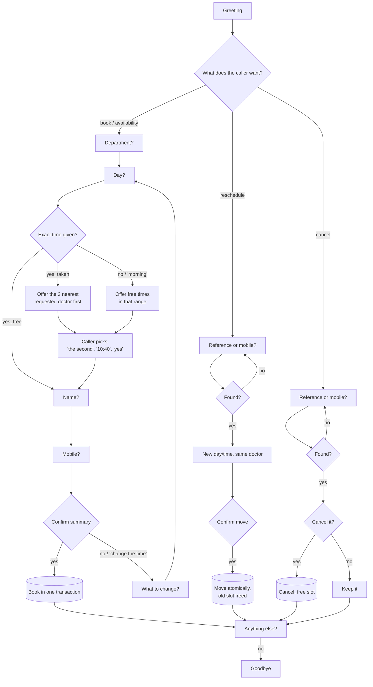
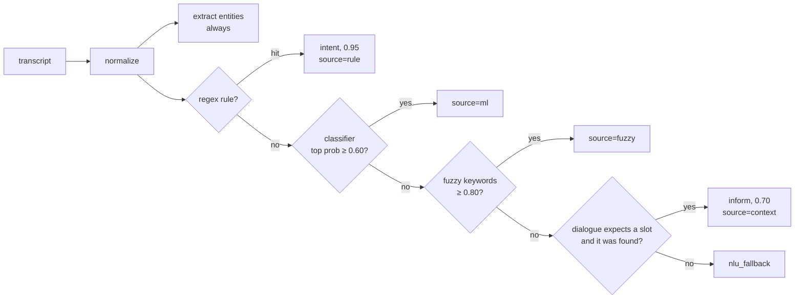
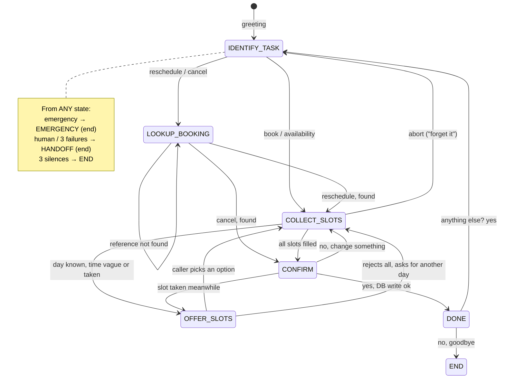

# Design

How the Shifa Care Clinic receptionist understands a caller and decides what to do. All of
it is our own code. There is no LLM, and no hosted AI API decides anything.

## 1. Use case

**Shifa Care Clinic** (fictional, Lahore) gets most of its calls about appointments. The
receptionist handles a whole call, start to finish:

| Job | What the agent does |
|---|---|
| **Book** | department → doctor (optional) → day → time → patient name → mobile → read back → book |
| **Reschedule** | find the booking (reference `SC-XXXX` or mobile) → new day/time, same doctor → confirm → move |
| **Cancel** | find the booking → read it back → confirm → cancel (the slot becomes free again) |
| **Check availability** | "Does cardiology have anything Thursday?" → offers times, which flow straight into booking |
| **Clinic info** | hours, address, departments, doctors in a department, without losing the booking in progress |
| **Emergency** | "chest pain", "can't breathe", "bleeding heavily" → tells the caller to call 1122 or go to an emergency department, and ends the call |
| **Hand-off** | "can I talk to a person?", or 3 misunderstood turns in a row → transfer to reception (simulated) |

**The clinic's rules:**
- Open Monday–Friday 9:00–17:00, with lunch 13:00–14:00.
- Saturday 9:00–13:00; closed on Sunday.
- Appointments are 20-minute slots, bookable up to 30 days ahead.
- 7 departments, 2 invented doctors each.
- About 30% of slots are pre-booked by fake patients, so "that slot is taken" happens naturally.

### Call flows



## 2. One turn, end to end

```
audio (webm/ogg/wav) ──► Whisper STT ──► NLU ──► Dialogue manager ──► Piper TTS ──► audio + text
                         (or JSON text)  │          │  ▲
                                         │          ▼  │
                                         │        SQLite (repository)
                                         └──► everything is returned to the UI's Brain panel
```

`ConversationService.turn()` runs these steps and times each one (`timings_ms`). The response
contains the transcript, the full NLU result, the decision (state, action, frame snapshot,
end_call) and the reply, so the web client can show *what it decided and why*.

## 3. NLU: what did the caller mean?



### 3.1 Normalize

Speech-to-text output is lowercased and Unicode-cleaned, and fillers (um, uh, hmm) are removed.
Number words become digits ("half past three P.M." → "3:30 pm", "quarter to four" → "3:45").
The **same function is applied to the training data**, so the rules, the classifier and the
entity extractors all see text in the same shape.

### 3.2 Fusion order and thresholds, and why

| Step | Fires when | Confidence | Why it's here |
|---|---|---|---|
| **Rules** | high-precision regex matches | 0.95 | Some intents must never be missed or guessed: *emergency*, *human agent*, *repeat*, *abort*, *goodbye*. Short answers (yes/no/hi/thanks) must match the **whole** utterance, so "no" never fires inside "know", "now" or "no, make it Friday". |
| **Classifier** | top probability ≥ **0.60** | model probability | Handles the open-ended phrasing rules can't list. Below 0.60 on 20 classes the model is usually split between two intents, and a wrong guess costs more than a clarifying question. |
| **Fuzzy keywords** | RapidFuzz score ≥ **0.80** against intent keyword phrases | score | Catches misheard or misspelled keywords when the classifier is unsure. For example, a bare "apointment" is classified `book_appointment` via fuzzy. |
| **Context boost** | the dialogue asked for a slot and an entity of that kind was found | 0.70 | After "What's the patient's name?", the answer "Ayesha Khan" is an answer, whatever the classifier thinks of two bare words. |
| **Fallback** | none of the above | — | The dialogue manager asks again; after 3 misunderstood turns in a row it hands off. |

The top-3 classifier alternatives are always returned, so the UI shows how close a call was.

### 3.3 The classifier

- **Model:** TF-IDF features (word 1–2-grams plus character 2–4-grams within word boundaries)
  feeding LogisticRegression (`C=10`, balanced class weights).
- **Training data:** 20 intents, **1,751 hand-written examples** in
  `backend/app/nlu/data/intents.yaml`. They include STT-style typos and Pakistani English and
  Roman-Urdu phrasing ("appointment chahiye", "theek hai").
- **Why character n-grams:** they make the model robust to misheard words.
- **Why `C=10`:** with the default regularisation, probabilities were spread too thinly to clear
  the 0.60 threshold.
- **Size:** weights are stored as float32. The model is about 560 KB and committed.

**Entity placeholders (delexicalization).** Before classification, entity values are replaced
by placeholder words:

```
"book cardiology on monday at 3"  →  "book somedepartment on somedate at sometime"
```

Placeholders: `somedate`, `sometime`, `timeofday`, `somedepartment`, `somedoctor`,
`phonenumber` and `bookingref`.

Without this, the classifier memorised department names and dates instead of learning the
sentence pattern: "dermatology" and "cardiology" looked like different features. This was the
single biggest accuracy gain (the `inform` F1 went from 0.70 to 0.82).

### 3.4 Entities (always extracted, whatever the intent)

| Entity | How |
|---|---|
| date | Our own patterns first, then dateparser: "today/tomorrow/day after", "next Monday", "this Friday", "the 5th", "5th of March", "12/3". Dates are resolved in the clinic's timezone and **always prefer the future**: "the 5th" means the next 5th to come. Two dateparser bugs are worked around: "next monday" returns None, and "the 5th" returns a past date. |
| time | regex: "3 pm", "3:30", "half past 3", "noon", "quarter to 4". A bare number only counts as a time when the agent just asked for one, so "go to 2 doctors" isn't 2 PM. |
| time_of_day | lexicon ranges: morning 09:00–13:00, afternoon / after lunch 14:00–17:00, early/late morning, plus Urdu words (subah, dopahar). |
| department | Exact synonyms first ("heart doctor", "skin specialist", "bachon ka doctor"), then RapidFuzz ≥ 85 for STT splits like "cardio logy". Symptoms are a weaker hint (×0.9): "fever" → General Medicine. Negated mentions are ignored ("not cardiology"). |
| unknown_department | "dentist", "eye doctor", "psychiatrist"… so the agent can say *we don't offer that* and list what is offered. |
| doctor | Fuzzy match on doctor names: ≥ 80 after "dr / doctor", ≥ 85 after the weaker "with", ≥ 90 for full names. "my name is Bilal Aslam" is a patient name, not the doctor of the same name. |
| patient_name | after "my name is / this is / I'm", or a bare name when the agent just asked for one |
| phone | Pakistani mobiles: `03XX XXXXXXX`, `+92 3XX…`, spaced or not |
| booking_ref | `SC-` + 4 characters from an alphabet without 0/O/1/I (so they survive being read aloud), also "S C 4 F 7 K". It does **not** match words like "screen" or "school". |

### 3.5 Metrics

From `backend/reports/nlu_metrics.json` (`python -m app.nlu.train`): 1,751 utterances,
20 intents.

| | Accuracy | Macro F1 |
|---|---|---|
| Held-out 20% split | **0.900** | 0.908 |
| 5-fold cross-validation (every utterance predicted once) | **0.912 ± 0.010** | 0.921 |

| Intent | Examples | F1 (held-out) | F1 (CV) |
|---|---|---|---|
| abort | 76 | 0.889 | 0.895 |
| affirm | 98 | 0.872 | 0.938 |
| book_appointment | 89 | 0.872 | 0.904 |
| cancel_appointment | 50 | 0.947 | 0.940 |
| change_request | 79 | 0.933 | 0.928 |
| check_availability | 90 | 0.882 | 0.912 |
| clinic_hours | 73 | 0.897 | 0.889 |
| clinic_location | 75 | 0.867 | 0.933 |
| deny | 70 | 0.880 | 0.903 |
| emergency | 70 | 0.966 | 0.957 |
| goodbye | 70 | 0.933 | 0.956 |
| greet | 66 | 0.923 | 0.955 |
| human_agent | 70 | 1.000 | 0.966 |
| inform | 143 | 0.931 | 0.883 |
| list_departments | 99 | 0.930 | 0.885 |
| list_doctors | 80 | 0.909 | 0.890 |
| out_of_scope | 262 | **0.838** | 0.864 |
| repeat | 55 | 0.909 | 0.944 |
| reschedule_appointment | 70 | **0.828** | 0.915 |
| thank_you | 66 | 0.963 | 0.970 |

**How to read this:**
- With only 10–50 test examples per intent, one error moves an intent's held-out F1 by
  0.03–0.10. The cross-validation column is the more stable estimate, and **every intent is
  at or above 0.86 there**.
- Two intents are just under the 0.85 target on the single held-out split; they are reported
  as they are, not tuned to the number.
- These are **classifier-only** numbers. In the running system, rules catch the intents where
  mistakes are expensive (emergency, yes/no, repeat, human, goodbye, abort) before the
  classifier is consulted, and the context boost resolves most slot answers.

## 4. Dialogue manager: what to do next?

One **frame** per call holds:
- the task (book / reschedule / cancel);
- the slots (department, doctor, date, time or time of day, patient name, phone, booking ref);
- the offered slots, the chosen slot and the existing appointment;
- the last prompt, the slot the agent expects next, and counters for failures and silences.



**Rules applied every turn, in order:**
1. **Emergency** → emergency advice, end the call. This beats everything, even mid-booking.
2. **Human agent**, or the 3rd misunderstood turn in a row → hand off.
3. **Abort** ("forget it", "never mind") → drop the task, ask how else to help.
4. **Repeat** ("what?", "say that again") → resend the last prompt.
5. **Picking an offered slot:**
   - "the first one", "option 2", "10:40", or "yes" when only one slot was offered;
   - "the 2nd" means option 2 here, not a date;
   - when several slots were offered, "yes" gets "which one?".
6. **Clinic questions** are answered, then the agent returns to where it was (the
   confirmation is asked again).
7. **Merge entities into the frame at any state.**
   - A changed value is acknowledged ("Sure, I've changed the date to Friday 11 January"),
     and anything depending on it (offered or chosen slot) is recomputed.
   - Only slot-carrying intents may write to the frame. Otherwise the Saturday in "what time
     do you close on Saturday?" would become the booking date.
8. **Validate** with the clinic's policies (past date, Sunday, more than 30 days ahead,
   before opening, after closing, lunch, a time already passed today), then ask for the next
   missing slot, offer slots, or read back for confirmation.
9. **At confirmation:**
   - "yes" writes to the database;
   - "no" asks "what would you like to change?";
   - anything else gets "sorry, I just need a yes or a no".

**Replies:**
- Every sentence lives in `dialogue/responses.py`, with 1–3 phrasings each.
- A phrasing is picked by a seeded random generator, so calls feel less robotic but tests stay
  deterministic.
- Replies are plain text written for speech: times as "9:20 AM", phones grouped as
  "0333 1234567", references spelled "S, C, 4, F, 7, K".

## 5. Messy callers: every case and how it's handled

Each case has a conversation test in `backend/tests/test_dialogue_edge_cases.py` (named in the
right column), driven through the real NLU and a seeded database.

| Messy caller | What happens | Test |
|---|---|---|
| Changes a slot mid-flow: "actually make it Friday", "no wait, 4pm instead", a different department after slots were offered | Entities merge at any state; the change is acknowledged, dependent choices are recomputed | `test_changes_date_mid_flow`, `test_changes_time_mid_flow`, `test_changes_department_after_slot_was_offered` |
| Changes details at the final confirmation | Same merge; the summary is read back again | `test_changes_details_at_confirmation` |
| Several slots in one sentence: "Book me with a dermatologist next Monday at 10 am" | All four are extracted at once; only what's missing is asked | `test_several_slots_in_one_sentence`, `test_name_and_phone_in_one_sentence` |
| Requested slot is taken | "Sorry, 10 AM isn't available. The nearest free times are…": the 3 nearest, the requested doctor's first | `test_taken_slot_offers_three_nearest`, `test_taken_slot_offers_requested_doctor_first` |
| Picks from the offer in different ways | "the second", "10:40", "yes" (asks which if several), "none of those" → asks for another day | `test_pick_offered_slot_by_ordinal`, `..._by_time`, `test_the_2nd_means_option_two_not_a_date`, `test_yes_to_several_offers_asks_which`, `test_rejects_all_offers` |
| Past date, Sunday, more than 30 days ahead | Explains the rule and asks for another day | `test_invalid_dates_are_rejected`, `test_recovers_after_invalid_date` |
| Before opening, after closing, lunch break, a time already passed today | Explains (with that day's closing time) and asks again | `test_times_outside_opening_hours_are_rejected`, `test_time_already_passed_today` |
| Vague time: "morning", "afternoon", "after lunch" | Mapped to a range; free slots in it are offered, or the nearest if it's full | `test_vague_time_offers_slots_in_that_range`, `test_vague_time_when_that_part_of_day_is_full` |
| Ambiguous date: "the 5th" | The next upcoming 5th | `test_the_5th_is_the_next_upcoming_5th` |
| Misheard or colloquial department: "cardio logy", "skin doctor", "heart doctor" | Synonyms + fuzzy matching | `test_misheard_or_colloquial_department` |
| Unknown department: "dentist" | "Sorry, we don't have a dentist", then the real list | `test_unknown_department_lists_what_is_offered` |
| Yes / no / something unrelated at confirmation | yes → book; no → "what would you like to change?"; unrelated → asks for yes or no; a clinic question → answered, then confirmation repeated | `test_no_at_confirmation_then_change_the_time`, `test_unrelated_answer_at_confirmation`, `test_question_at_confirmation_is_answered_then_confirmation_repeated` |
| "Repeat that" / "what?" | Last prompt again, word for word | `test_repeat_resends_last_prompt` |
| Silence / empty transcript | "Are you still there?" + last prompt; after 3 in a row, a polite goodbye; the counter resets when they speak | `test_silence_reprompts_then_ends_after_three`, `test_silence_counter_resets_when_caller_speaks` |
| Whisper inventing words on silence ("Thank you for watching. Bye now.") | Segments Whisper marks as non-speech, and known subtitle phrases, are dropped, so silence stays silence and doesn't end the call | `test_whisper_drops_hallucinated_segments` (test_speech.py) |
| Out of scope: "what's the weather?" | "I can only help with appointments and clinic information", then back to the flow | `test_out_of_scope_steers_back` |
| Cancels mid-booking: "forget it", "never mind" | Task dropped, nothing written, "how else can I help?" | `test_abort_mid_booking` |
| Invalid phone number | Asks again with the format: "11 digits starting with 03, for example 0300 1234567" | `test_invalid_phone_asks_again_with_format_hint` |
| Booking reference not found | Says so and offers lookup by mobile; already-cancelled bookings can't be cancelled again | `test_reference_not_found_on_cancel`, `test_reference_not_found_on_reschedule_then_found_by_phone`, `test_cancelled_booking_cannot_be_cancelled_again` |
| Double-booking race: someone takes the slot between the offer and "yes" | The DB rejects the second booking; the agent apologises and offers the nearest free slots, keeping the name and phone | `test_slot_taken_between_offer_and_confirm` |
| Emergency words at any point | Overrides every state, ends the call with 1122 advice | `test_emergency_at_any_point` |
| Asks for a person, or isn't understood 3 times in a row | Hand-off; the counter resets after an understood turn | `test_human_agent_request`, `test_three_misunderstandings_in_a_row_hand_off`, `test_misunderstanding_counter_resets_after_an_understood_turn` |

## 6. Design decisions

- **Hybrid NLU instead of one model.**
  - Rules give certainty where mistakes are costly (emergency, yes/no) and are explainable.
  - The classifier covers open phrasing; fuzzy matching covers STT typos; dialogue context
    covers short answers.
  - Every decision records its `source`, so the Brain panel can show why.
- **A frame-based state machine for the dialogue.**
  - Deterministic and fully testable.
  - "Merge entities at any state" is what makes mid-call changes work without special cases
    for each one.
- **Double-booking is prevented by the database, not just the code.**
  - A slot is claimed with a conditional `UPDATE … WHERE is_booked = false`; only one caller
    can flip it.
  - Appointments have a **partial unique index** on `slot_id` for *booked* rows only. A plain
    unique column would make a cancelled slot impossible to book again.
  - Two connections racing for the same slot cannot both succeed (tested). The loser gets
    `SlotUnavailableError`, and the agent re-offers.
- **Local speech models.**
  - faster-whisper and Piper run on CPU: no API keys, no cost, no audio leaving the machine.
    Audio is decoded with PyAV, which handles the browser's webm/Opus directly.
  - Whisper gets an initial prompt listing the department and doctor names, so it spells them
    right.
  - `vad_filter` drops silence before recognition.
  - Speech models load once at startup, never per request. Whisper loads from local files only,
    so startup never downloads anything.
- **Fallbacks at every layer.**
  - If the Whisper model is missing, the backend runs text-only; audio turns get 503 "send text
    instead".
  - If the Piper voice is missing or crashes, replies have no audio and the browser speaks them
    with `speechSynthesis`.
  - If the microphone is denied, the UI shows a clear error and the text box works.
  - None of these crash the server.
- **Clinic-local naive datetimes** (Asia/Karachi) throughout, so "today", opening hours and the
  database all agree.
- **Testable by construction.**
  - The dialogue manager gets an injected repository and clock.
  - The conversation service gets injected speech engines.
  - Tests run whole calls against an in-memory database at a pinned "now", with fake speech, in
    about 20 seconds.
  - One slow test does a real Piper → Whisper round trip.

## 7. Known limitations and next steps

- **English only** (the Whisper model is `base.en`). Common Roman-Urdu words are understood in
  text, but spoken Urdu is not.
- **Sessions are in memory.** A restart drops calls in progress; multiple workers would need
  Redis or the database.
- **"Next Monday" means the coming Monday.** Some callers mean the Monday of next week.
- **Long spoken offers:** offering slots on different days reads out the date and doctor for each.
- **Simulated hand-off:** there's no real transfer.
- **No caller authentication:** anyone with a reference or a mobile number can cancel that
  booking. A real deployment would verify by SMS code.
- **Data-limited classifier:** two intents are under 0.85 on the held-out split. More real call
  transcripts would help more than tuning.
- **Push-to-talk, not full duplex:** no barge-in while the agent is speaking.
- **Next steps:**
  - Structured logging with masked phone numbers.
  - Request size limits.
  - docker-compose.
  - Streaming STT for lower latency.
  - Reminders by SMS.
