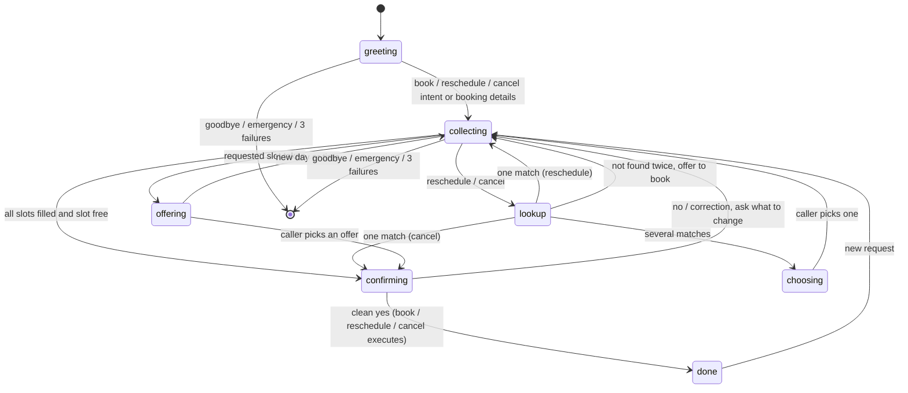

# Design

## Use case

A receptionist line for a small fictional clinic (Maple Street Clinic, US locale, 911 for emergencies): **book, reschedule and cancel** appointments. Four fake doctors (two GPs, dermatology, pediatrics), Mon-Fri 09:00-17:00, 30-minute slots. The brain is our own deterministic code; no LLM is in the decision path.

## Pipeline

```
text -> nlu.parse -> Parsed(intent, entities) -> dialogue.handle_turn(state, ...) -> (new state, action) -> responses.render -> reply
```

- **NLU** (`nlu.py`, `parsing.py`): keyword/regex rules, stdlib date/time parsing, `difflib` fuzzy doctor match.
  - Intent priority: emergency > goodbye > repeat > help > cancel / reschedule / book > affirm / deny > unknown.
  - Entities: name, DOB, doctor, specialty (synonyms like "skin" -> dermatology), date, time (also "half past three", "noon", morning/afternoon), booking ref `CLN-XXXX`.
  - **DOB vs date:** a past year, or a date while the brain is asking for the DOB, is a DOB; otherwise a date is an appointment date. Ordinal words ("the second one") are choices, not dates.
  - A bare answer is a name only when the name is being asked for; "I'm X" is a name only in that case too.
- **Dialogue** (`dialogue.py`): explicit state in `CallState` (JSON, persisted in SQLite per call). Any entity in any utterance fills its slot, so one sentence can fill four slots; the first missing slot decides the next question. Booking needs name, DOB, doctor or specialty, date, time.
- **Responses** (`responses.py`): templates, with the last reply stored for "repeat".

## State machine



Actions shown in the Brain panel include `ask_*`, `confirm_booking`, `confirm_reschedule`, `confirm_cancel`, `offer_slots`, `choose_appointment`, `booked`, `rescheduled`, `cancelled`, `explain_slot_problem`, `unknown_doctor`, `not_found`, `reprompt`, `repeat`, `help`, `emergency`, `goodbye`, `give_up`.

## Confirm safety

Nothing is written without a read-back and a **clean yes**. A yes counts only if there is no negation anywhere ("no", "not", "don't", "never") and no correction word ("but", "instead", "actually", "make it") alongside it. A flow word with a plain yes ("yes, book it") confirms; "no please don't book it" never does. If the caller says something new that differs from what was read back, it is merged and the read-back is repeated.

## Messy callers

| Case | Handling | Test |
|---|---|---|
| Several details in one sentence | All slots filled at once | `test_happy_booking_one_sentence`, `test_multi_entity` |
| Changes a detail midway | New value overwrites, slot re-checked, read-back repeats | `test_change_time_midway`, `test_no_with_correction_rereads` |
| "No" at read-back | Asks what to change | `test_deny_at_readback` |
| "Yes, but make it 3:30" | Never executes; re-reads | `test_yes_with_correction_rereads` |
| "No please don't book it" | Never executes | `test_negated_please_never_books_or_cancels` |
| Slot already taken | Offers 3 nearest free slots, same doctor first | `test_slot_taken_offers_alternatives` |
| Picks an offer | By number or ordinal | `test_choice_by_number` |
| New day while offered slots | Re-searches that day | `test_new_day_while_offering` |
| Weekend or outside hours | Explains and re-asks | `test_weekend_and_closed` |
| Unknown doctor | Lists the available doctors | `test_unknown_doctor` |
| Unintelligible or silent | Reprompt; give up politely after 3 | `test_reprompt_then_give_up`, `test_no_progress_turns_give_up` |
| "Repeat that" | Replays the last reply | `test_repeat` |
| Asks for help | Explains and re-asks the current question | `test_help_reasks` |
| Switches intent (book to cancel) | Flow changes, slots kept where relevant | `test_switch_book_to_cancel`, `test_switch_cancel_to_reschedule_keeps_ref` |
| Booking not found | One retry, then offers to book | `test_not_found_then_offer_book` |
| Several bookings match | Lists up to 3, asks which | `test_cancel_multiple_matches` |
| Emergency phrase | "Call 911", call ends | `test_emergency`, `test_bleeding_is_emergency` |
| "I am bleeding heavily" at the name prompt | Still an emergency, not a name | `test_i_am_not_a_name` |
| Filler ("um", "uh") | Not taken as a name | `test_filler_is_not_a_name`, `test_fillers` |
| Spoken numbers and times ("3 30 pm") | Parsed correctly | `test_spaced_and_spoken_times` |
| Spoken DOB | Parsed | `test_spoken_dob` |
| Double-booking race | DB unique index, offers alternatives | `test_double_booking_raises` |
| Expired or unknown call | 404 | `test_expired_call_404`, `test_unknown_call_404` |

## Data model and double-booking guarantee

SQLite, two tables: `appointments(ref, patient_name, dob, doctor_id, start, status)` and `calls(id, state, updated_at)`. A partial unique index `one_booking_per_slot` on `(doctor_id, start) WHERE status='booked'` makes a double-booking impossible even under races; the insert fails and the brain offers alternatives. Cancelling frees the slot; rescheduling keeps the reference. A process-wide lock serialises turns.

## Why no LLM

The brief forbids it, and for a booking line determinism is a feature: the same words always give the same decision, every rule has a test, there is no per-call cost or latency, and no hallucinated bookings. The cost is brittleness on unusual phrasing, handled by the reprompt/give-up path.

## Known limitations

- NLU is English-only and rule-based; unusual phrasing falls through to a reprompt.
- "I'm X" counts as a name only when the name is being asked for.
- Phone numbers, reminders and auth are out of scope; one clinic only.
- A single-process lock around turns; SQLite is the shared store. Use per-call locks or Postgres for real throughput.
- Browser speech quality varies; voice needs Chrome or Edge.
- Known minor gaps: "not ok" can read as yes in isolation, "five past three" is unsupported, and a failure to save call state after a committed booking is only commented, not retried.
