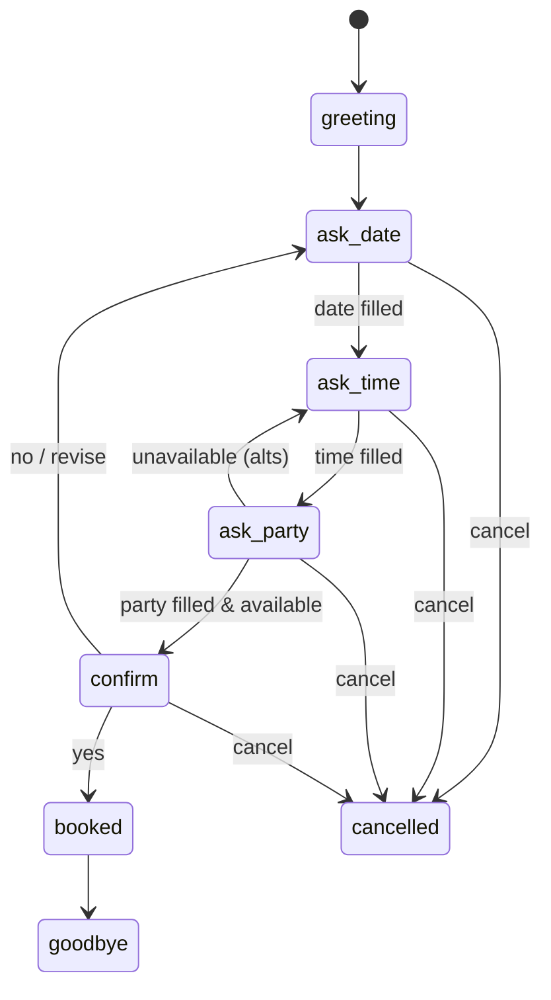

# Design — Harbor Lights booking brain

## Use case

Book a dinner table at **Harbor Lights Bistro** (made-up restaurant).

Happy path:

1. Greet the caller
2. Get a **date**
3. Get a **time** (half-hour slots, 5:00 PM – 9:00 PM)
4. Get **party size** (1–20)
5. Check fake tables against active SQLite bookings
6. Read back a short summary
7. On yes → save booking, show confirmation id + ticket; append a fake email/SMS line to a log file
8. Wrap up

Staff can open `#/admin`, type the demo password (shown on screen, default `admin`), then list / search / cancel / restore bookings, peek at stats, export CSV, and seed a few demo rows.

## Why the brain is not an LLM

The brief wants **your** code to pick intents, questions, and actions. A small state machine with explicit slots is:

- Easy to test (same input → same next state)
- Cheap (no tokens, no vendor)
- Easy to show in a UI — every turn returns a decision trace

If we had stuck GPT in the loop, the decision panel would be theater. Here the panel matches what the Python actually did.

## Architecture

```
Browser (React)
  ├─ Web Speech Recognition (STT)  ──┐
  ├─ Text box (always available)   ─┼─→  POST /api/turn  (rate-limited)
  ├─ Admin (#/admin)               ─┼─→  GET/DELETE/POST /api/admin/*
  ├─ Health poll                   ─┼─→  GET /api/health
  └─ speechSynthesis (TTS)  ←──────────  reply + decision + confirmation JSON

FastAPI (lifespan on startup)
  middleware      → request_id + latency log; CORS allow-list
  rate_limit.py   → sliding window in memory (IP + session)
  parser.py       → intent + slot values from raw text
  dialogue.py     → state changes + prompts
  availability.py → eight fake tables + SQLite (soft cancel / restore)
  notifications.py→ append-only fake email/SMS log
  db.py           → create tables on startup

Docker (optional)
  api  → uvicorn :8000  (volume for bookings.db)
  web  → nginx :80      (static build, /api proxied to api)
```

## States



People often dump everything in one line (`Friday at 8 for 2`). That’s fine. The engine fills what it can and asks for the next missing piece in order: date → time → party → confirm.

## One turn, step by step

1. Parse text with regex / keywords / `python-dateutil`.
2. Map to an intent: `provide_info`, `confirm`, `deny`, `cancel`, `change_*`, `out_of_scope`, `unclear`, …
3. Apply extracted slots (including mid-flow changes).
4. Reject times outside dinner hours.
5. If all slots are present → check availability; if full, clear time and offer up to three nearby opens.
6. On confirm + available → INSERT an active booking, write the fake notification line, return a `confirmation` ticket.
7. Build a `DecisionTrace` (state before/after, intent, slots touched, action, notes) for the UI.

## Persistence and admin

- DB file: `backend/data/bookings.db` (override with `BOOKINGS_DB`).
- Soft cancel sets `status=cancelled` (frees the table). Restore flips back only if that table is still free.
- Notifications: `backend/data/notifications.log` — never sends real email or SMS.
- Admin header: `X-Admin-Password` must match `ADMIN_PASSWORD` (default `admin`). Good enough for a take-home demo, not for a real restaurant staff portal.

## Local hardening already in the tree

See the README checklist. Short version: lifespan, rate limits, structured logs, health+DB, ticket UI, admin search/stats/CSV/seed, CORS lock, gitignore for db/logs, Docker, connection banner, a11y on mic/send.

## Still cloud-only (not in this free build)

Twilio phone numbers, real SMS/email, streaming STT, Postgres, Redis across many API boxes, OIDC staff login, public HTTPS/CDN, Sentry. GitHub Actions: fine on **your** fork; we did not commit workflows here.

## Messy callers

| Situation | What we do |
| --- | --- |
| Changes time/date/size mid-flow | Update that slot; ask for whatever is still missing |
| Unclear utterance | Stay put; ask again with a short example |
| Slot full | Offer up to 3 nearby open times |
| “No” at confirm | Invite a revision |
| Cancel / goodbye | Land in `cancelled` / `goodbye` |
| Weather, jokes, etc. | Polite nudge back to booking |
| “11 pm” | Reject; remind dinner hours |

## Speech

STT/TTS never leave the browser, so the API never sees audio and needs no keys. Recognition is happiest in Chrome/Edge. Typing always works.

## Data

Eight fake tables (seats 2–10). Active bookings hold a table; cancelled ones do not. Seed demo drops a few yesterday/today rows so admin isn’t empty on first open.
