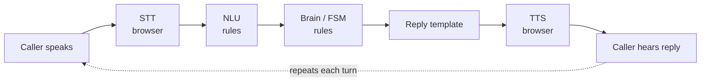
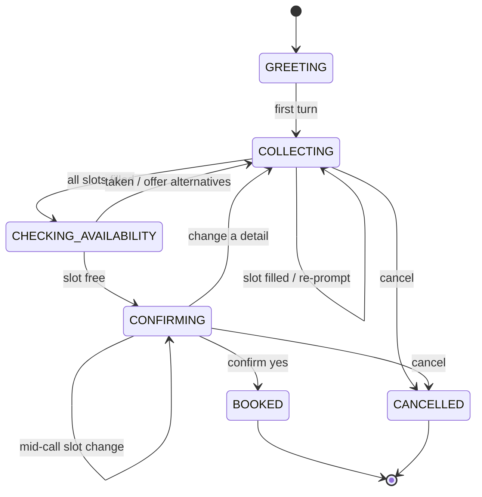

# Decision-Logic Design

## 1. Use case

Sehat Koh Medical Center handles clinic appointment booking, a job normally done by phone.
The assistant collects the visit reason, date, time, patient name, and phone number.
It checks availability, offers alternatives when needed, confirms the final details, books the slot, and says goodbye.

## 2. Why rule-based is sufficient here

Booking has a small, fixed set of slots and a bounded goal. The required intelligence is bookkeeping:
track filled slots, ask for the first missing slot, validate values, check availability, and confirm.
These operations require deterministic correctness, not open-ended generation, so no LLM is used for any decision.
The brain is the project's own Python code, satisfying the core rule that decision logic is implemented directly.

## 3. Architecture / pipeline

```text
Speech → STT (browser) → NLU (rules) → brain/FSM (rules) → reply template → TTS (browser)
```

- **Browser STT:** The React client uses `SpeechRecognition` / `webkitSpeechRecognition` to turn speech into text.
- **`brain/nlu.py`:** `parse_text` maps text to an intent and detected slots using regular expressions, `dateparser`, and `search_dates`. It receives the current state and pending slot so parsing can be context-dependent.
- **`brain/state.py`:** The `Session` dataclass stores `current_state`, the slot dictionary, `pending_slot`, and whether a confirmation change field is awaited.
- **`brain/brain.py`:** `handle_turn` copies the session, applies intent and slot updates, advances the finite-state machine, validates the patient name, and selects reply templates.
- **`brain/availability.py`:** Provides the deterministic fake booking store, working-hours/30-minute-slot validation, taken-slot checks, nearest-free-slot search, and booking mutation.
- **Browser TTS:** The React client speaks the returned reply with `speechSynthesis`.

The brain is pure Python. The API in `api/main.py` only persists sessions in an in-memory dictionary and delegates each turn to `handle_turn`.



## 4. The state machine

- **`GREETING`:** The initial session state; the first usable turn moves it to `COLLECTING`.
- **`COLLECTING`:** Applies detected values, validates pending answers, and asks for the first missing required slot. When all slots are present, it enters `CHECKING_AVAILABILITY`.
- **`CHECKING_AVAILABILITY`:** A transient decision step that checks working hours and whether the requested slot is free. It moves to `CONFIRMING` for a free slot or back to `COLLECTING` with a time prompt and alternatives.
- **`CONFIRMING`:** Reads back all collected details. A confirmation intent books; a rejection or change request identifies a field to collect again.
- **`BOOKED`:** The terminal success state after `availability.book` accepts the requested slot.
- **`CANCELLED`:** The terminal cancellation state reached by a cancel/stop request from any flow.

The core collection loop is: find the first empty required slot in
`date`, `time`, `reason`, `patient_name`, `phone`, then ask the question mapped to that slot.





## 5. How the brain decides; the two key mechanisms

### Slot-filling driven by emptiness

`brain.py` defines the required-slot order and `_pending` returns the first slot whose value is absent.
Each turn applies detected values to the copied session; a `None` value removes a slot.
Therefore a multi-slot utterance such as “book a follow-up Thursday at 2pm” can fill reason, date, and time in one turn.
Date expressions are resolved by `dateparser.search_dates`; times, reasons, names, and phone numbers use regular expressions.
New values overwrite old values in the same slot dictionary. That is how a collection-time change works without a separate change-data structure or restart.

### Context-dependent interpretation (slot-directed parsing)

`parse_text` receives both `current_state` and `pending_slot`.
Confirmation words such as “yes”, “yeah”, “ok”, and “yep” become `confirm_yes`, and negative confirmation words become `confirm_no`, only when the state is `CONFIRMING`.
Outside confirmation, those words are not confirmation decisions and can be interpreted as slot answers or filler.
Loose extraction is enabled only for the relevant pending slot: a bare name is accepted only while `patient_name` is pending, a bare phone number only while `phone` is pending, and flexible bare time formats only while `time` is pending.
This prevents filler such as “whatever works” from becoming a name and prevents “no” from having two conflicting meanings in different parts of the flow.
At confirmation, detected slot values are applied before `confirm_no` is handled, so “actually make it 3pm not 2” changes the time and re-runs availability instead of booking the old time.

## 6. Edge-case table

| Scenario | Example input | How the brain handles it | Why it matters |
|---|---|---|---|
| Multi-slot utterance | “book a follow-up Thursday at 2pm” | Fills reason + date + time in one turn. | Natural speech is not one-fact-at-a-time. |
| Mid-call change (collection) | “actually make it Friday” | Overwrites the date, keeps other slots, and continues without restarting. | Callers change their mind. |
| Mid-call change (at confirmation) | “actually make it 3pm not 2” | Slot change takes precedence over `confirm_no`; updates time and re-confirms after availability checking. | The old time must never be booked. |
| Vague date | “sometime next week” | Does not produce a concrete date and re-prompts for one. | An ambiguous date cannot be booked. |
| Ambiguous time | “at 7” | Marks the hour ambiguous, asks for AM or PM, and leaves the time empty. | 7 AM versus 7 PM is a real booking error. |
| Filler as slot answer | “whatever works” when asked name | Filler-only input is not stored and the assistant re-prompts. | Prevents data poisoning. |
| Change-phrase mistaken for name | “actually make it Friday” at name step | The change phrase is excluded from bare-name capture; the date is updated instead. | Prevents a patient named “actually make it Friday.” |
| Invalid name/phone | “02” as phone | The phone fails the minimum digit check and the assistant re-prompts. | Prevents unreachable or garbage records. |
| Taken slot | Requested time unavailable | `nearest_free` returns the two closest free times; the caller selects one. | Prevents double-booking. |
| Outside working hours | “7am” (clinic opens 9) | Returns a distinct “we’re open 9am to 5pm” message rather than calling the time taken. | Keeps the explanation accurate. |
| Varied confirmation | “yeah”, “ok”, “yep” | All match the confirmation-yes rules in `CONFIRMING`. | Callers do not use exactly one confirmation phrase. |
| Cancel mid-flow | “cancel” | Immediately moves to `CANCELLED`, returns a clean goodbye, and does not crash. | Callers can abandon a request safely. |
| Empty/garbage | “” or “asdf” | Returns a “didn’t catch that” prompt and leaves state unchanged. | Speech recognition can produce empty or noisy text. |

## 7. Testing

The suite contains 56 pytest cases, and each test is named for the scenario it guards.
Run it from the project root:

```bash
python -m pytest -v
```

Adversarial manual testing found several parsing and confirmation bugs; those cases were then locked as regression tests in `tests/test_scenarios.py`, `tests/test_brain.py`, and `tests/test_nlu.py`.

## 8. Design decisions & trade-offs

- Slots stay in machine format for logic: ISO dates and 24-hour times. Reply helpers convert them to speech-friendly forms such as “Thursday, October 29” and “2 PM”.
- Sessions and bookings use in-memory stores. This is sufficient for an assessment; a deployment needs Redis or a database.

## 9. What a production version would add

- Persistent database storage for sessions, appointments, audit history, and availability.
- Authentication and authorization for patients, staff, and administrative actions.
- Real EHR/calendar integration with transactional booking and concurrent-booking protection.
- Telephony integration for inbound calls and server-side speech providers.
