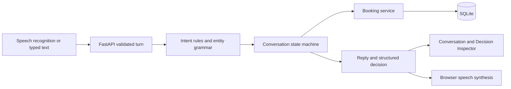

# VoxDesk design

## Use case and architecture

Northline Studio is a fictional single-chair barbershop. Appointment reception is bounded and realistic: identify a service, collect a day/time/name, check a calendar, request confirmation and persist the result. It exposes meaningful cases—duration overlaps, corrections, stale availability, ambiguous times, retries and cancellation—without external credentials or real customer records.

Next.js owns the interface and browser audio. FastAPI/Pydantic validates HTTP contracts. `brain/language.py` recognizes intent and entities; `brain/engine.py` transitions structured context through a small `BookingPort` interface. `bookings.py` owns calendar rules/operations; `db.py` owns models/transactions. An injected clock and IANA timezone make behavior reproducible.

The backend is authoritative. State labels, extracted values, availability, references, outcomes and explanations come from its responses. UI network/audio activity indicates local status, not invented engine decisions. `last_committed_action` distinguishes a receipt from merely retrieving an existing appointment or ending a conversation.

## Custom deterministic brain

**AI tools helped develop this software; they do not run the receptionist.** There are no LLM clients, prompts, model calls, embeddings or remote intent engines. Python rules and static reply templates determine actions. Browser services handle audio transcription/synthesis only, as permitted by the assessment.

### Intent rules and priority

Text is normalized for case, whitespace, apostrophes and AM/PM punctuation. Ordered rules handle:

1. Exact end/repeat/denial/confirmation phrases.
2. Negated action commands.
3. Business questions, including informational “How do I cancel a booking?”
4. Explicit cancellation, rescheduling, availability and creation patterns. Conflicting requested actions require clarification.
5. Contextual corrections: “actually”, “make it”, “instead”, “I meant”.
6. Active-task details or unknown-request recovery.

Confirmation uses a full-utterance allowlist. “Yes, but make it Friday” cannot commit. “Read a book” is not a booking command. Denial discards pending changes. Rule matches have no confidence percentages because they are not calibrated probabilities.

### Entity extraction

Service aliases map to three catalog IDs. Haircut plus beard means the combination; alternatives and known unsupported services are clarified. Dates support relative days, weekdays, next weekday and validated ISO dates. Bare weekday includes today; next weekday is strictly future. Yesterday is extracted and rejected by business validation. A 180-day horizon keeps the calendar bounded.

Time parsing supports AM/PM, unambiguous 24-hour values, noon/midnight, word hours, “five thirty”, “half past four” and “quarter past four”. Bare 1–12 hours require AM/PM rather than assuming the likely studio time. A same-utterance day period can disambiguate a time. Period-only availability is supported; booking requires an exact start. Multiple distinct values, invalid hours/minutes, invalid dates and numeric slash dates trigger field-specific clarification and clear the affected old value.

Names are collected in a name context or through a name-introduction phrase, as a separate answer. Control/request words and other extracted details cannot become names. References match `NL-` plus eight alphanumeric characters; generated references use random synthetic hexadecimal values. Names are never used to guess a booking. This is a documented small English grammar, not unrestricted NLU.

### State machine and context

`SessionView` stores workflow intent, state, entities, missing information, proposed action, last committed action, bounded history, last decision, clarification count, target booking version, actual appointment/slots and monotonic revision. Context is copied before each turn and persisted as JSON. No shared global conversation variables exist.

| Situation | Transition / behavior |
| --- | --- |
| Idle/completed + supported request | Initialize workflow and collect supplied entities |
| Missing service/date/time | `COLLECTING_DETAILS` or `RESCHEDULING`, ask specific question |
| Existing operation without reference | `IDENTIFYING_EXISTING_BOOKING` |
| Reference found | Load authoritative appointment and version |
| Slot valid, name missing | Ask name, without reserving |
| Complete valid proposal | `AWAITING_CONFIRMATION` |
| Explicit confirmation | Revalidate, write, then `BOOKING_COMPLETE` or `COMPLETED` |
| Commit rejected | Clear proposal and request corrected information |
| Denial/negated command | Discard pending proposal, `IDLE` |
| Business question/repeat | Respond and preserve context |
| Restart | Reset proposal; retain persisted appointments |
| End | `COMPLETED`, discard pending authorization |

Checks run synchronously; the frontend receives the result rather than a transient checking snapshot. Cancellation uses the same explicit confirmation gate. Enum labels reserved for checking/cancelling do not imply background tasks.

### Corrections and uncertainty

A correction overrides only its supplied fields. “Actually make it 5 PM” retains service/date/name, clears authorization and checks availability again. “No, I meant Friday” is a date correction, not a denial. Ambiguous corrections clear the old field; unspecified corrections invalidate authorization and ask what should change. Negated action commands always discard the pending action.

Ordinary request forms such as “make a booking”, “I want you to make a haircut”, and polite lead-ins are matched by explicit grammar rules. A directional correction (“change from 4 PM to 5 PM”) extracts its destination; two alternatives without that directional grammar still need clarification. Name answers strip a bounded set of leading fillers (“and”, “um”, “it's”) and trailing courtesy words, with the interpreted name shown in the confirmation summary.

`last_booking_reference` remembers the most recently verified appointment within a session, separately from the pending proposal. Reschedule/cancel can reuse it; explicit references take priority and no other session is searched. Old persisted sessions can recover it from their own assistant-generated booking receipt, followed by database lookup; user-supplied receipt quotations are not trusted as session memory. A time-only reschedule keeps the date, and a date-only reschedule keeps the time, except when that field was explicitly rejected or is awaiting clarification. Stale versions still require fresh review. Draft-level “move it” and “cancel it” cannot target an older confirmed booking.

Availability and creation share collected details. Accepting an availability offer enters the create workflow and never directly commits a booking. Unknown speech after an availability result gets a targeted booking-offer clarification; no fuzzy match turns a transcription like “poke it” into a write. Status/reference-help questions have dedicated rules and cannot authorize writes. Business replies select only requested catalog topics to keep spoken answers brief.

Unknown input cannot become a write. The engine asks the outstanding question or explains supported tasks. Every third consecutive clarification offers restart/end guidance. Business interruptions preserve the workflow. The frontend exposes both newly extracted entities in the raw trace and accumulated entities in collected details. Session revisions reject unordered concurrent utterances rather than choosing their order silently.

## Booking persistence and time

Three SQLAlchemy tables store appointments, conversations and turn receipts. Starts/ends are UTC epoch seconds; API timestamps include the business offset and IANA zone. Relative dates use business time. DST gaps/folds are rejected rather than guessed. Monday–Saturday 10:00–19:00 must contain the full service; Sunday, past starts and out-of-horizon dates are rejected. Availability suggestions use ten-minute increments; exact valid starts may use other minutes.

Intervals are half-open: `existing.start < proposed.end AND existing.end > proposed.start`. Adjacent appointments can touch. Cancelled rows preserve a retrieval record and release their interval.

Every mutating turn acquires **`BEGIN IMMEDIATE` before reading session/appointment state**. Conflict validation, appointment mutation, context update and idempotency receipt commit together. SQLite's file writer lock covers separate connection pools/server workers. Concurrent confirmations cannot both silently book an overlap. A losing request sees the winner's write. The API returns only after commit; errors roll everything back. Busy writers wait at most ten seconds. See [SQLite transactions](https://www.sqlite.org/lang_transaction.html) and [isolation](https://www.sqlite.org/isolation.html).

Each turn includes `request_id` and `expected_revision`. A unique session/request receipt stores its exact historical response. Identical retries replay it; changed content using the same ID returns 409. The frontend persists pending requests in tab storage until the outcome is known, including across reloads. A dropped response after a real commit therefore cannot cause another booking.

Reschedule/cancel carries the version loaded at proposal time. Commit rejects an appointment changed by another session and asks for a fresh review. Started appointments cannot be changed. Rescheduling validates before changing the original row; failure preserves the old booking. All writes go through the conversation confirmation gate.

## Voice and interface

Recognition is feature-detected (`SpeechRecognition`/`webkitSpeechRecognition`); final transcripts become turns, interim text is feedback only. Permission denial, missing microphone, no speech, network errors and unsupported browsers offer typed recovery. Recognition aborts before synthesis and typed sends; the mic is disabled during speech. There is no automatic listening restart. Cleanup stops both APIs. Muting and stopping audio are explicit controls.

The UI uses system fonts and code-native graphics, accessible names/focus, reduced-motion support, live conversation output, alerts and responsive layouts. The inspector displays actual rule/explanation/state/next action; it does not simulate traces. Browser support is limited; [MDN documents platform constraints](https://developer.mozilla.org/en-US/docs/Web/API/SpeechRecognition).

## Validation, tradeoffs and limitations

Fixed-clock Pytest tests exercise intent/extraction, actual state transitions, corrections, missing details, confirmation, unknown input, boundaries, conflicts, rescheduling/cancellation, idempotency, revisions, session isolation and persistence after restart. Separate app instances test concurrent writers. A simulated commit error tests rollback of booking, context and receipt.

Playwright exercises the production UI with a disposable real backend, including a lost response after commit and mobile overflow. Only speech APIs are mocked in adapter tests. Mocks cannot prove actual microphone permission, recognition accuracy or audible output. Those remain device checks in `docs/DEMO_CHECKLIST.md`; actual executed results are recorded in `docs/PROGRESS.md`.

SQLite serialization favors correctness and setup simplicity over throughput. Session JSON avoids event-sourcing complexity but receipts have no expiry, and future schema changes need migrations. Availability is a snapshot rather than a hold. The small English grammar asks clarification instead of guessing; month-name dates, compound requests and broad paraphrases are limited.

An availability result can become a booking while retaining its service/date; an empty result stays open for another date. Changing a draft to a day period clears its exact time and asks for a new one. Reschedule validation finishes before mutating ORM objects because the engine catches domain errors to persist a clarification. The frontend pins a patched PostCSS via npm override because the initial nested version was flagged by audit; [the PostCSS advisories](https://github.com/advisories/GHSA-r28c-9q8g-f849) explain the affected source-map behavior.

This is a localhost synthetic demo with no authentication, real identity verification, notifications, payments, PII governance, holiday calendars or multiple chairs. References are identifiers, not authorization. Browser speech services may be remote and fail independently; typed workflows remain available. Optional shadcn/ui was unnecessary for the native controls; Tailwind/Lucide provide the requested UI foundation without another component abstraction.
