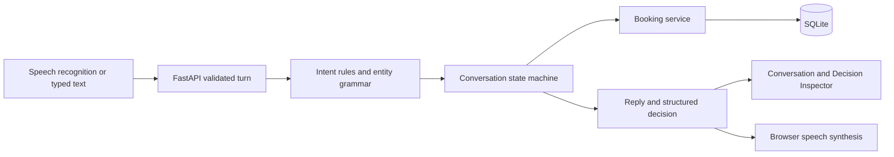

# VoxDesk design

## Use case and architecture

Northline Studio is a fictional single-chair barbershop. Appointment reception is bounded and realistic: identify a service, collect a day/time/name, check a calendar, request confirmation and persist the result. It exposes meaningful cases—duration overlaps, corrections, stale availability, ambiguous times, retries and cancellation—without external credentials or real customer records.

Next.js owns the interface and browser audio. FastAPI/Pydantic validates HTTP contracts. `brain/language.py` orders intent rules and composes the control, service, calendar and clock grammars in `control_phrases.py`, `services.py`, `calendar_dates.py` and `clock_times.py`. `brain/engine.py` transitions structured context through a small `BookingPort` interface. `bookings.py` owns calendar rules/operations; `db.py` owns models/transactions. An injected clock and IANA timezone make behavior reproducible.

The backend is authoritative. State labels, extracted values, availability, references, outcomes and explanations come from its responses. UI network/audio activity indicates local status, not invented engine decisions. `last_committed_action` distinguishes a receipt from merely retrieving an existing appointment or ending a conversation.

## Custom deterministic brain

**AI tools helped develop this software; they do not run the receptionist.** There are no LLM clients, prompts, model calls, embeddings or remote intent engines. Python rules and static reply templates determine actions. Browser services handle audio transcription/synthesis only, as permitted by the assessment.

### Intent rules and priority

Text is normalized for case, whitespace, apostrophes and AM/PM punctuation. Ordered rules handle:

1. Whole-utterance end/repeat/denial/confirmation controls and courtesy acknowledgements.
2. Negated action commands.
3. Business questions, including informational “How do I cancel a booking?”
4. Explicit cancellation, rescheduling, availability and creation patterns. Conflicting requested actions require clarification.
5. Contextual corrections: “actually”, “make it”, “instead”, “I meant”.
6. Active-task details or unknown-request recovery.

Confirmation uses a full-utterance allowlist. “Yes, but make it Friday” cannot commit. “Read a book” is not a booking command. Denial discards pending changes. `control_phrases.py` composes bounded denial clauses and optional courtesy, so “never mind, don't do it, revert the change” rejects the proposal without substring matching. “Nothing, thank you so much” ends the conversation; thanks alone preserves the current step. Rejecting when nothing is pending says so and keeps the saved receipt. Rule matches have no confidence percentages because they are not calibrated probabilities.

### Entity extraction

Service aliases map to three catalog IDs. The service grammar separates positive choices from local exclusions: “haircut without a beard trim” selects haircut, while “hair and beard” selects the combination. Contradictions, alternatives and positive unsupported services require clarification; a negated unsupported service does not override an otherwise valid choice. Dates support relative days, bounded day offsets, weekdays, next weekday, validated ISO dates, month names/abbreviations with numeric or word-ordinal days, and year-first numeric forms. Bare weekday includes today; next weekday is strictly future. Negated dates require an explicit replacement. Yesterday is extracted and rejected by business validation. A 180-day horizon keeps the calendar bounded.

`brain/calendar_dates.py` parses and masks whole calendar spans before the clock-time grammar runs. “28th of October 2026”, “2026 October 28”, and “2026 1028” become the same ISO date; their numbers cannot become hours or minutes. Malformed year-led fragments such as “2026 0 to 10” and invalid dates are also masked, with a date-specific clarification, preserving a separately supplied time. Ordinal day words are consumed before validating the calendar range so “thirty third” cannot collapse into the third day. Leap years and weekday/date consistency use Python's calendar arithmetic. Named dates without a year use the current business year, never an implicit rollover; explicit incomplete/spoken years require clarification. The booking layer still rejects past and out-of-horizon dates, and includes the interpreted past date in its reply.

Time parsing supports AM/PM, unambiguous 24-hour values, noon/midnight, word hours, “five thirty”, “half past four”, “quarter past four” and “quarter to five”. Quarter-to computes the preceding hour, including the AM/PM boundary at twelve. Bare 1–12 hours require AM/PM rather than assuming the likely studio time. A same-utterance day period can disambiguate a time. Period-only availability is supported; booking requires an exact start. Unsupported offsets, ranges and negated times cannot collapse to a trailing hour: they ask for an exact positive time. Multiple distinct values, invalid hours/minutes, invalid dates and numeric slash dates trigger field-specific clarification and clear the affected old value.

Names are collected in a name context or through a name-introduction phrase. Creation requests can include marked inline clauses such as "with the name Alex Example"; separators delimit the name from following appointment details. Anchored request wrappers such as “use name”, “put it under”, and “my name is” are removed before validating the entire name value. Bounded courtesy/repair prefixes and trailing politeness are removed; Unicode letters, apostrophes and hyphens remain supported. Bare names and the short “use Taha” form require the name-collection context. Explicit name clauses are consumed before calendar/time/service parsing, so name words cannot become service aliases or dates. A date/time error clears only that field and preserves the explicit name. Shared name-preposition rules support "for [the] name" and "with [the] name" in both inline and separate answers. Availability conflicts likewise clear only the rejected slot field, preserving the name until an explicit correction. Multiple or negated name clauses invalidate the name and pending proposal. "You should use Muhammad" is an explicit name instruction even while reviewing a proposal; a later confirmation is still required. Control/request fragments, alternatives and unmarked appointment details cannot become names. References match `NL-` plus eight alphanumeric characters; generated references use random synthetic hexadecimal values. Names are never used to guess a booking. This is a documented small English grammar, not unrestricted NLU.

### State machine and context

`SessionView` stores workflow intent, state, entities, missing information, `rejected_fields`, proposed action, last committed action, bounded history, last decision, clarification count, target booking version, actual appointment/slots and monotonic revision. Rejected fields persist independently until explicitly repaired; fixing the time cannot restore a rejected date from the original appointment. The new list defaults to empty for older persisted sessions. Context is copied before each turn and persisted as JSON. No shared global conversation variables exist.

| Situation | Transition / behavior |
| --- | --- |
| Idle/completed + supported request | Initialize workflow and collect supplied entities |
| Missing service/date/time | `COLLECTING_DETAILS` or `RESCHEDULING`, ask specific question |
| Existing operation without reference | `IDENTIFYING_EXISTING_BOOKING` |
| Reference found | Load authoritative appointment and version |
| Slot valid, name missing | Ask name, without reserving |
| Complete valid proposal | `AWAITING_CONFIRMATION` |
| Explicit confirmation | Revalidate, write, then `BOOKING_COMPLETE` or `COMPLETED` |
| Commit rejected | Clear proposal and request corrected information |
| Denial/negated command | Discard pending proposal, `IDLE` |
| Business question/repeat | Respond and preserve context |
| Restart | Reset proposal; retain persisted appointments |
| End | `COMPLETED`, discard pending authorization |

Checks run synchronously; the frontend receives the result rather than a transient checking snapshot. Cancellation uses the same explicit confirmation gate. Enum labels reserved for checking/cancelling do not imply background tasks.

### Corrections and uncertainty

A correction overrides only its supplied fields. “Actually make it 5 PM” retains service/date/name, clears authorization and checks availability again. “No, I meant Friday” is a date correction, not a denial. Ambiguous corrections clear the old field; unspecified corrections invalidate authorization and ask what should change. Negated action commands always discard the pending action.

Ordinary request forms such as “make a booking”, “I want you to make a haircut”, “can you fit me in”, “could you squeeze me in”, and polite lead-ins are matched by explicit grammar rules. Contrast tests exercise the same request families with single and combined services. A directional correction (“change from 4 PM to 5 PM”) extracts its destination; two alternatives without that directional grammar still need clarification. Name answers strip a bounded set of leading fillers (“and”, “um”, “it's”) and trailing courtesy words, with the interpreted name shown in the confirmation summary.

`last_booking_reference` remembers the most recently verified appointment within a session, separately from the pending proposal. Reschedule/cancel can reuse it; explicit references take priority and no other session is searched. Old persisted sessions can recover it from their own assistant-generated booking receipt, followed by database lookup; user-supplied receipt quotations are not trusted as session memory. A time-only reschedule keeps the date, and a date-only reschedule keeps the time, except when that field was explicitly rejected or is specifically awaiting clarification. An open “new date or time” question accepts either and keeps the other saved value. A field-only request such as “change the timing for this appointment” clears any pending time and asks for its replacement; it cannot re-propose an earlier value. Within active rescheduling, a complete “from X to Y” answer supplies the destination even when surrounding speech is unclear. Outside that context, reported actions and garbled booking objects cannot start a change. Stale versions still require fresh review. Draft-level “move it” and “cancel it” cannot target an older confirmed booking.

Operation scope is explicit. “Cancel that change” discards a reschedule proposal. “Cancel it” during a new booking discards that draft, even if a previous appointment is remembered. During rescheduling, the ambiguous pronoun clears pending authorization and asks whether to discard the change or cancel the confirmed appointment. An explicit reference or “cancel my confirmed appointment” selects the stored appointment, with its own confirmation. A subsequent bare “yes” cannot act on an abandoned proposal.

Availability and creation share collected details. Accepting an availability offer enters the create workflow and never directly commits a booking. Unknown speech after an availability result gets a targeted booking-offer clarification; no fuzzy match turns a transcription like “poke it” into a write. Status/reference-help questions have dedicated rules and cannot authorize writes. Business replies select only requested catalog topics to keep spoken answers brief.

Intent normalization also removes bounded repair prefixes such as “I said” and normalizes clause punctuation, while preserving negation. Name answers and draft cancellation use that same normalization so the repair words cannot become a name or redirect a draft cancellation to an older booking. New/another booking requests share their noun grammar with negation and informational-question rules.

Availability results accept subsequent entity-bearing answers even after their query has completed. A bounded affirmative with new details (“yes, do it at 4:30 PM”) starts collecting a booking with that time; a bare time refines availability without assuming a booking instruction. Both paths revalidate against current database conflicts. An affirmative that changes a ready proposal updates the proposal and asks for another confirmation. Exact affirmative action phrases (“yes, book it”) confirm only a matching, complete pending action. Compound action requests invalidate prior authorization.

Time normalization joins adjacent hour/minute tokens (“5 30 PM”, “four 30 PM”) and supports numeric hours with spoken minutes. AM/PM and range validation still apply; alternatives are not joined. Explicit approximate time claims (“around 40”, “around forty”, “around 430”) that cannot be interpreted produce a time clarification, so an invalid requested time cannot silently become an all-day availability search. No fuzzy correction maps “Effect” to a service or “look it” to a booking command.

Unknown input cannot become a write. The engine asks the outstanding question or explains supported tasks. Every third consecutive clarification offers restart/end guidance. Business interruptions preserve the workflow. The frontend exposes both newly extracted entities in the raw trace and accumulated entities in collected details. Session revisions reject unordered concurrent utterances rather than choosing their order silently.

## Booking persistence and time

Three SQLAlchemy tables store appointments, conversations and turn receipts. Starts/ends are UTC epoch seconds; API timestamps include the business offset and IANA zone. Relative dates use business time. DST gaps/folds are rejected rather than guessed. Monday–Saturday 10:00–19:00 must contain the full service; Sunday, past starts and out-of-horizon dates are rejected. Availability suggestions use ten-minute increments; exact valid starts may use other minutes.

Intervals are half-open: `existing.start < proposed.end AND existing.end > proposed.start`. Adjacent appointments can touch. Cancelled rows preserve a retrieval record and release their interval.

Every mutating turn acquires **`BEGIN IMMEDIATE` before reading session/appointment state**. Conflict validation, appointment mutation, context update and idempotency receipt commit together. SQLite's file writer lock covers separate connection pools/server workers. Concurrent confirmations cannot both silently book an overlap. A losing request sees the winner's write. The API returns only after commit; errors roll everything back. Busy writers wait at most ten seconds. See [SQLite transactions](https://www.sqlite.org/lang_transaction.html) and [isolation](https://www.sqlite.org/isolation.html).

Each turn includes `request_id` and `expected_revision`. A unique session/request receipt stores its exact historical response. Identical retries replay it; changed content using the same ID returns 409. `frontend/lib/session-cache.ts` validates pending data and session binding and catches storage read/write/removal failures. With working tab storage, pending requests survive reloads; when storage fails, a warning explains the limit and the current tab retains its request in memory. Safe retries reuse the exact body/ID. An unreadable HTTP response also preserves that pending request instead of assuming failure or generating a new confirmation.

Reschedule/cancel carries the version loaded at proposal time. Commit rejects an appointment changed by another session and asks for a fresh review. Started appointments cannot be changed. Rescheduling validates before changing the original row; failure preserves the old booking. All writes go through the conversation confirmation gate.

## Voice and interface

Recognition is feature-detected (`SpeechRecognition`/`webkitSpeechRecognition`); final transcripts become turns, interim text is feedback only. Permission denial, missing microphone, no speech, network errors and unsupported browsers offer typed recovery. Recognition aborts before synthesis and typed sends; the mic is disabled during speech. There is no automatic listening restart. Cleanup stops both APIs. Muting, stopping audio and replaying the current reply are explicit controls. Users can select US, UK or Pakistan English; installed/browser voice support determines actual pronunciation. Synchronous synthesis failure clears the speaking state and leaves typing usable.

The UI uses system fonts, code-native graphics, accessible names/focus, reduced-motion support, live conversation output, alerts and responsive layouts. Message text uses 14px and the composer 16px; primary microphone, send and confirmation controls remain 44px high. Typed turns return focus to the composer. Voice controls share the chat bar, with language selection and listening guidance beneath the input.

The interface centers an open transcript with right-aligned user messages and a pinned composer. The sidebar starts collapsed to icons, expands to labels and becomes a drawer on phones. A labeled right-side Decision inspector button animates the Inspector open/closed; collapsed content is inert and hidden from assistive technology. Desktop panels scroll independently; on narrow screens the Inspector opens over the chat. Appointment details have a separate sidebar view, also accessible from a mobile calendar button. Hidden views stay mounted so conversation state and unsent input survive navigation. Available starts stay inside the chat and still require confirmation. Warm neutral light/dark themes use a guarded browser preference; a small bootstrap applies the saved theme before hydration.

Two first-turn suggestions are centered above the input only while the authoritative session revision is zero and no request is pending. They submit ordinary turns through the same API path as typed/voice input. A restored used session keeps them hidden; a fresh session restores them. Inline receipts appear only beside the latest reply whose real decision is `commit.confirmed`, using the authoritative appointment object. No UI text infers that a proposed action succeeded.

`frontend/components/appointment-card.tsx` renders saved details from the authoritative appointment object and pending details in a separate proposed-change region. Ending or discarding a proposal cannot relabel the saved appointment as a draft. Connection indicators reflect the latest session/turn request outcome; they are not a continuous health monitor. The Inspector displays actual rule/explanation/state/next action; it does not simulate traces. Browser support is limited; [MDN documents platform constraints](https://developer.mozilla.org/en-US/docs/Web/API/SpeechRecognition).

## Validation, tradeoffs and limitations

Fixed-clock Pytest tests exercise intent/extraction, actual state transitions, corrections, missing details, confirmation, unknown input, boundaries, conflicts, rescheduling/cancellation, idempotency, revisions, session isolation and persistence after restart. Separate app instances test concurrent writers. A simulated commit error tests rollback of booking, context and receipt.

Contrast sets test meaning changes across service exclusions, action targets, negated dates/times, partial clock expressions, multi-field repair order and request families. These complement reported-transcript regressions; they are authored by the same coding agent and are not independent human evaluation. See [the conversation test matrix](docs/CONVERSATION_TEST_MATRIX.md) for the coverage map and a held-out manual protocol.

Playwright exercises the production UI with a disposable real backend, including lost commit responses, storage/network failures, saved/proposed separation, keyboard focus, slots and multiple mobile sizes. Speech APIs and explicit failure scenarios are mocked. Mocks cannot prove actual microphone permission, recognition accuracy or audible output. Those remain device checks in `docs/DEMO_CHECKLIST.md`; actual executed results are recorded in `docs/PROGRESS.md`.

The browser runner checks the production build's API URL before launch, requires its own free ports and never reuses unrelated servers. Configurable frontend/backend ports and a separate build directory allow isolation from a running demo. GitHub Actions is configured for Python 3.11/3.13 backend tests and Node 22 frontend checks, using SHA-pinned actions and retained failure artifacts. It has not executed remotely while publication is on hold.

SQLite serialization favors correctness and setup simplicity over throughput. Session JSON avoids event-sourcing complexity but receipts have no expiry, and future schema changes need migrations. Availability is a snapshot rather than a hold. The small English grammar asks clarification instead of guessing; fully word-spoken years, compound requests and broad paraphrases are limited.

An availability result can become a booking while retaining its service/date; an empty result stays open for another date. Changing a draft to a day period clears its exact time and asks for a new one. Reschedule validation finishes before mutating ORM objects because the engine catches domain errors to persist a clarification. The frontend pins a patched PostCSS via npm override because the initial nested version was flagged by audit; [the PostCSS advisories](https://github.com/advisories/GHSA-r28c-9q8g-f849) explain the affected source-map behavior.

This is a localhost synthetic demo with no authentication, real identity verification, notifications, payments, PII governance, holiday calendars or multiple chairs. References are identifiers, not authorization. Browser speech services may be remote and fail independently; typed workflows remain available. Optional shadcn/ui was unnecessary for the native controls; Tailwind/Lucide provide the requested UI foundation without another component abstraction.
