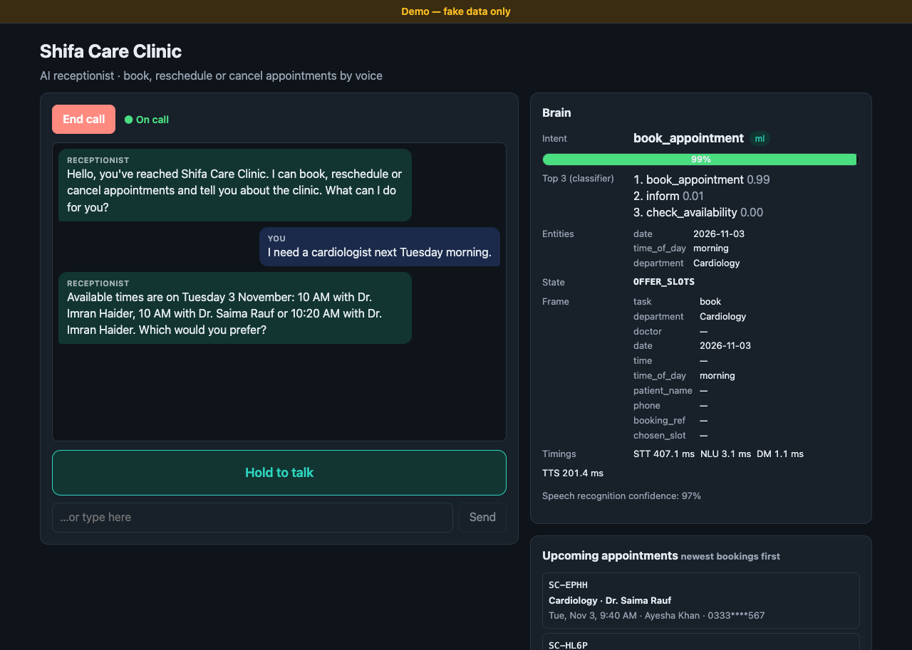
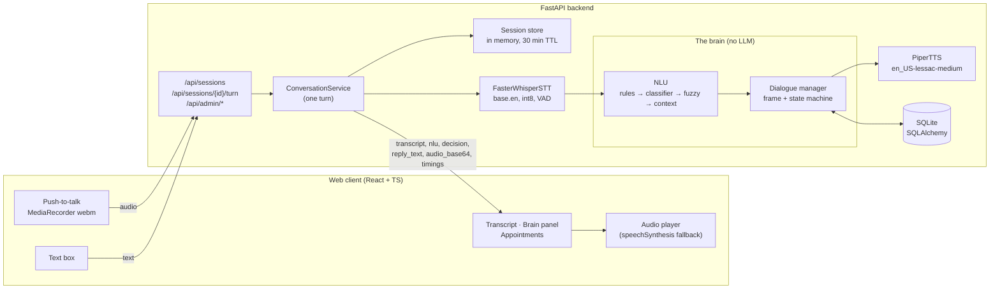

# Shifa Care Clinic — Voice Receptionist

A phone receptionist for a fictional clinic that you can talk to. It books, reschedules and
cancels appointments, answers questions about the clinic, and handles messy callers: people
who change their mind, give everything in one sentence, ask for a slot that's taken, go quiet,
or describe an emergency.

```
Caller speaks → Whisper (speech to text) → the brain → Piper (text to speech) → caller hears the reply
```

**The brain uses no LLM.** Every decision comes from our own code: regex rules, fuzzy matching,
a small scikit-learn classifier trained on our own examples, and a state machine. Nothing calls
OpenAI, Anthropic, Gemini or any hosted AI API. Speech recognition and synthesis also run
locally, so the whole thing works offline after a one-time model download.

> All data is fake: the clinic, its address, the doctors, the patients and their phone numbers are
> invented. The one real-world number is **1122**, Pakistan's public Rescue emergency line. The
> emergency reply gives it on purpose.



- [DESIGN.md](DESIGN.md): the use case, how the brain decides, every messy-caller case, NLU metrics.
- [AI_USAGE.md](AI_USAGE.md): how AI tools were used to build this, and where they got things wrong.

## Features

- **Book** (department → optional doctor → day → time → name → mobile → confirm), **reschedule**
  and **cancel** (found by booking reference like `SC-4F7K` or by mobile number), **check
  availability**, and **clinic info** (hours, address, departments, doctors).
- **Says everything in one go or piece by piece:** "Book me with a dermatologist next Monday at
  10 am" fills four slots at once.
- **Changes at any point:** "actually make it Friday", even at the final confirmation.
- **Taken slot:** offers the 3 nearest free times (the requested doctor first). The caller can pick
  "the second one" or "10:40".
- **Rules enforced:** no past dates, Sundays, lunch break, after-hours or bookings more than 30 days ahead.
- **Emergency words override everything** ("chest pain", "can't breathe") and the caller is told
  to call 1122 or go to an emergency department.
- **Repeat, silence, out-of-scope, "forget it", human hand-off** (on request or after 3
  misunderstood turns in a row).
- **Web client:** push-to-talk, a text box fallback, transcript bubbles, and a **Brain panel**
  showing what the agent decided each turn (intent, confidence, source, top-3 alternatives,
  entities, dialogue state, filled slots, action, timings). A live list of appointments
  updates after each turn.
- **Terminal chat** (`python -m app.cli`) for trying the brain without audio.

## Architecture



## Tech stack

| Part | Choice |
|---|---|
| Backend | Python 3.14, FastAPI, Uvicorn, pydantic-settings |
| Database | SQLite + SQLAlchemy 2.0 |
| NLU | Regex rules, RapidFuzz, scikit-learn (TF-IDF + LogisticRegression), dateparser |
| Dialogue | Our own frame-based state machine |
| Speech to text | faster-whisper (`base.en`, CPU, int8) — local |
| Text to speech | Piper (`en_US-lessac-medium`) — local; the browser's voice is the fallback |
| Frontend | Vite + React 18 + TypeScript, plain CSS |
| Quality | pytest, ruff, vitest + Testing Library, GitHub Actions |

## Prerequisites

- **Python 3.14** (the version in `backend/pyproject.toml`). Check with `python3 --version`.
- **Node.js 18+** (developed with Node 22 LTS) and npm.
- **No ffmpeg install needed:** audio is decoded by PyAV, whose wheels bundle FFmpeg.
- About **250 MB of disk** for the speech models, and a microphone for voice mode.
- A Chromium browser or Firefox. The microphone only works on `localhost` or HTTPS.

## Setup and run

You need two terminals: one for the backend, one for the frontend.

### macOS / Linux

```bash
git clone https://github.com/cheenafly/savvpro-test-voice-agent.git
cd savvpro-test-voice-agent

# 1. Backend: virtualenv + dependencies
cd backend
python3.14 -m venv .venv
source .venv/bin/activate
pip install --upgrade pip
pip install -r requirements.txt

# 2. Speech models (Piper voice ~63 MB, Whisper base.en ~140 MB), one time
python scripts/download_models.py

# 3. Run the API on http://localhost:8000
#    The database is created and seeded with fake data automatically on first start.
uvicorn app.main:app --reload
```

```bash
# 4. Frontend (second terminal)
cd savvpro-test-voice-agent/frontend
cp .env.example .env          # VITE_API_URL=http://localhost:8000
npm install
npm run dev
```

5. Open **http://localhost:5173**, press **Start call**, then hold **Hold to talk** while you
   speak (or type in the box).

With `make` available, the same steps are `make install`, `make models`, `make run-backend` and
`make run-frontend`, run from the repo root.

### Windows (PowerShell)

```powershell
git clone https://github.com/cheenafly/savvpro-test-voice-agent.git
cd savvpro-test-voice-agent\backend
py -3.14 -m venv .venv
.venv\Scripts\Activate.ps1
python -m pip install --upgrade pip
pip install -r requirements.txt
python scripts\download_models.py
uvicorn app.main:app --reload
```

```powershell
# second terminal
cd savvpro-test-voice-agent\frontend
copy .env.example .env
npm install
npm run dev
```

Then open **http://localhost:5173**. If PowerShell blocks `Activate.ps1`, run
`Set-ExecutionPolicy -Scope CurrentUser RemoteSigned` once, or use `.venv\Scripts\activate.bat`
from `cmd`.

### Seeding

There's nothing to do: on startup the backend creates `backend/clinic.db` and, if it is empty,
seeds 7 departments, 14 doctors and 3 weeks of 20-minute slots, with about 30% pre-booked by
fake patients. To start over with fresh data: `python -m app.db.seed` (or `make seed`).

## Try this conversation

| You say | The receptionist… |
|---|---|
| "I need a cardiologist next Tuesday morning." | offers three morning times |
| "The second one." | picks it and asks for the patient's name |
| "Actually, make it Wednesday." | "Sure, I've changed the date to Wednesday…": keeps the same time and doctor if free, otherwise offers the nearest |
| "Ayesha Khan." | asks for a mobile number |
| "0333 123 4567." | reads back everything and asks to confirm |
| "Yes." | books it, spells the reference (e.g. `SC-4F7K`) and the booking appears in the panel |
| "I want to cancel my appointment" | asks for the reference (or mobile number) |
| "SC-4F7K" (your reference) | reads the appointment back and asks to confirm the cancellation |

Other things to try: "what time do you close on Saturday?", "do you have a dentist?",
"my father has chest pain", "repeat that", "forget it", "can I talk to a person?", or silence.

## Terminal chat (no audio)

```bash
cd backend
.venv/bin/python -m app.cli            # or: make chat
.venv/bin/python -m app.cli --debug    # also prints intent, confidence, source, entities, state
```

Type your turns. An empty line counts as silence, and Ctrl-D or Ctrl-C hangs up. It uses the same
conversation service and database as the API.

## Tests, lint, retraining

```bash
cd backend
.venv/bin/python -m pytest                  # fast suite, ~530 tests, ~20 s (make test)
RUN_SLOW=1 .venv/bin/python -m pytest -m slow   # real Piper → Whisper round trip (make test-slow)
.venv/bin/python -m ruff check . && .venv/bin/python -m ruff format --check .   # make lint
.venv/bin/python -m app.nlu.train           # retrain the intent classifier (make train)

cd ../frontend
npm test                                    # vitest component tests
npm run build                               # type-check + production build
```

- **Fast tests** use fake speech engines and an in-memory database, so they need no models.
- **The slow test** needs `scripts/download_models.py` to have run, and skips itself otherwise.
- **Retraining** reads `backend/app/nlu/data/intents.yaml`, prints a held-out report and a 5-fold
  cross-validation report, and writes `backend/models/nlu.joblib` and
  `backend/reports/nlu_metrics.json`. The trained model is small (~560 KB) and committed, so the
  app runs without a training step.

CI (`.github/workflows/ci.yml`) runs ruff, the fast pytest suite, a grep that fails if any LLM
package appears in the backend, and the frontend tests and build.

## Configuration

Copy `backend/.env.example` to `backend/.env` to change anything. No secrets are needed.

| Variable | Default | What it does |
|---|---|---|
| `DATABASE_URL` | `sqlite:///./clinic.db` | SQLAlchemy URL |
| `CLINIC_TIMEZONE` | `Asia/Karachi` | "Today", "tomorrow" and opening hours use this zone |
| `CORS_ORIGINS` | `["http://localhost:5173","http://127.0.0.1:5173"]` | Allowed frontend origins (JSON list) |
| `LOG_LEVEL` | `INFO` | Python log level |
| `MODELS_DIR` | `models` | Where speech models live (relative to `backend/`) |
| `NLU_MODEL_PATH` | `models/nlu.joblib` | Intent classifier; trained automatically if missing |
| `REPORTS_DIR` | `reports` | Where training writes `nlu_metrics.json` |
| `STT_PROVIDER` | `faster_whisper` | `faster_whisper` or `none` (text only) |
| `STT_MODEL` | `base.en` | Any faster-whisper size; `tiny.en` is faster on slow CPUs |
| `STT_DEVICE` / `STT_COMPUTE_TYPE` | `cpu` / `int8` | Passed to faster-whisper |
| `TTS_PROVIDER` | `piper` | `piper` or `none` (the browser speaks instead) |
| `TTS_VOICE` | `en_US-lessac-medium` | Piper voice, read from `MODELS_DIR/<voice>.onnx` |
| `VITE_API_URL` (frontend) | `http://localhost:8000` | Backend URL, in `frontend/.env` |

## API

| Method & path | Purpose |
|---|---|
| `POST /api/sessions` | Start a call; returns the greeting turn |
| `POST /api/sessions/{id}/turn` | One caller turn: JSON `{"text": "..."}` **or** multipart `audio` (webm/ogg/wav) |
| `GET /api/sessions/{id}` | Current frame and history |
| `GET /api/admin/slots?department=&date=` | Slots, free and booked |
| `GET /api/admin/appointments?order=start\|recent` | Upcoming appointments (phone numbers masked) |
| `GET /health` | Liveness |

Each turn returns `transcript`, `transcript_confidence`, `nlu` (intent, confidence, source,
entities, alternatives), `decision` (state, action, frame, end_call), `reply_text`,
`audio_base64`/`audio_mime`, and `timings_ms` (`stt`, `nlu`, `dm`, `tts`). Interactive docs are
at http://localhost:8000/docs.

## Project structure

```
├── backend/
│   ├── app/
│   │   ├── main.py            # app factory; loads models once at startup
│   │   ├── config.py          # settings from env (pydantic-settings)
│   │   ├── clinic.py          # clinic facts: name, hours, booking window
│   │   ├── cli.py             # python -m app.cli
│   │   ├── schemas.py         # API request/response models
│   │   ├── api/               # routes: sessions, turn, admin, health
│   │   ├── services/          # conversation (one turn end to end), session store
│   │   ├── db/                # models, repository (all queries), seed
│   │   ├── nlu/               # normalizer, rules, fuzzy, entities, classifier, pipeline, train
│   │   │   └── data/          # intents.yaml (1,751 examples), lexicon.yaml
│   │   ├── dialogue/          # frame, states, policies, responses, manager
│   │   └── speech/            # stt.py (Whisper), tts.py (Piper, NullTTS)
│   ├── scripts/download_models.py
│   ├── models/nlu.joblib      # committed; speech models are downloaded here (gitignored)
│   ├── reports/nlu_metrics.json
│   └── tests/                 # pytest: NLU, dialogue edge cases, DB, API, speech, CLI
├── frontend/
│   └── src/
│       ├── App.tsx
│       ├── api/               # client + types mirroring the backend schemas
│       ├── hooks/             # useRecorder (push-to-talk), useAudioPlayer
│       └── components/        # CallControls, Transcript, Composer, BrainPanel, AppointmentsPanel
├── docs/                      # screenshots, AI session log
├── .github/workflows/ci.yml
├── DESIGN.md  AI_USAGE.md  TASK.md  Makefile
```

## Troubleshooting

- **"Microphone permission was denied" / no mic prompt:** browsers only allow the microphone on
  `http://localhost` or HTTPS. Open the app at `http://localhost:5173`, not a LAN IP. If you
  blocked it once, re-allow it from the padlock icon in the address bar. The text box always works.
- **Model download fails with `CERTIFICATE_VERIFY_FAILED` (macOS):** the python.org installer
  ships without CA certificates. The script already uses the `certifi` bundle; if that's missing,
  run `pip install certifi`, or run *Install Certificates.command* from your Python folder in
  Applications.
- **"could not load whisper model" in the log:** the models weren't downloaded. Run
  `python scripts/download_models.py`. Until then the backend runs **text-only**, and audio turns
  return 503 with "send text instead".
- **No server voice / "could not load piper voice":** the backend falls back to `NullTTS` and the
  browser reads replies with its own voice. If `piper-tts` won't install on your platform, remove
  it from `requirements.txt` and set `TTS_PROVIDER=none`.
- **Transcription is slow:** set `STT_MODEL=tiny.en` (and run the download script again).
- **Port already in use:** run the backend on another port with `uvicorn app.main:app --port 8001`
  and set `VITE_API_URL=http://localhost:8001` in `frontend/.env`. Vite picks the next free port
  if 5173 is taken; then add that origin to `CORS_ORIGINS`.
- **"Can't reach the backend":** check that the backend is running and that `VITE_API_URL` matches
  its address. Restart `npm run dev` after changing `.env`.
- **Want a clean slate:** stop the backend, delete `backend/clinic.db` and start it again.
