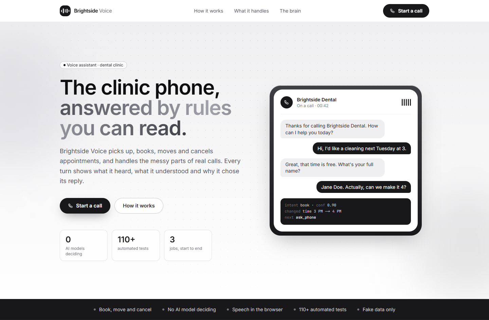
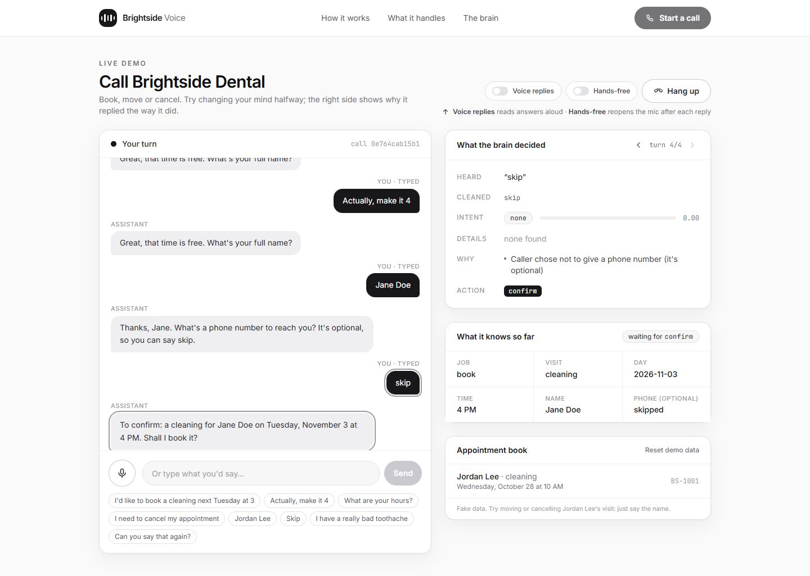
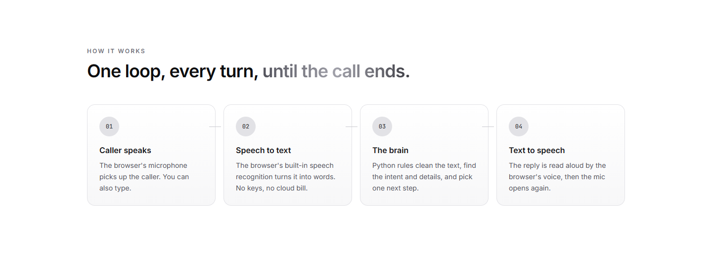
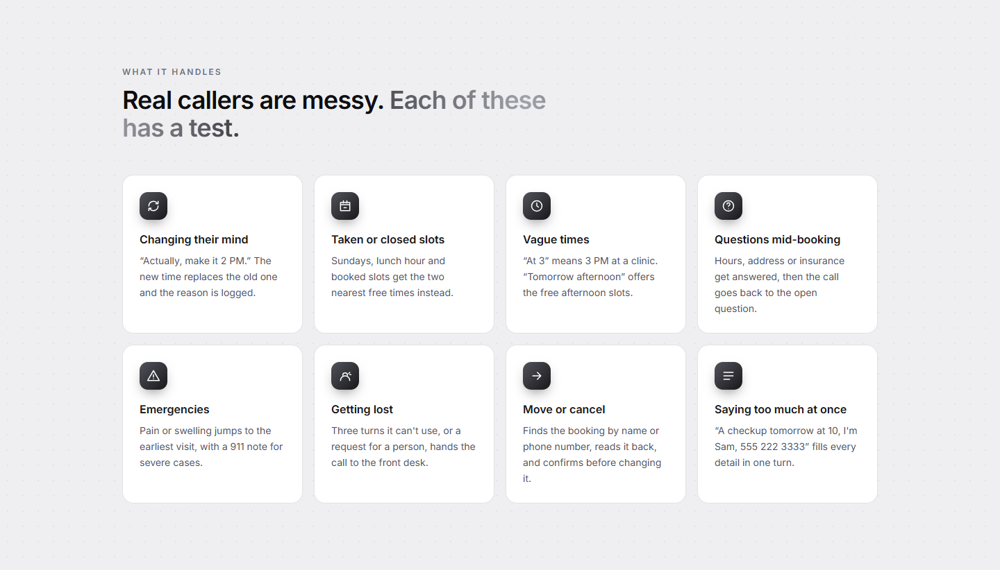
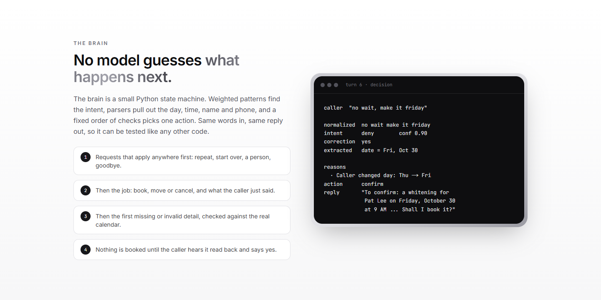
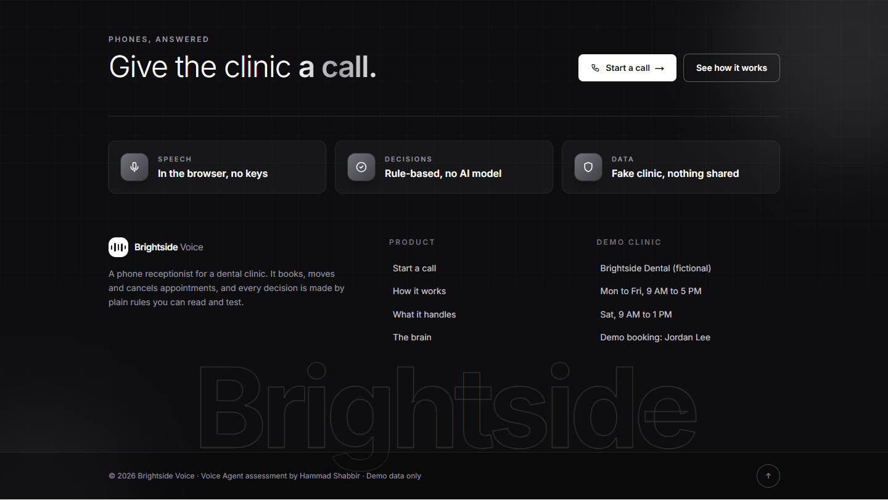
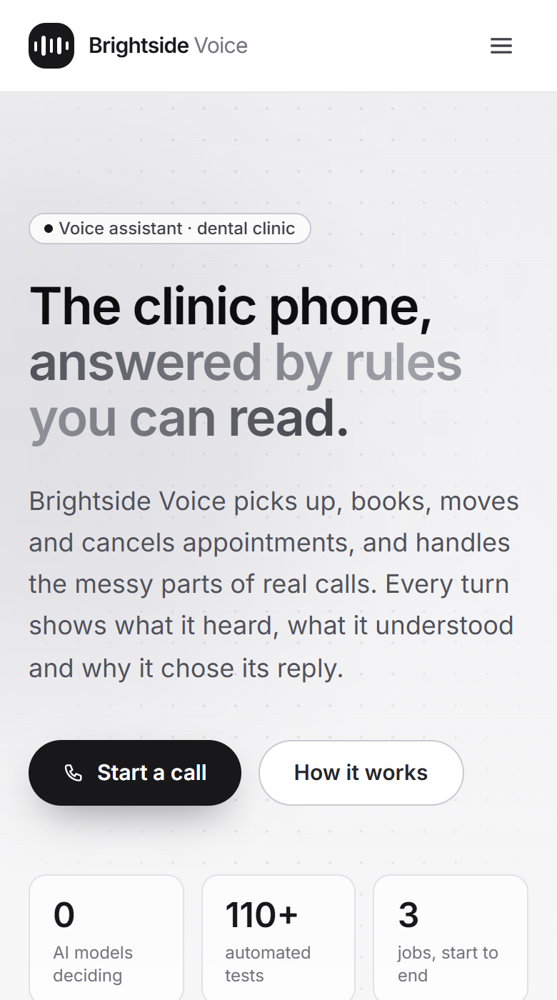

# Brightside Voice

A voice assistant that answers the phone for a (fictional) dental clinic, **Brightside Dental**. It books, moves
and cancels appointments from start to end and handles the messy parts of real calls: changing your mind halfway,
asking about hours mid-booking, taken slots, vague times, emergencies and getting lost.

```
Caller speaks → Speech to text → The brain → Text to speech → Caller hears the reply
   (browser)     (browser Web Speech API)   (Python rules)   (browser speechSynthesis)
```

The brain is plain Python. **No AI model decides anything.** The call screen shows, for every turn, what was heard,
the intent and its score, the details found, the reasons and the action taken.

- [`DESIGN.md`](DESIGN.md): the use case and how the brain makes decisions.
- [`AI_USAGE.md`](AI_USAGE.md): the AI tools used to build it, where they went wrong, and the token count.

## Screenshots

**Landing page: header and hero**



**The call screen.** A real call: the caller changes the time ("make it 4") and skips the optional phone number.
On the right, what the brain decided on that turn, what it knows so far, and the appointment book.



**How it works**



**What it handles**



**The brain**



**Footer**



<details>
<summary><b>Mobile</b></summary>



</details>

## Run it

You need **Python 3.11+** and **Node 20+**. For the microphone use **Chrome or Edge** (Firefox and Safari have no
speech recognition, so you type instead). No API keys are needed.

### 1. Backend (port 8000)

```bash
cd backend
python -m venv .venv
# Windows: .venv\Scripts\activate    macOS/Linux: source .venv/bin/activate
pip install -r requirements-dev.txt
uvicorn app.main:app --reload --port 8000
```

### 2. Frontend (port 3000)

```bash
cd frontend
npm install
npm run dev
```

Open <http://localhost:3000>, click **Start a call**, and allow the microphone. The assistant greets you and then
listens; with **Hands-free** on, the mic reopens after each reply. You can also type, or click one of the sample lines.

If the backend runs somewhere else, set `NEXT_PUBLIC_API_URL` (see `frontend/.env.example`).

### With Docker

```bash
docker compose up --build
```

Then open <http://localhost:3000>.

## Try these calls

| Call | Say |
|---|---|
| Book | "I'd like a cleaning next Tuesday at 3" → your name → any phone number, or "skip" → "yes" |
| Change your mind | During a booking: "actually, make it 4". At the read-back: "no wait, make it Friday" |
| Taken slot | Book the demo booking's slot (shown in the appointment book) → "the second one" |
| Closed | "Book a filling on Sunday", then "Saturday at 4" |
| Move | "I need to reschedule" → **"Jordan Lee"** (the fake demo booking) → "Friday" → "11 am" → "yes" |
| Cancel | "Cancel my appointment" → **"Jordan Lee"** (or its fake number, 555 014 2233) → "yes" |
| Emergency | "I have a really bad toothache" → "the first one" |
| Questions | "What are your hours?" / "Where are you?" / "Do you take Delta?" at any point |
| Get help | "Say that again", "start over", "can I talk to a person" |

**Reset demo data** on the call screen puts the appointment book back to its starting state.

## Tests

```bash
cd backend && python -m pytest -q        # 118 tests: parsing, calendar, whole calls, HTTP API
cd frontend && npm run lint && npx tsc --noEmit && npm run build
```

CI runs both on every push (`.github/workflows/ci.yml`).

## Project layout

```
backend/
  app/
    nlu/          normalize.py (speech clean-up), when.py (dates, times), intents.py (intent + details)
    clinic/       calendar.py (hours, slots, bookings; in-memory, fake data)
    dialog/       manager.py (the brain: state + one decision per turn)
    api/          routes.py (HTTP), store.py (live calls)
    main.py       FastAPI app factory
  tests/          unit tests + whole-call scenarios + API tests
frontend/
  src/app/        landing page (/) and call screen (/call)
  src/components/ call/ (console, transcript, decision, state, schedule), layout/
  src/lib/        api.ts (typed client), useSpeech.ts (browser STT + TTS)
```

## API

| Method | Path | What it does |
|---|---|---|
| `POST` | `/api/calls` | Start a call; returns `call_id` and the greeting |
| `POST` | `/api/calls/{id}/turns` | Send what the caller said `{"text": "..."}`; returns the decision |
| `GET` | `/api/calls/{id}` | Every turn of a call so far |
| `GET` | `/api/schedule` | The appointment book (phone numbers masked) |
| `POST` | `/api/reset` | Restore the demo data |
| `GET` | `/api/health` | Health check |

Interactive docs: <http://localhost:8000/docs>.

## Notes

- All data is fake and kept in memory; restarting the backend resets it.
- The clinic runs on the server's local time, so "today" and "tomorrow" follow the machine's clock.
- **Phone numbers are optional** and accepted in any format ("135 567454 2132", "+44 20 7946 0000"). Only the last
  four digits are ever read back or shown; a booking can be found by name instead.
- Nothing secret is configured or committed. The only settings are in the `.env.example` files.
