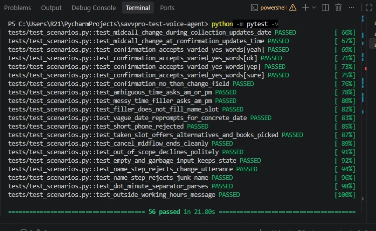
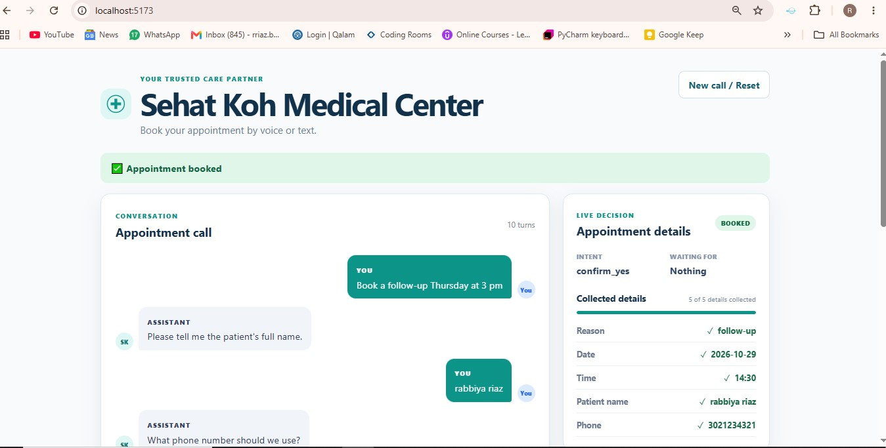
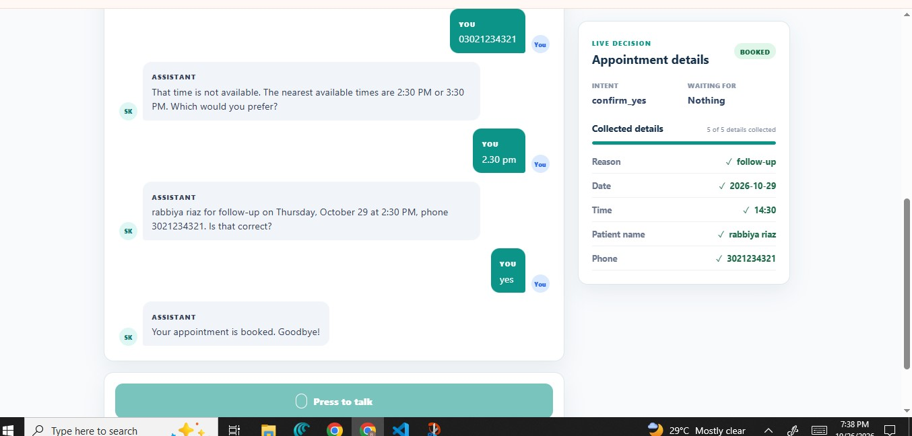
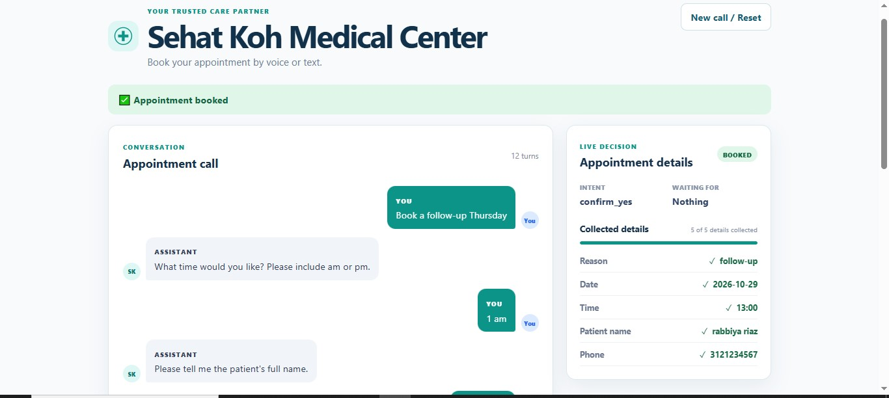
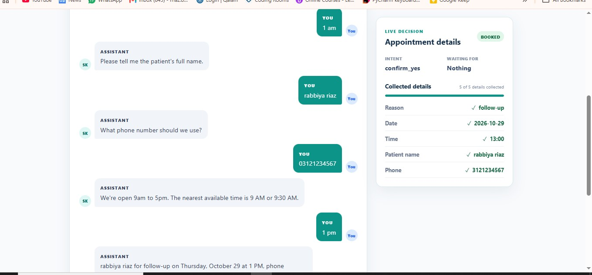
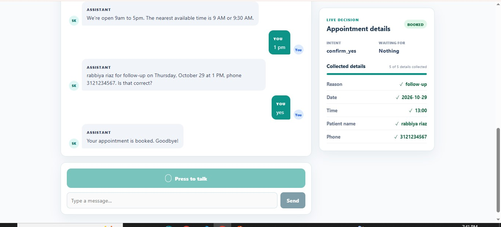

# Sehat Koh Medical Center

A rule-based voice assistant that books clinic appointments by voice or text. **No LLM is used for any decision; all intent detection, slot filling, and dialogue control are handled by rule-based Python.**

## Pipeline

```text
Caller speaks → Speech-to-text (browser) → Rule-based Python brain → Text-to-speech (browser) → Caller hears reply
```

Speech-to-text (STT) and text-to-speech (TTS) use the browser Web Speech API for speech I/O. The appointment brain is implemented entirely with pure Python rules.

## Features

- Multi-slot extraction from natural language
- Mid-call changes to previously provided details
- Slot validation and follow-up prompts
- Availability checks with alternative times
- Confirmation read-back before booking
- Out-of-scope request handling
- Voice and text input
- Live decision panel showing intent, state, and collected slots

## Tech stack

- **Backend:** Python with FastAPI
- **Frontend:** React with Vite
- **Tests:** pytest
- **Speech I/O:** Browser Web Speech API for STT/TTS

No external API keys are required.

## Project structure

```text
.
├── brain/
│   ├── nlu.py           # text → intent + slots (rules, regex, dateparser)
│   ├── brain.py         # handle_turn — the finite-state machine
│   ├── state.py         # Session dataclass + states
│   ├── availability.py  # fake availability store + nearest-slot logic
│   └── cli.py           # terminal test loop
├── api/
│   └── main.py          # FastAPI: /turn, /reset, /health
├── frontend/
│   ├── src/             # React app (voice I/O + decision panel)
│   ├── index.html
│   ├── package.json
│   └── vite.config.js
├── tests/               # pytest suite (56 cases)
├── Captures/            # demo screenshots
├── requirements.txt
├── README.md
├── DESIGN.md
└── AI_USAGE.md
```

## Prerequisites

- Python 3.12 or newer
- Node.js 18 or newer

## Setup and run

Use two terminals from the project root.

1. **Start the backend**

   ```bash
   pip install -r requirements.txt
   uvicorn api.main:app --reload
   ```

   The API runs at [http://localhost:8000](http://localhost:8000).

2. **Start the frontend**

   ```bash
   cd frontend
   npm install
   npm run dev
   ```

   The development server runs at [http://localhost:5173](http://localhost:5173).

3. Open [http://localhost:5173](http://localhost:5173) in **Chrome or Edge**. The backend must be running first.

## Running tests

Run the full suite from the project root, not from inside `tests/`:

```bash
python -m pytest -v
```

The full suite passes with 56 tests covering the rule-based brain and edge cases.



## Browser note

Voice input uses the Web Speech API, which is supported in Chrome and Edge. In other browsers, the text input provides identical appointment-booking functionality.

## Try it

Start with:

> “Book a follow-up Thursday at 2pm.”

The assistant extracts the appointment details, collects the patient’s name and phone number, reads the booking back for confirmation, and then books the appointment.

### Scenario 1: Correct input, full booking

The caller gives valid details and the appointment books successfully.






### Scenario 2: Time outside opening hours

The caller requests a time before the clinic opens; the assistant explains the working hours instead of treating the slot as taken.









