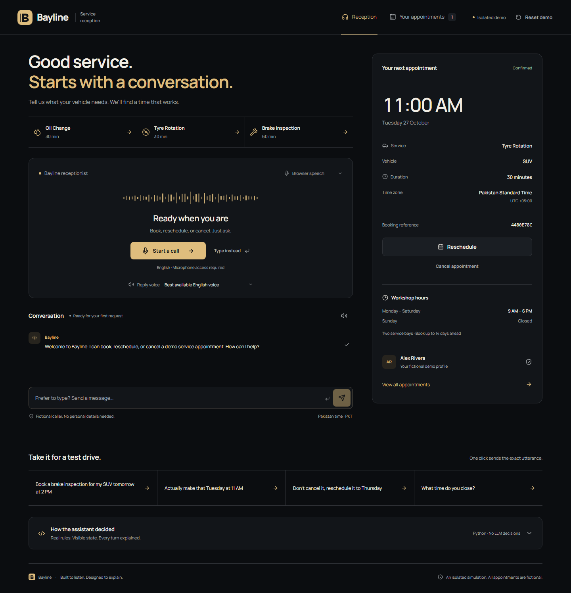

# Bayline · Voice Service Reception

**Candidate:** Farrukh Yousaf | **GitHub:** [Farukhthegreat](https://github.com/Farukhthegreat)

A vehicle-service receptionist that **books, reschedules, and cancels appointments through English speech**. Its brain is explicit Python rules and a state machine—**no runtime LLM decisions**. React shows the actual extracted details, state changes, availability checks, and committed actions.

**Live demo:** https://savvpro-test-voice-agent.onrender.com · **Submission:** https://github.com/savvpro/savvpro-test-voice-agent/pull/3

Each browser gets an isolated, fictional two-bay workshop, occupied test slots, and an existing appointment for **Alex Rivera — SUV — Tyre Rotation — next open day at 11 AM**. No real personal details are needed.



[Watch the silent workflow walkthrough](docs/images/demo-walkthrough.webm) · [Mobile view](docs/images/reception-mobile.png) | [Appointments page](docs/images/appointments-desktop.png) | [Confirmed update](docs/images/appointments-updated-desktop.png)

## Run locally

Requirements: Python 3.12+, [uv](https://docs.astral.sh/uv/), Node.js 24, and desktop Chrome for the primary voice experience. Microphone access requires HTTPS or localhost.

```sh
git clone https://github.com/Farukhthegreat/savvpro-test-voice-agent.git
cd savvpro-test-voice-agent
git checkout candidate-Farukhthegreat
uv sync --frozen
npm --prefix frontend ci
npm --prefix frontend run build
uv run uvicorn backend.app:app --host 127.0.0.1 --port 8000
```

Open **http://127.0.0.1:8000**. Python serves the compiled React app and API. SQLite is created automatically at `./workshop.db`; **no API keys, database account, or Docker are required** for the default browser-speech path.

For frontend development, run Python and `npm --prefix frontend run dev` in separate terminals. Vite proxies `/api` to Python; open the Vite URL.

## Try it

1. Click **Start a call**, allow microphone access, and speak after the listening indicator appears. The receptionist replies aloud and listens again automatically.
2. Say **“Reschedule my appointment”** to use the pre-existing booking. Give a new date/time, then explicitly confirm.
3. Say **“Book a brake inspection for my SUV tomorrow at 2 PM”** to exercise the seeded occupied bays. Pick an offered alternative and confirm.
4. Try **“Actually make that Thursday at 11 AM”** while confirming. Details change and confirmation is requested again.
5. Try **“Don't cancel it, reschedule it to Thursday”** and **“What time do you close?”**.
6. A brake inspection at **5:30 PM** is rejected because it would finish after 6 PM. An oil change has a valid duration then, subject to availability.
7. Create another booking, then ask to cancel without identifying it: the assistant asks which appointment. Choose by number, service, vehicle, or reference.
8. Expand **How the assistant decided** to inspect real rule matches and state transitions.

**Your appointments** opens a dedicated booking list on desktop and mobile. Its reschedule/cancel actions identify the selected booking by reference and return to reception for confirmation. After confirmation, the returned schedule immediately updates the appointment card, list, and navigation count, without waiting for speech or a page reload. A status notice identifies the changed booking and links to the updated schedule; unconfirmed or failed changes preserve the original booking. Service shortcuts start a booking without inventing missing details; **Type instead** takes you directly to the composer.

Quick-test buttons and typed input use the same decision endpoint as voice. Their replies are spoken without requiring a microphone call; only an active call resumes listening afterward. Use **Stop reply** to stop one-shot playback or **Replay last reply** to retry a browser playback error. New chat messages reveal word by word, and live recognition updates animate without changing the recognized text. Reduced-motion preferences show text immediately. This is a visual reveal of the actual API response, not server-side token streaming. Pause/resume, replay, interrupt playback, finish recording, and end-call controls are available. **Reset demo → Reset Demo Session** restores only your own fixtures and conversation. On Sunday, the initial appointment moves to the next opening day; calendar dates always use Pakistan time.

## Optional configuration

Copy `.env.example` to `.env` and edit locally. Do not commit it.

Neon CLI users can run `neon init` and `neon deploy`: FastAPI also reads the generated `.env.local`. Both env files stay private, and hosted process environment variables take precedence. From the project root, `npm run build` is also supported. See [Neon setup and evidence](docs/NEON_SETUP.md).

| Variable | Purpose |
| --- | --- |
| `DATABASE_URL` | Defaults to `sqlite:///./workshop.db`. Use a Neon Postgres connection string with TLS for hosted persistence. Postgres URLs are normalized to psycopg. |
| `GROQ_API_KEY` | Optional backend-only key. Enables **Server speech** and `/api/stt` with `whisper-large-v3-turbo`. Transcription only, never decisions. |
| `SECURE_COOKIES` | `false` on local HTTP; set `true` on hosted HTTPS. |
| `TEST_DATABASE_URL` | Separate Postgres test database. Tests create/drop random schemas; the role needs schema-creation permission. Also accepted in ignored `.env.test`. |

Select **Server speech** if browser recognition is unavailable/inaccurate and Groq is configured. It records up to 20 seconds, finishes after speech followed by silence, and offers **Finish speaking**. Uploads are bounded at 5 MB. This app does not store raw audio. Browser recognition may send audio to its vendor; server speech sends audio to Groq.

Browser recognition is not universally supported and may require internet access. Typed input remains available. Synthesis has a capped watchdog and chunked replies so a missing completion event cannot indefinitely block the next turn.

The **Reply voice** selector lists English voices actually available in your browser. Automatic selection prefers voices labelled Natural/Neural/Enhanced, then Google voices, ahead of basic local voices. Reply chunks prefer sentence and clause boundaries to avoid unnecessary mid-sentence pauses. Available voice quality depends on the browser and device.

## Tests and checks

```sh
uv run pytest
uv run ruff check backend tests
uv run mypy backend
npm --prefix frontend run check
npm --prefix frontend run test
npm --prefix frontend run build
```

Without `TEST_DATABASE_URL`, Postgres variants are explicitly skipped. With it, the same workflow/API/transaction suites run on SQLite and Postgres. Use a separate test database. CI provides Postgres 17 automatically. Coverage includes concurrent allocations, savepoint rollback after partial insertion, contiguous segments, deduplication, stale turns, reset isolation, corrections, relative dates, negation, and appointment selection.

With the app running, optional UI smoke and silent walkthrough capture:

```sh
npm --prefix frontend exec -- playwright install chromium
node frontend/scripts/smoke.mjs
```

Screenshots/video are saved to ignored `artifacts/`. Smoke uses actual Python decisions and database operations; it does **not** substitute for manual microphone testing. See the [verification record](docs/VERIFICATION.md).

## Hosting

The multistage `Dockerfile` builds React and runs FastAPI as a non-root user. It supports the host's `PORT`, uses one worker, and serves both layers under one origin. Health endpoint: `/api/health`.

**Render:** connect this fork and candidate branch, choose Docker/Free, set Neon `DATABASE_URL` and `SECURE_COOKIES=true`. `render.yaml` supplies the blueprint. Groq is optional. Free services can sleep and have ephemeral filesystems.

**Railway alternative:** connect the same repository/branch; use the root Dockerfile. `railway.toml` supplies the health check. Set the same variables and generate a public domain. Check account eligibility and free/trial credit; unlimited free hosting is not guaranteed.

Use Postgres for hosted persistent storage. Startup uses `Base.metadata.create_all()` and idempotent seeding, not Alembic. It does not upgrade existing schemas or erase bookings. Add explicit migrations for future schema changes on an existing database.

## Design and assessment evidence

- [DESIGN.md](DESIGN.md): use case, decision architecture, and shipped interface system.
- [Architecture](docs/ARCHITECTURE.md): dialogue states, extraction rules, transactions, speech lifecycle, and limits.
- [AI_USAGE.md](AI_USAGE.md): actual assistance, observed mistakes, and sanitized usage evidence.
- [Verification](docs/VERIFICATION.md): completed and outstanding checks.
- [TASK.md](TASK.md): original requirements, unchanged.
- [Original submission instructions](docs/ORIGINAL_SUBMISSION_INSTRUCTIONS.md): preserved upstream README.
- [AGENTS.md](AGENTS.md): mandatory engineering constraints.

No real personal data, payments, notifications, or real workshop services are involved.
