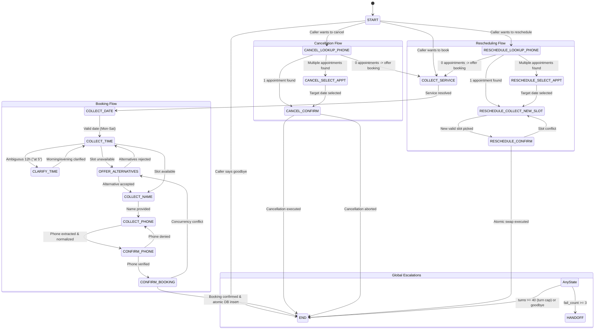

# CLAUDE.md — Architecture, Workflows & Developer Guide

> **Repository:** BrightSmile Dental Voice Assistant (`savvpro-test-voice-agent`)  
> **Candidate Branch:** `candidate-MuhammadLuqman0407`  
> **Core Rule:** Strictly zero LLM usage inside the decision-making brain. 100% deterministic code.

---

## 1. Project Overview & Mission

The Dental Voice Assistant is a real-time conversational telephony agent for **BrightSmile Dental Clinic**. It enables callers to **book**, **reschedule**, and **cancel** appointments deterministically over phone/audio or text with sub-second latency, zero hallucinations, and full privacy compliance.

### The One Big Rule (Hard Constraint)
The decision-making brain (`ai-tool/src/voice_agent/brain`) **MUST** be pure deterministic code:
- Regex and fuzzy token matching via `rapidfuzz`
- Deterministic temporal parsing via `dateparser` (with injected static `Clock`)
- Spoken digit parsing via `word2number`
- Finite State Machine (`voice_agent.brain.state.State` + `dialog.py`)
- **NEVER** use OpenAI, Claude, Gemini, Mistral, LangChain, or any LLM for intent, slot extraction, or response selection.
- Verified automatically by AST scan in `ai-tool/tests/unit/test_no_llm.py`.

---

## 2. Directory Architecture & Layer Boundaries

The codebase enforces strict **Clean / Hexagonal Architecture** with Dependency Inversion:
`frontend ➔ backend ➔ ai-tool`

```
dental-voice-assistant/
├── ai-tool/                          # Pure Python package (voice_agent)
│   ├── src/voice_agent/
│   │   ├── ports.py                  # Core Protocols (STTEngine, TTSEngine, BookingGateway, Clock)
│   │   ├── pipeline.py               # VoicePipeline (STT ➔ Brain ➔ TTS)
│   │   ├── brain/
│   │   │   ├── dialog.py             # FSM Coordinator, fail counter, turn caps
│   │   │   ├── responses.py          # ALL reply strings live here (Single Source of Truth)
│   │   │   ├── state.py              # State enum + SessionContext model
│   │   │   ├── flows/
│   │   │   │   ├── book.py           # Booking state handlers & alternative slots
│   │   │   │   ├── cancel.py         # Cancellation state handlers
│   │   │   │   └── reschedule.py     # Atomic rescheduling handlers
│   │   │   └── nlu/
│   │   │       ├── intents.py        # RapidFuzz intent classification (>=85% score)
│   │   │       └── entities.py       # Date, time, service, phone & spoken number parser
│   │   ├── stt/
│   │   │   ├── faster_whisper_stt.py # Faster-Whisper base.en (int8 CPU)
│   │   │   └── fake_stt.py           # Test STT stub
│   │   └── tts/
│   │       ├── edge_tts_engine.py    # Microsoft EdgeTTS natural voice engine
│   │       ├── piper_engine.py       # Offline Piper TTS option
│   │       └── fake_tts.py           # Test TTS stub
│   └── tests/                        # 44 passing unit & 32 messy scenario tests
│
├── backend/                          # FastAPI Web & Database Service
│   └── app/
│       ├── main.py                   # App factory, lifespan, model cache
│       ├── config.py                 # Pydantic-settings configuration
│       ├── schemas.py                # Pydantic WebSocket & REST schemas
│       ├── api/
│       │   ├── ws_calls.py           # Live WebSocket /ws/calls (binary audio + JSON text)
│       │   ├── appointments.py       # REST CRUD (/appointments, /slots, /by-phone)
│       │   ├── clinic.py             # GET /clinic rules & services
│       │   └── health.py             # GET /health & /api/health
│       ├── db/
│       │   ├── models.py             # SQLAlchemy models (Appointment partial unique index)
│       │   └── engine.py             # Async SQLAlchemy engine (SQLite / PostgreSQL)
│       ├── repositories/
│       │   └── appointments.py       # Database CRUD & concurrency locks
│       └── services/
│           ├── booking_gateway.py    # SqlBookingGateway (implements BookingGateway port)
│           ├── clock.py              # SystemClock (implements Clock port)
│           └── session_store.py      # In-memory TTL/LRU voice session cache
│
├── frontend/                         # React 18 + Vite + TypeScript Application
│   └── src/
│       ├── App.tsx                   # Main 2-column telephony dashboard shell
│       ├── types.ts                  # Shared TypeScript interfaces & message models
│       ├── api/client.ts             # REST client for appointments & clinic metadata
│       ├── hooks/
│       │   ├── useCall.ts            # WebSocket client hook (/ws/calls)
│       │   ├── useRecorder.ts        # Push-to-talk Web Audio recorder
│       │   └── useAudioPlayer.ts     # Audio playback queue manager
│       └── components/
│           ├── CallPanel.tsx         # Voice/text chat, quick chips & push-to-talk
│           ├── DebugPanel.tsx        # Real-time FSM state, slot tracker & latencies
│           ├── AppointmentsPanel.tsx # Live appointments schedule calendar
│           └── Settings.tsx          # Clinic operating rules & stack specs
│
├── scripts/
│   └── ws_smoke_test.py              # Automated / manual WebSocket test client
├── DESIGN.md                         # FSM diagram & 32 messy-case documentation
├── AI_USAGE.md                       # Required report of AI tools, token logs & fixes
└── TASK.md                           # Original assessment requirements
```

---

## 3. The Finite State Machine (FSM)



---

## 4. Detailed Step-by-Step User Journey

### A. New User Booking (Turn 0 to Done)

```
[User Connects] ──➔ Turn 0: Greeting
                 ──➔ Turn 1: Service Resolution ("cleaning")
                 ──➔ Turn 2: Date Parsing ("tomorrow", Mon-Sat check)
                 ──➔ Turn 3: Time Slot Check ("10 AM", 09:00-17:00 check)
                 ──➔ Turn 4: Patient Name ("Sara Khan")
                 ──➔ Turn 5: Spoken Phone Digit Extraction ("zero three zero zero...")
                 ──➔ Turn 6: Confirmation & Atomic DB Commit ──➔ [Completed]
```

1. **Turn 0 — System Greeting:**
   - Server sends Turn 0 immediately on WebSocket accept with synthesized EdgeTTS audio:
     *"Hello, thank you for calling BrightSmile Dental Clinic. How can I help you today?"*
2. **Turn 1 — Service Extraction (`COLLECT_SERVICE`):**
   - Caller: *"I need a checkup"*
   - NLU resolves service via RapidFuzz keyword matching against `cleaning`, `checkup`, `filling`, `whitening`, `root canal`, `braces consultation`.
   - FSM transitions to `COLLECT_DATE`.
3. **Turn 2 — Date Resolution (`COLLECT_DATE`):**
   - Caller: *"Tomorrow"*
   - Parsed using `dateparser.parse()` with static `reference_date` from injected `Clock`.
   - Validates clinic operating days: Monday through Saturday. Sunday prompts polite closure notice.
   - FSM transitions to `COLLECT_TIME`.
4. **Turn 3 — Time & Availability Check (`COLLECT_TIME`):**
   - Caller: *"10 AM"*
   - Validates hours: 09:00 AM to 05:00 PM in 30-minute increments.
   - Ambiguity detection: Utterances like *"at 5"* move to `CLARIFY_TIME` (*"Did you mean 5 AM or 5 PM?"*).
   - Queries `gateway.is_slot_available()`. If taken, recommends 2 nearest open alternatives (`OFFER_ALTERNATIVES`).
   - FSM transitions to `COLLECT_NAME`.
5. **Turn 4 — Patient Name (`COLLECT_NAME`):**
   - Caller: *"Sara Khan"*
   - Stored in transient `SessionContext` only (never logged unmasked).
   - FSM transitions to `COLLECT_PHONE`.
6. **Turn 5 — Phone Extraction & Readback (`COLLECT_PHONE`):**
   - Caller: *"zero three zero zero one two three four five six seven"*
   - `word2number` parses spoken digits to string `"03001234567"`.
   - Assistant reads back spaced digits: *"I have your number as 0 3 0 0 1 2 3 4 5 6 7. Is that correct?"*
   - FSM transitions to `CONFIRM_PHONE`.
7. **Turn 6 — Booking Confirmation & Atomic Insert (`CONFIRM_BOOKING`):**
   - Caller: *"Yes, that's correct"*
   - Calls `gateway.book()`. Executes database insert with partial unique index `(appointment_date, start_time) WHERE status != 'cancelled'`.
   - Assistant plays confirmation reply and sends `end_call: true` + `call_ended` frame.

### B. Existing User Reschedule & Cancel Flow
- **Intent Switch:** Caller can say *"Actually cancel my visit"* at any turn. Extracted name and phone are preserved.
- **Lookup by Phone:** Assistant requests telephone number and queries `find_upcoming_by_phone(phone)`.
- **Multiple Disambiguation:** If caller holds 2+ bookings, lists dates and asks caller to specify which one.
- **Atomic Reschedule:** Cancels the old booking and inserts the new booking inside **one single database transaction**. If concurrent conflict occurs, rolls back cleanly and suggests alternative slots without losing the old booking.

---

## 5. Messy Real-World Caller Handling (32 Scenarios)

| Case # | Scenario | Caller Utterance | Assistant Action |
| :--- | :--- | :--- | :--- |
| **01** | Ambiguous Time Clarification | *"I want to come in at 5"* | Asks: *"Did you mean morning or evening?"* (`CLARIFY_TIME`) |
| **02** | Clarified Time Off-Hours | Answers *"morning"* for 5 o'clock | Rejects 05:00 AM, informs clinic open 9 AM-5 PM, stays in `COLLECT_TIME` |
| **03** | Off-Hours Early Morning | *"Can I get an 8:00 AM slot?"* | Rejects < 09:00, prompts for open time |
| **04** | Off-Hours Late Evening | *"Book me at 6:30 PM"* | Rejects $\ge$ 17:00, informs 5 PM closing |
| **05** | Sunday Closure | *"Book me this Sunday"* | Identifies Sunday closure, asks for Mon-Sat |
| **06** | Alternatives: Accept #1 | *"The first one"* / *"1"* | Selects slot #1, advances to `COLLECT_NAME` |
| **07** | Alternatives: Accept #2 | *"The second"* / *"2"* | Selects slot #2, advances to `COLLECT_NAME` |
| **08** | Alternatives: Affirmative | *"Yes"* / *"Sure"* | Accepts first proposed alternative |
| **09** | Alternatives: Explicit Time | *"11:00 AM"* | Validates requested time against availability |
| **10** | Alternatives: Full Day | No slots available on date | Informs full day, moves back to `COLLECT_DATE` |
| **11** | Race Condition at Booking | Slot taken before confirm | Catches conflict, queries fresh slots, re-offers alternatives |
| **12** | Phone Digit Readback | Valid 7-15 digit phone | Formats as spaced digits (`0 3 0 0 ...`) for verification |
| **13** | Phone Too Short | *"1234"* (< 7 digits) | Rejects politely, prompts for 7-15 digits |
| **14** | Spoken Words in Phone | *"zero three zero zero..."* | Converts word tokens into numeric digits string |
| **15** | Duplicate Booking | Same phone at same slot | Detects conflict, informs caller, avoids duplicate |
| **16** | Mid-Flow Intent Switch | Booking ➔ *"Cancel instead"* | Transitions immediately to `CANCEL_LOOKUP_PHONE` |
| **17** | Context Preservation | Name & phone provided before switch | Preserves slots, skips re-asking phone |
| **18** | Cancel: Single Appointment | 1 upcoming visit found | Confirms date/service before deleting |
| **19** | Cancel: Multiple Appointments | 2+ upcoming visits found | Lists dates, prompts user to select target date |
| **20** | Cancel: No Appointments | 0 upcoming visits found | Informs no booking found, offers to book |
| **21** | Cancel: Rejection on Confirm | Caller answers *"No"* to cancel | Aborts cancellation, retains appointment |
| **22** | Reschedule: Happy Path | Specifies new date/time | Atomically updates booking in single DB transaction |
| **23** | Reschedule: No Bookings | 0 visits found | Informs caller, offers to create new appointment |
| **24** | Reschedule: Slot Taken | Selected new slot occupied | Re-offers 2 nearest open alternatives |
| **25** | Reschedule: Race Conflict | Concurrent booking snatch | Rolls back cleanly, re-queries available slots |
| **26** | Empty / Silent Utterance | Audio silence / whitespace | Prompts caller (*"I didn't catch that"*), increments `fail_count` |
| **27** | Off-Topic Input | Weather / sports / nonsense | Clarifies scope (dental appointments only), increments `fail_count` |
| **28** | 3-Strike Escalation | 3 consecutive failures | `fail_count == 3` triggers transfer to receptionist (`HANDOFF`) |
| **29** | Fail Count Reset | Progress after failure | Any valid slot extraction resets `fail_count` to 0 |
| **30** | Turn Soft Cap | $\ge 40$ dialog turns | Terminates call gracefully with goodbye message |
| **31** | Multi-Slot Single Utterance | *"Checkup tomorrow at 2 PM"* | Populates service, date, and time simultaneously in 1 turn |
| **32** | Caller Hangup Intent | *"bye"*, *"thank you, goodbye"* | Detects exit intent, replies with goodbye, closes call cleanly |

---

## 6. Frontend Telephony Dashboard (React + Vite + TypeScript)

The frontend provides an interactive, accessible telephony interface:
1. **`CallPanel.tsx`**:
   - Connection status pill (Ready, Connecting, Speaking, Listening)
   - Scrollable chat transcript with avatars, timestamps, and FSM state tags
   - Push-to-Talk button with pulsing red cue (Web Audio stream)
   - Text input box with Send button for text testing
   - Quick prompt chips (e.g., *"Book a cleaning tomorrow at 10 AM"*, *"Cancel my visit"*)
2. **`DebugPanel.tsx`**:
   - Live FSM State badge (e.g., `START`, `COLLECT_TIME`, `CONFIRM_BOOKING`)
   - Extracted Slots inspector (`service`, `date`, `time`, `patient_name`, `patient_phone`)
   - Latency breakdown: STT ms, Brain NLU ms, TTS ms, Total round-trip ms
   - Raw WebSocket JSON frame inspector
3. **`AppointmentsPanel.tsx`**:
   - Real-time clinic schedule calendar (Day selector, Next/Prev/Today buttons)
   - Auto-refreshes whenever a booking, rescheduling, or cancellation action occurs
   - Privacy-masked patient phone numbers
4. **`Settings.tsx`**:
   - Operating hours (Mon–Sat 09:00–17:00, Closed Sundays), slot duration (30 mins), and service catalog
   - Technology engine indicators (Faster-Whisper, Rule-Based FSM, EdgeTTS)

---

## 7. Extensibility Roadmap ("Free to Add Other Things")

Features that can be cleanly integrated into this architecture:
1. **SIP Telephony Gateway (Twilio / LiveKit):**
   - Connect the `/ws/calls` WebSocket to Twilio Media Streams or LiveKit SIP to handle actual PSTN phone calls from mobile devices.
2. **Multilingual Support:**
   - Faster-Whisper automatically detects caller language. Localized string dictionaries can replace `responses.py` for multi-language clinics (Spanish, Urdu, Arabic).
3. **Automated SMS & Calendar Invites:**
   - Post-booking webhook dispatching Google Calendar / Outlook `.ics` files and SMS confirmation alerts via Twilio/Meta API.
4. **Streaming Voice Activity Detection (Silero VAD):**
   - Server-side VAD chunking over WebSocket for natural hands-free interruption and turn detection.
5. **Multi-Dentist Operatory Assignment:**
   - Extend the schema to handle multiple dental chairs and doctor schedules in parallel.

---

## 8. Developer Commands & Verification

```bash
# 1. Setup Python & Backend
pip install -e dental-voice-assistant/ai-tool/
pip install -r dental-voice-assistant/backend/requirements.txt

# 2. Run Backend Server
cd dental-voice-assistant/backend
uvicorn app.main:app --reload --port 8000

# 3. Build & Run Frontend
cd dental-voice-assistant/frontend
npm install
npm run dev      # Local Vite dev server on http://localhost:5173
npm run build    # Strict TypeScript type check and production bundle

# 4. Run Test Suites
# ai-tool tests (44 passed, including AST no-llm check)
python -m pytest dental-voice-assistant/ai-tool/tests/ -q

# backend tests (54 passed)
python -m pytest dental-voice-assistant/backend/tests/ -q

# 5. Automated WebSocket Smoke Test
python dental-voice-assistant/scripts/ws_smoke_test.py
```

