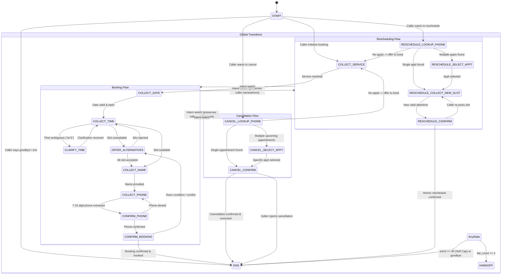

# System Design: Rule-Based Dental Voice Assistant

## 1. Overview
The Dental Voice Assistant is a real-time conversational telephony agent for "BrightSmile Dental Clinic". It handles caller intents to **book**, **reschedule**, and **cancel** appointments deterministically without external LLM inference, ensuring sub-second response times, zero hallucination risk, and strict privacy compliance.

### Core Hard Constraints
- **Zero LLMs**: Intent detection, slot extraction, and reply generation are 100% deterministic (regex, fuzzy token matching via `rapidfuzz`, `dateparser`, `word2number`, and finite state machine).
- **Responses Single Source of Truth**: All caller reply strings live strictly in `ai-tool/src/voice_agent/brain/responses.py`.
- **Clock Injection**: All date/time calculations use an injected `Clock` protocol to maintain deterministic testability.
- **Privacy & PII**: Caller phone numbers are masked in all logs and transcripts; caller names are kept in transient session context only.
- **Dependency Inversion**: Direction is strictly `frontend -> backend -> ai-tool`. `ai-tool` contains no database or web framework dependencies.

---

## 2. State Machine Architecture

The conversation flow is managed by a deterministic Finite State Machine (FSM) defined in `voice_agent.brain.state.State` and coordinated in `voice_agent.brain.dialog`.

### State Diagram

---

## 3. Messy Real-World Caller Handling

Section 6 of the architecture requires handling unpredictable human speech, ambiguous phrasing, off-hours requests, race conditions, and mid-call changes of mind. The table below outlines how each messy case is handled.

| Case # | Scenario | Caller Behavior / Utterance | Assistant Behavior & Resolution |
| :--- | :--- | :--- | :--- |
| **01** | Ambiguous Time Clarification | *"I want to come in at 5."* | Detects ambiguous 12-hour reference without AM/PM. Asks `"Did you mean morning or evening?"`. |
| **02** | Clarify Time -> Off-Hours | Answers *"morning"* for 5 o'clock. | Resolves to 05:00, checks clinic hours (9 AM - 5 PM), rejects politely, informs hours, prompts for time. |
| **03** | Off-Hours Early Morning | *"Can I get an 8:00 AM slot?"* | Detects time < 09:00. Informs caller clinic is open 9 AM to 5 PM, stays in `COLLECT_TIME`. |
| **04** | Off-Hours Late Evening | *"Book me at 6:30 PM."* | Detects time >= 17:00. Informs caller clinic is open 9 AM to 5 PM, stays in `COLLECT_TIME`. |
| **05** | Sunday Closure | *"Book me an appointment this Sunday."* | Parses date, identifies Sunday (`weekday() == 6`), informs caller clinic is closed Sundays, asks for a weekday/Saturday. |
| **06** | Alternatives: Accept First | *"The first one"* / *"The first"* / *"1"* | Selects slot #1 from offered alternatives, updates session context slot, transitions to `COLLECT_NAME`. |
| **07** | Alternatives: Accept Second | *"The second"* / *"second one"* / *"2"* | Selects slot #2 from offered alternatives, updates session context slot, transitions to `COLLECT_NAME`. |
| **08** | Alternatives: Accept with "Yes" | *"Yes"* / *"Sure"* / *"Sounds good"* | Interprets affirmative consent as accepting the first proposed alternative, advances to `COLLECT_NAME`. |
| **09** | Alternatives: Explicit Time | Caller specifies another time like *"11:00 am"*. | Matches explicit time against offered slots or validates anew against gateway availability. |
| **10** | Alternatives: Day Fully Booked | Requested date has zero available slots. | Informs caller no appointments remain on that date, moves state back to `COLLECT_DATE` to choose another day. |
| **11** | Race Condition at Booking | Slot taken between selection and final confirm. | `gateway.book` returns `None`. Assistant catches concurrency failure, apologizes, queries fresh slots, re-offers alternatives without crashing. |
| **12** | Phone Validation & Readback | Provides valid 7-15 digit phone (*"0300-1234567"*). | Strips delimiters, validates length, reads phone back spaced digit-by-digit (`0 3 0 0 1 2 3 4 5 6 7`) for confirmation. |
| **13** | Phone Invalid (Too Short) | Caller gives 4 digits (*"1234"*). | Detects invalid length (< 7 digits). Rejects and politely requests a valid 7 to 15 digit telephone number. |
| **14** | Spoken Words in Phone | *"zero three zero zero one two three four five six seven"* | Uses word-to-number digit mapping to parse spoken words into standardized digit string. |
| **15** | Duplicate Booking | Same phone already has an appointment at that slot. | Checks `find_upcoming_by_phone`, flags conflict before booking, prevents duplicate double-booking. |
| **16** | Mid-Flow Intent Switch | Starts booking, then says: *"Actually, cancel my appointment"*. | Immediately transitions from booking flow to `CANCEL_LOOKUP_PHONE`. |
| **17** | Intent Switch Context Preservation | Caller provided name and phone during booking before switching. | Preserves extracted name and phone number; skips phone ask in cancel flow and performs immediate appointment lookup. |
| **18** | Cancel: Single Appointment | Caller has exactly one active appointment. | Confirms cancellation details (date/time/service) with caller before executing cancellation. |
| **19** | Cancel: Multiple Appointments | Caller has 2+ upcoming appointments. | Lists all upcoming dates/times, prompts caller to identify which date to cancel, confirms selection. |
| **20** | Cancel: No Appointments | Phone number has no active bookings. | Politely states no upcoming appointments were found, asks if they would like to book a new one. |
| **21** | Cancel: Rejection on Confirm | Caller answers *"No"* when asked to confirm cancel. | Aborts cancellation, acknowledges retention, politely closes call. |
| **22** | Reschedule: Happy Path | Caller specifies appointment, new date, and new time. | Validates slot availability, confirms both old and new times, calls `gateway.reschedule` atomically in a single transaction. |
| **23** | Reschedule: No Appointments | Phone number has no appointments to reschedule. | Informs caller no appointments were found under that number, offers to book a new appointment. |
| **24** | Reschedule: Requested Slot Taken | Caller picks an occupied slot for rescheduling. | Informs caller that new slot is unavailable, presents 2 nearest open alternatives on that day. |
| **25** | Reschedule: Concurrency Race | Another patient books target slot during confirmation. | Atomic reschedule fails (`gateway.reschedule` returns `False`), alerts caller, re-offers available alternatives. |
| **26** | Empty / Silent Utterance | Caller says nothing, audio silence, or whitespace. | Prompts caller (*"I didn't catch that..."*), increments `fail_count` by 1. |
| **27** | Off-Topic Input | Caller talks about weather, sports, or nonsense. | Informs caller assistant only handles dental appointments, increments `fail_count` by 1. |
| **28** | Three-Strike Escalation | 3 consecutive empty/unrecognized inputs. | `fail_count == 3` triggers `State.HANDOFF` with polite receptionist transfer message, terminating automated prompt. |
| **29** | Fail Count Reset on Progress | 2 failures followed by valid slot input. | Any successful slot extraction (date, time, phone, service) resets `fail_count` to 0. |
| **30** | Call Turn Soft Cap | Caller exceeds 40 dialog turns. | Assistant delivers polite wrap-up message and terminates session (`should_end = True`), preventing infinite telephony loops. |
| **31** | Multi-Slot Single Utterance | *"I want a checkup tomorrow at 2 PM"* | Single utterance populates `service`, `date`, and `time` simultaneously in one turn. |
| **32** | Caller Goodbye / Hangup | Caller says *"bye"*, *"thank you, goodbye"*, *"cancel call"*. | Detects exit intent at any point, replies with polite goodbye, ends call cleanly. |

---

## 4. Key Architectural Decisions

1. **Deterministic Intent Classifier (`voice_agent.brain.nlu.intents`)**:
   - Uses regex patterns and fuzzy matching (`rapidfuzz.fuzz.partial_ratio >= 85`) against defined keyword corpora.
   - Guaranteed predictable intent scoring without non-deterministic LLM temperature or API latency.

2. **Entity & Slot Extraction (`voice_agent.brain.nlu.entities`)**:
   - Service matching maps colloquial terms (e.g., *"teeth whitening"*, *"scale and polish"*, *"cavity"*) to canonical clinic services.
   - Date parser injects `reference_date` from `Clock` to prevent clock drift in automated test suites.
   - Ambiguous time resolution flags inputs like `"at 5"` or `"five"` as `ambiguous=True` when neither AM nor PM is indicated, ensuring patient safety.
   - Alternative choice parser accepts `"first"`, `"second"`, `"1"`, `"2"`, affirmative `"yes"`, or explicit timestamps (`"11:00"`).

3. **Concurrency & Atomic Transactions**:
   - Booking uses database row locks (`SELECT FOR UPDATE`) or unique constraint handling on `(appointment_date, start_time) WHERE status != 'cancelled'`.
   - Rescheduling occurs in a single database transaction. If the target slot is unavailable or snatched by a concurrent process, the transaction rolls back cleanly, returning `False` to trigger alternative recovery.

4. **Test-First Verification Harness**:
   - Scenario runner (`test_runner.py`) reads declarative YAML scenarios simulating multi-turn dialogs.
   - Unit tests verify AST syntax trees to guarantee no forbidden LLM packages exist in the codebase.
