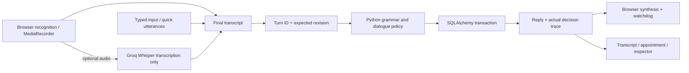
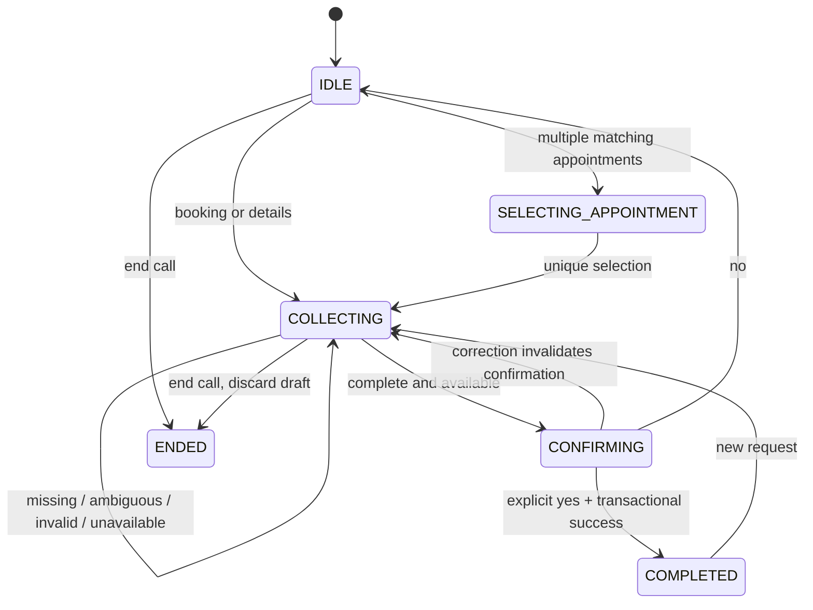

# Deterministic reception design

## Use case and boundaries

Bayline performs the job of a vehicle-service telephone receptionist: booking, rescheduling, cancelling, and answering catalog/hours questions. It is a synthetic assessment application. Every browser owns its own simulated workshop and fictional Alex Rivera profile; the simulation is deliberately isolated so one reviewer's reset cannot alter another's appointments.

There is no runtime language model, embedding model, classifier API, agent framework, or generated dialogue. Python regular expressions and explicit rules extract details; an explicit state machine chooses questions and operations; response templates produce the reply. Browser STT or optional Groq Whisper performs transcription only. The frontend never chooses booking outcomes.

## Decision policy

- Global hours, services, repetition, and help replies preserve the pending task.
- Negated cancellation is excluded before intent precedence: reschedule, cancel, book. Unknown language triggers clarification, never an invented intent.
- Extract service and vehicle synonyms, relative dates, weekday names, ISO dates, named-month dates, AM/PM and 24-hour times, and supported spoken clock forms.
- Dates resolve in Asia/Karachi using an injectable clock. An unqualified weekday is the next occurrence including today; "next Monday" on Monday means seven days ahead. Ambiguous slash dates require clarification. A bare 1–6 resolves to PM because those are the only plausible workshop hours; 7/8 require AM/PM clarification.
- One service per appointment. Services last 30 or 60 minutes; both vehicle types use the same two bays. Every segment must fit before 18:00 and on a half-hour boundary.
- Reschedule/cancel with zero active caller appointments offers booking; one is automatically selected and read back; multiple require a unique service/vehicle/date/reference or ordinal selection. Background fixtures are excluded.
- A reschedule's unqualified date names the destination. "appointment on" explicitly uses a date as a source selector. Complex two-date sentences should be split into selection and destination turns.
- Corrections apply all extracted details, invalidate confirmation, and recheck business rules and availability. Explicit yes with new details reads back the edited proposal rather than committing it.
- Alternatives are the three valid free start times nearest the request, with chronological order breaking equal-distance ties. Ordinal choices refer to that displayed list.

## Transactions and isolation

All persisted timestamps are UTC-naive instants, consistently converted to/from PKT at boundaries. SQLAlchemy's JSON type stores explicit dialogue state. Each session owns two independently identified bay rows; `UniqueConstraint("bay_id", "segment_start")` prevents conflicting allocations in both databases.

A 60-minute service inserts two adjacent segments on the same bay. Reservation tries available bays using nested transaction savepoints. A uniqueness collision rolls back the attempt, including partially inserted segments and edits to the original appointment. Cancellation deletes allocations and marks the appointment cancelled. Failed rescheduling never releases the original capacity.

Turn processing checks a persisted `(session_id, turn_id)` result before claiming the expected session revision with a conditional SQL update. The successful update serializes the session's state changes. The brain, appointment writes, new state, and deduplicated response commit together. Reused IDs with different text and stale revisions return 409. SQLite lock contention retries are bounded. Postgres uses its native transactional row locking through the update.

Reset claims and advances the same revision, deletes only that session's fixtures/history, and reseeds atomically. Old in-flight requests cannot satisfy the advanced revision. Startup calls `Base.metadata.create_all()` only: it creates missing tables but does not migrate existing schemas. One application worker is the declared deployment model; do not run destructive startup resets.

## Speech lifecycle

Recognition is suspended during synthesized replies. Interim results are display-only. A final transcript, a typed utterance, and a chip all use the same turn endpoint. A failed network request retains the same turn ID for safe retry. Clicked/typed turns play a one-shot reply even outside a call; they do not enable the microphone. Only an active call listens afterward. Replay is also one-shot and does not leave the microphone marked active.

New chat text uses a bounded CSS word reveal (180ms per word, delays capped at 600ms). Recognition corrections replace the actual interim text, with a 100ms reveal for newly changed words. Full text is available once to assistive technology, decorative word spans are hidden from it, and reduced motion disables the reveal. History is not animated on initialization. The backend still returns one deterministic JSON response; no token-generation stream is simulated.

Synthesis uses chunks of at most 18 words, preserving complete sentences and preferring clause boundaries when a sentence is longer. Available natural/neural or Google English voices are preferred over basic local voices, with a user-selectable override. Every chunk flushes the synthesis queue and has a duration estimate plus buffer, capped at 12 seconds. `onend`, timeout, errors, and user cancellation use guarded completion. Playback errors or a watchdog expiry without `onstart` show a replay recovery message instead of silently advancing. A strong reference retains the active utterance; a paused synthesis engine is resumed before speaking. Generation tokens also fence delayed API replies after pause/navigation, interruption, reset, or teardown. This prevents a missing browser completion event from leaving the controller stuck speaking.

Server speech is capability-gated by GROQ_API_KEY. MediaRecorder captures a maximum 20-second turn, ends after 1.4 seconds of silence following speech, and supports explicit stop. It releases microphone tracks/audio contexts, sends bounded audio to `/api/stt`, and submits the returned text separately to the normal turn endpoint. Provider failure never mutates appointments. No raw recordings are stored by this application.

## Deliberate limits

This is a transactional demo, not a commercial multi-tenant booking service. No real customer authentication, payments, notifications, telephony/PSTN integration, or personal data collection. There is a finite English grammar; unsupported phrases receive clarification. Voice interruption is an explicit control rather than full-duplex spoken barge-in. Browser speech support, voice quality, provider quotas, and hosting cold starts vary. In-process rate limits assume one worker and are not a distributed abuse-prevention system. Free hosted filesystems are not durable; deploy with Postgres.
