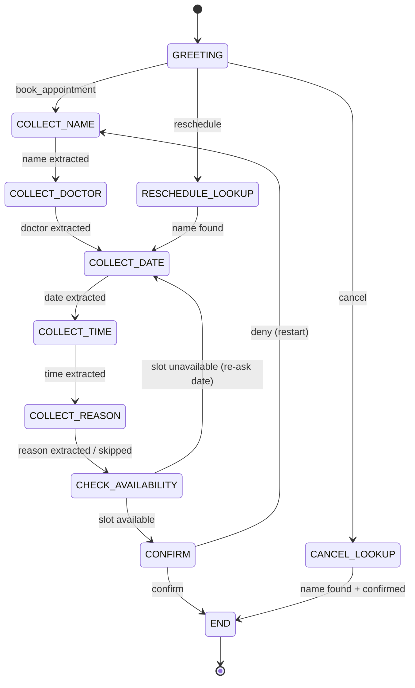

# Voice Agent — Brain Design Document

> **Written before any code.** This is the authoritative spec for the brain's behaviour.
> Updated continuously as implementation reveals edge cases.

---

## 1. Use Case

**Clinic / Dentist Appointment Booking Assistant**

A patient phones the clinic. The voice agent:
- Books a new appointment (primary flow)
- Reschedules an existing appointment
- Cancels an existing appointment
- Handles mid-call corrections at **any point** in the conversation

The agent collects five slots, confirms them with the caller, and ends politely.

---

## 2. Intents

Every utterance is first classified into one of these intents **before** any slot extraction.

| Intent | Trigger condition | Example utterances |
|---|---|---|
| `book_appointment` | Caller wants to schedule a new visit | "I'd like to book an appointment", "Can I make an appointment?", "I need to see a doctor" |
| `reschedule` | Caller wants to move an existing appointment | "I need to reschedule", "Can I change my appointment?", "Move my booking" |
| `cancel` | Caller wants to cancel | "Cancel my appointment", "I want to cancel", "Please remove my booking" |
| `change_doctor` | Correction: change the doctor/department slot | "Actually I'd prefer Dr. Khan", "Switch to a different doctor", "Can I see someone else?" |
| `change_date` | Correction: change the date slot | "Actually Tuesday works better", "Let's do next Monday instead", "Change the date" |
| `change_time` | Correction: change the time slot | "Make it 3pm instead", "Change the time to morning", "Actually 10am" |
| `change_name` | Correction: caller gave wrong name | "Sorry, my name is actually Sara", "I said the wrong name" |
| `provide_info` | Caller is providing a slot value (name, date, time, doctor, reason) | "John Smith", "Tuesday at 3pm", "Dr. Khan", "I have a toothache" |
| `confirm` | Caller confirms what was just said | "Yes", "That's right", "Correct", "Yep", "Sure", "Sounds good" |
| `deny` | Caller rejects what was just said | "No", "That's wrong", "Incorrect", "Not quite" |
| `repeat` | Caller asks the agent to repeat | "Can you repeat that?", "Sorry, what?", "Pardon?" |
| `goodbye` | Caller is ending the call | "Thank you, bye", "That's all", "Goodbye", "Thanks, see you" |
| `unclear` | Nothing matched — catch-all | (any unrecognised input) |

### Intent Priority Order

When classifying an utterance, intents are checked in this order:
1. `goodbye`
2. `cancel`
3. `reschedule`
4. `change_doctor` / `change_date` / `change_time` / `change_name`  ← **corrections, checked early**
5. `confirm` / `deny`
6. `repeat`
7. `book_appointment`
8. `provide_info`  ← slot extraction
9. `unclear`  ← fallback

> [!IMPORTANT]
> Correction intents (steps 4) are checked **before** `provide_info` (step 8). This means "Actually Tuesday" triggers `change_date`, not raw slot extraction. This is the core of the correction-handling architecture.

---

## 3. Slots

| Slot | Required? | Type | Normalisation | Example raw → stored |
|---|---|---|---|---|
| `name` | ✅ | string | Title-case, strip filler words | "um john smith" → `"John Smith"` |
| `doctor` | ✅ | string or `"any"` | Map aliases; default to `"any"` if caller doesn't care | "Dr Khan" / "doctor khan" → `"Dr. Khan"` |
| `date` | ✅ | ISO date string | Resolve relative dates against today | "Tuesday" → `"2026-11-03"` |
| `time` | ✅ | 24h time string | Normalise am/pm, fuzzy words | "3pm" → `"15:00"`, "morning" → `"09:00"` |
| `reason` | ❌ optional | string | Lowercase, strip filler | "I have a toothache" → `"toothache"` |

### Mock Availability

A hardcoded dict provides fake availability for demo purposes. The brain checks date + time + doctor against it and responds with a realistic "that slot is taken, how about X?" if unavailable.

```python
MOCK_AVAILABILITY = {
    "2026-11-03": {"09:00": ["any", "Dr. Khan"], "14:00": ["any"]},
    "2026-11-04": {"10:00": ["any", "Dr. Smith"], "16:00": ["any", "Dr. Khan"]},
    # ... etc
}
```

---

## 4. FSM States

### State Definitions

| State | Description | Expected next input |
|---|---|---|
| `GREETING` | Agent introduces itself | Intent: `book_appointment`, `reschedule`, `cancel` |
| `COLLECT_NAME` | Agent asks for caller's name | Slot: `name` |
| `COLLECT_DOCTOR` | Agent asks for preferred doctor/department | Slot: `doctor` (or "no preference") |
| `COLLECT_DATE` | Agent asks for preferred date | Slot: `date` |
| `COLLECT_TIME` | Agent asks for preferred time | Slot: `time` |
| `COLLECT_REASON` | Agent asks for reason (optional) | Slot: `reason` or skip signal |
| `CHECK_AVAILABILITY` | (Internal) brain checks mock availability | No user input — auto-transitions |
| `CONFIRM` | Agent reads back all slots and asks for confirmation | Intent: `confirm` or `deny` or correction |
| `END` | Agent says goodbye and terminates | — |
| `RESCHEDULE_LOOKUP` | Agent asks for name to look up existing booking | Slot: `name` → then re-collects date/time |
| `CANCEL_LOOKUP` | Agent asks for name to look up existing booking | Slot: `name` → confirms cancellation |

### State Machine Diagram



---

## 5. Correction Path — The Critical Design

> [!IMPORTANT]
> This is the most important part of the design. Graders specifically look for robust correction handling.

### The Problem

At any point in the conversation, the caller may go back and change something they already provided:

- *"Actually, can you make that Tuesday instead of Wednesday?"* (while in `COLLECT_TIME`)
- *"Wait, I think I said Dr. Smith but I meant Dr. Khan"* (while in `CONFIRM`)
- *"Sorry, my name is Sara, not Susan"* (while in `COLLECT_DOCTOR`)

A naive FSM would ignore this or misinterpret it as a slot value for the **current** state.

### The Solution: Intent-First Processing

Every utterance, regardless of which state the FSM is in, goes through the same processing pipeline:

```
utterance
    │
    ▼
┌─────────────────────────────────────────────────────┐
│  Step 1: Intent Classification                      │
│  (check intents in priority order — see §2)         │
└────────────────────┬────────────────────────────────┘
                     │
         ┌───────────▼────────────┐
         │  Is it a CORRECTION    │
         │  intent?               │
         │  (change_*, deny)      │
         └───────┬────────────────┘
                 │ YES                    NO
                 ▼                        ▼
    ┌────────────────────────┐   ┌────────────────────┐
    │  CORRECTION HANDLER    │   │  NORMAL FSM HANDLER │
    │  1. Update named slot  │   │  Process expected   │
    │  2. If in CONFIRM,     │   │  slot for current   │
    │     stay in CONFIRM    │   │  state, advance FSM │
    │  3. If mid-flow,       │   └────────────────────┘
    │     acknowledge &      │
    │     re-ask current Q   │
    └────────────────────────┘
```

### Correction Handler Pseudocode

```python
def handle_utterance(utterance: str, state: FSMState, slots: SlotDict) -> Response:
    intent, extracted = classify_and_extract(utterance)

    # --- CORRECTION PATH ---
    if intent in CORRECTION_INTENTS:
        slot_key = CORRECTION_TO_SLOT[intent]   # e.g. change_date → "date"
        slots[slot_key] = extracted[slot_key]   # overwrite the slot

        if state == FSMState.CONFIRM:
            # Stay in CONFIRM, re-read the updated summary
            return Response(
                text=f"Got it, I've updated that. Let me confirm: {summarise(slots)}. Is that correct?",
                next_state=FSMState.CONFIRM,
                slots=slots
            )
        else:
            # Mid-flow correction: acknowledge and re-ask current question
            return Response(
                text=f"No problem, I've updated that. {re_ask_current(state)}",
                next_state=state,   # stay in current state
                slots=slots
            )

    # --- DENY in CONFIRM = restart ---
    if intent == Intent.DENY and state == FSMState.CONFIRM:
        return Response(
            text="Let's start over. What would you like to change?",
            next_state=FSMState.COLLECT_NAME,
            slots=SlotDict()
        )

    # --- NORMAL FSM PROCESSING ---
    return fsm_advance(state, intent, extracted, slots)
```

### Correction Intent → Slot Mapping

| Correction intent | Slot updated |
|---|---|
| `change_name` | `name` |
| `change_doctor` | `doctor` |
| `change_date` | `date` |
| `change_time` | `time` |

---

## 6. Edge Cases — Explicitly Handled

| Edge case | Handling strategy |
|---|---|
| **Multi-slot utterance** | "Tuesday at 5pm with Dr. Khan" — extract all three slots simultaneously, advance FSM past all filled states |
| **Ambiguous date** | "Next week" without a day → agent asks "Which day next week?" |
| **Invalid time** | "25pm", "yesterday" → agent says "Sorry, I didn't catch a valid time. Could you say it again?" |
| **Past date** | Date resolved to before today → "That date has already passed. Could you pick a future date?" |
| **No preference for doctor** | "I don't mind" / "any doctor" → store `"any"` and move on |
| **Repeated unclear** | 3 consecutive `unclear` intents → agent says "I'm having trouble understanding. Let me transfer you." and transitions to `END` |
| **Caller changes mind mid-slot** | "Actually..." triggers correction path before current slot extraction |
| **Caller gives reason without being asked** | Extract it opportunistically and store in `reason` slot; skip `COLLECT_REASON` state |
| **Caller says name then immediately changes it** | Second utterance detected as `change_name` → overwrites slot, re-asks next question |
| **Slot already confirmed, caller reopens it** | Any correction intent in `CONFIRM` state → update slot, re-read full summary |

---

## 7. Agent Response Templates

Consistent, natural-sounding responses keyed by state and intent.

| Situation | Template |
|---|---|
| GREETING | "Hello! Welcome to City Dental Clinic. I can help you book, reschedule, or cancel an appointment. What would you like to do?" |
| Ask for name | "Could I get your name please?" |
| Ask for doctor | "Do you have a preferred doctor, or shall I find the first available?" |
| Ask for date | "What date works best for you?" |
| Ask for time | "And what time of day do you prefer?" |
| Ask for reason (optional) | "What's the reason for your visit? Or feel free to skip that." |
| Slot unavailable | "Unfortunately that slot isn't available. The next opening I have is {alt_date} at {alt_time}. Would that work?" |
| Confirm summary | "Great. Let me confirm: appointment for {name}, with {doctor}, on {date} at {time}{reason_part}. Is that correct?" |
| Correction acknowledged | "Of course, I've updated that." |
| Unclear (1st/2nd) | "Sorry, I didn't quite catch that. Could you say it again?" |
| Unclear (3rd) | "I'm having difficulty understanding. Let me connect you with a staff member." |
| END (booking) | "Perfect, you're all booked! We'll see you on {date} at {time}. Is there anything else?" |
| END (cancel) | "Your appointment has been cancelled. Have a great day!" |

---

## 8. Implementation Notes (for Phase 2/3)

- Intent classification: **regex-first**. Only add spaCy if regex patterns prove insufficient for a specific intent.
- FSM: **hand-rolled dict-based state machine**. No external library needed at this scale.
- Slot extraction: happens inside the `provide_info` branch and also opportunistically during correction intents.
- Date parsing: use `dateparser` library with `PREFER_DAY_OF_MONTH='first'` and `RELATIVE_BASE` set to today.
- All brain logic is **pure Python functions** with no I/O — makes unit testing trivial.
- The WebSocket layer calls brain functions; brain functions never touch WebSocket.
