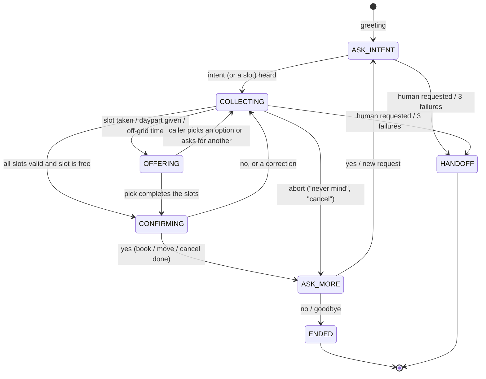

# Design

## Use case

**Green Valley Clinic's appointment line.** A caller can **book**, **reschedule** or **cancel** an appointment
with one of three doctors (general: Dr. Khan, dental: Dr. Ahmed, skin: Dr. Raza). The assistant does the whole job:
it collects the details, checks the schedule, reads everything back, makes the change and says goodbye.
Opening hours are Monday to Saturday, 9 AM to 5 PM, in 30-minute slots (last slot 4:30 PM), booking up to 30 days ahead.

I chose it because it needs real decisions (availability, alternatives, corrections, looking up an existing
booking) while the domain stays small enough to test exhaustively.

## The big rule: the brain is my own code

Nothing in `backend/app/brain/` calls a model or a network service. The pipeline is:

```
text ─► NLU (nlu.py) ─► Parsed ─► Dialogue manager (policy.py) ─► reply text + Trace
        regex + small          finite state machine + slot filling
        hand-written parsers   + scheduler (services/scheduler.py)
```

Speech to text and text to speech happen in the browser (Web Speech API); the backend only ever sees text, and
returns text. That keeps the brain deterministic and testable: the same words always lead to the same decision.

### 1. NLU: `nlu.py`, `datetime_parse.py`, `phone.py`

One function, `parse(text, today, expecting)`, turns a sentence into a `Parsed` record:

| Output | How it is found |
|---|---|
| intent (book / reschedule / cancel) | ordered regexes: reschedule is checked before cancel before book |
| control flags (human, repeat, restart, abort, goodbye, FAQ, yes, no) | keyword regexes |
| doctor | keywords ("dentist", "rash", "check-up"); "Dr./Doctor + surname" only, so a patient called *Khan* does not select Dr. Khan |
| day | own parser: today, tomorrow, weekdays, "next Monday", "15 November", "the 15th", "5/11", "in 3 days" |
| time | own parser: "4 pm", "half past four", "quarter to five", "16:00", "noon", "4 in the afternoon" |
| part of day | morning, afternoon, evening |
| name | "my name is …", or the whole reply when a name was just asked for; stop-words cut it off |
| phone | digits or spoken digits ("oh three double two …"), normalised to `03XXXXXXXXX` |
| choice | first / second / third / last |

Two ideas make the parsing robust:

* **`expecting`**: the question we just asked. A bare "4" is a time only after we asked for a time; a bare
  "20" is a day only after we asked for a day. Without that, "4" is ignored rather than guessed.
* **Ordering**: the phone number is extracted first and *removed* from the text, so its digits can never be
  read as a date or time. Corrections like "4 PM, **not** 4 AM" keep only the side the caller wants.

Assumptions (all unit-tested): a bare hour 1-6 means PM, 7-11 means AM, 12 means noon (clinic hours);
a weekday name means its next occurrence after today, and "next Monday" means Monday of the following week;
numeric dates are day/month.

### 2. Dialogue manager: `policy.py`

A finite state machine over `State`, with slot filling:



Every turn follows the same order of rules (first match wins):

1. **Silence / low STT confidence** → re-prompt (see the escalation ladder below).
2. **Global commands**, valid in every state: human → hand-off; repeat → last reply; start over → reset;
   goodbye → end; FAQ (hours, address) → answer *and re-ask the open question*; "never mind" → drop the flow.
3. **Change of intent mid-call** ("actually I want to reschedule") → switch flow, keeping name and phone.
   A bare "cancel" *during a booking* means "drop this booking", not "cancel an existing appointment".
4. **State handler**: fills slots, handles yes/no, offers, corrections.
5. Otherwise → **not understood**.

**Slot filling** (`_advance`) always asks for the next missing item in a fixed order, after validating what
it already has: booking = doctor → day → time → *(availability check)* → name → phone → read-back → confirm.
Availability is checked **before** asking for name and phone, so nobody dictates their number for a slot
that does not exist. Reschedule and cancel first look the appointment up by phone number.
A new value for an already-filled slot is a **correction**: it overwrites the old one and is acknowledged
aloud ("Okay, 5 PM.").

**New information beats a bare yes/no.** At the read-back, "no, make it 5" is treated as a correction and the
whole summary is re-validated and re-read, rather than asking "what would you like to change?".

**Failure ladder.** Each consecutive turn without progress increments a counter: 1st → "Sorry, I didn't
understand" + the question; 2nd → "Let me try again" + the question + an example answer; 3rd → hand-off to a
human receptionist. Any progress resets the counter.

### 3. Actions: `services/scheduler.py`

An in-memory fake schedule. About 35 % of slots are pre-filled by "other patients" using a stable hash, so
availability is pseudo-random but **deterministic** (tests rely on this). `book`, `cancel` and `reschedule`
are lock-protected and re-check availability, which is what catches two callers racing for one slot.
`alternatives()` returns the three free slots closest in time to the one requested.

## Messy callers: what is handled, and where it is tested

All tests live in `backend/tests/test_dialogue_scenarios.py` unless noted.

| Messy behaviour | What the assistant does | Test |
|---|---|---|
| Changes the time or day halfway | overwrites, says "Okay, …", continues | `test_caller_changes_the_time_halfway` |
| Changes it at the read-back | re-validates, re-confirms | `test_caller_changes_the_day_at_confirmation` |
| "I said 4 PM, not 4 AM" | keeps the wanted side | `test_correction_with_not`, `test_nlu.py` |
| Requested slot is taken | offers the 3 nearest slots; pick by "second" or by saying a time | `test_taken_slot_offers_…` |
| Rejects all offers / says "yes" to several | asks for another time / asks which one | `test_none_of_those_…`, `test_yes_to_several_…` |
| Ignores the offers and names a new time | treats it as a fresh request | `test_caller_ignores_offers_…` |
| Vague: "sometime next week", "morning" | asks for a day / lists morning slots | `test_vague_week_…`, `test_morning_request_…` |
| Sunday, past date, > 30 days, outside 9-5, time already passed today | explains and asks again | `test_closed_sunday_…` and following |
| Time like 10:15 | explains the half-hour grid, offers nearby slots | `test_off_grid_time_…` |
| Several details in one sentence / details out of order | fills all of them, asks only for what is missing | `test_everything_in_one_sentence_…` |
| Answers a different question than asked | still extracts any slot it contains | `test_slot_without_intent_word_…` |
| Invalid / incomplete phone number | asks again; number is always read back digit by digit | `test_invalid_phone_is_reprompted` |
| Number arrives in pieces ("0333" … "7403766") | remembers the digits heard so far, asks only for the rest, joins them | `test_phone_number_split_across_two_utterances_is_joined` |
| Silence during a long read-back | short re-prompt ("Please say yes or no"), the full summary only on the second retry | `test_silence_at_the_read_back_…` |
| Silence, mumbling, low STT confidence | re-prompt → rephrase → hand-off | `test_silence_then_handoff_…`, `test_low_stt_…` |
| "Repeat that", "start over", "never mind", "bye" | handled in every state | `test_repeat_…`, `test_start_over_…` |
| Asks opening hours / address mid-booking | answers, then repeats the open question | `test_faq_mid_flow_…` |
| Wants a human | immediate hand-off | `test_human_request_…` |
| Switches to reschedule or cancel mid-call | switches flow, keeps contact details | `test_switching_from_booking_…` |
| Says "cancel" while booking | drops the booking, does not cancel anyone's appointment | `test_cancel_during_booking_…` |
| Another caller takes the slot before confirmation | "that slot was just taken", re-offers | `test_slot_lost_between_…` |
| Books the same doctor twice on one day | blocks it and points to reschedule | `test_duplicate_booking_…` |
| Reschedules to the time already held | says so | `test_reschedule_to_the_same_slot_…` |
| Phone number not found (twice) | re-asks once, then hands off | `test_lookup_not_found_twice_…` |
| Declines the cancellation | leaves the appointment untouched | `test_cancel_declined_…` |
| Keeps talking after the call ended | harmless "call has ended" | `test_turns_after_the_call_ended_…` |

## The frontend and the decision trace

`frontend/` is a Next.js page with a mic button, a typing fallback and a transcript. Beside it, the **decision
panel** shows, for the latest turn, the state transition, the rule that fired (e.g.
`advance.slot_taken_offer_alternatives`), the intents and entities extracted, the current slots, any notes
(e.g. "correction: at 16:00 → 11:00"), and a log of all previous turns. This comes straight from the `trace`
object the backend returns with every reply.

## Production practices

* App-factory pattern; the clock is injected, so tests are deterministic
* Typed Python with pydantic request/response schemas, input validation (max length, confidence range)
* Structured per-turn logging with session id, rule fired and latency
* Idle-session expiry, CORS allow-list and timezone from environment variables, no secrets in the repo
* `ruff` lint/format, `pytest` with 96 % coverage, GitHub Actions CI for backend and frontend
* Only fake data; the brain, API and UI are separate layers that can be replaced independently

## Known limitations and next steps

* Browser speech APIs limit voice to Chrome/Edge and need internet for recognition. A server-side STT/TTS
  adapter (e.g. a local Whisper) could be added in front of `/turn` without changing the brain.
* English only; names are taken as heard, with no spelling confirmation.
* Reschedule and cancel identify the caller by phone number only. A real clinic would add a second check.
* Sessions and bookings are in memory; production would use a database and Redis.
* No barge-in: the caller cannot interrupt the assistant mid-sentence.
